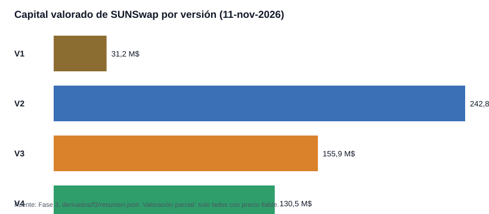
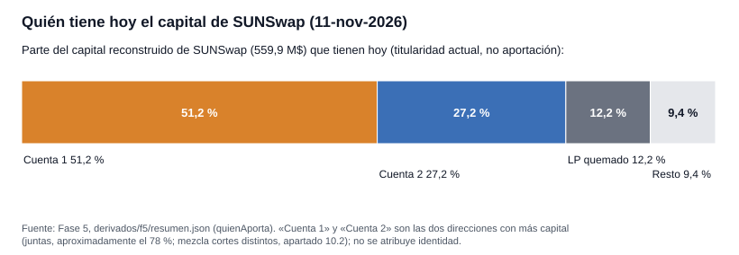
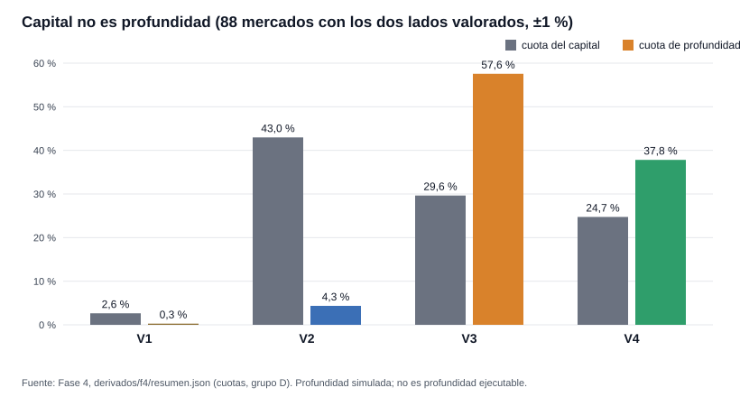
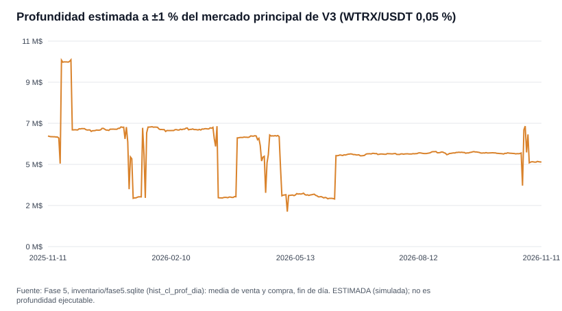
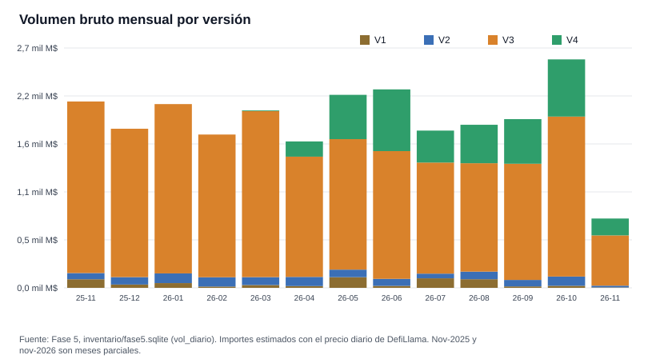
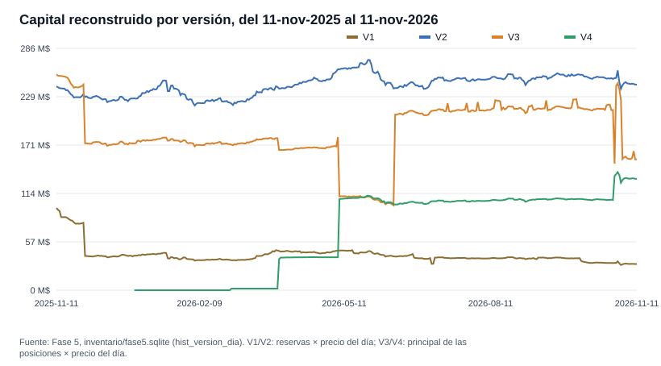

# SUNSwap bajo el microscopio: distribución del capital, titularidad y profundidad en V1–V4

**Informe de investigación independiente · School On-Chain | Crypto Intelligence**

Fecha de la edición: 12-nov-2026 · Investigadora principal: Claude (sin orquestación de agentes) · Estado: **informe final validado el 12-nov-2026.** Edición pública del informe validado (huella `aa0f7080ebfc5980`) sin las notas internas de trabajo; la propuesta técnica del observatorio no se ha iniciado.
Datos: lectura de la cadena TRON y de APIs públicas el 11-nov-2026 (bloque 87.907.580 para el inventario) y eventos del 11-nov-2025 (00:00 UTC) al 11-nov-2026 (22:03 UTC), llamada en todo el informe **ventana completa**.

Etiquetas de certeza que se usan en todo el informe: **VERIFICADO** (demostrado con datos de la cadena, código oficial o comparación exacta) · **ESTIMADO** (cálculo con supuestos explícitos) · **HIPÓTESIS** (explicación pendiente de demostración) · **DESCONOCIDO** (no puede determinarse con lo que hay) · **PENDIENTE** (comprobación todavía no realizada). Los importes en dólares son siempre ESTIMADO; las cantidades de tokens son exactas.

---

## 1. Resumen ejecutivo

SUNSwap es el principal intercambio descentralizado (DEX) de TRON. Esta investigación reconstruyó desde la propia cadena —las cantidades: saldos, eventos y volúmenes— cuánto capital hay en sus mercados, cómo se reparte, cuánto se puede mover de verdad, cuánto se opera, quién tiene y quién mueve la liquidez y cómo ha evolucionado en un año. Esas cantidades se valoraron en dólares con precios de DefiLlama contrastados con Binance; los paneles externos (SUN.io, DefiLlama) solo se usaron además para contrastar totales. Resultados en una página:

1. **Un universo amplio con pocos mercados activos.** Hay **26.904 mercados registrados** en las cuatro versiones (V1 20.637 · V2 5.365 · V3 590 · V4 312; SunCurve, otros 15, se estudia aparte). **1.524 cumplían a la vez los dos criterios de «activo»: tener liquidez y algún evento en los últimos 30 días.** Hay 25.055 tokens distintos y 140 direcciones diferentes que se llaman «USDT»: los símbolos no identifican nada. VERIFICADO.
2. **Capital valorado: 560,4 M$ (valoración parcial: suma solo lo que tiene precio fiable).** V2 242,8 M$ (43,3 %) · V3 155,9 M$ (27,8 %) · V4 130,5 M$ (23,3 %) · V1 31,2 M$ (5,6 %). Solo 34 tokens tienen precio fiable; el resto no se valora ni se inventa. ESTIMADO.
3. **Muy concentrado.** Los tres mayores mercados reúnen el **59,95 %** del capital valorado y los diez mayores el 83,3 % (HHI 1.391, que solo se lee junto a esos dos porcentajes). Por activo: WTRX 39,8 %; agrupando TRX y WTRX, el 60,6 %. ESTIMADO.
4. **Capital no es profundidad.** Con el 1 % de movimiento de precio (en los 88 mercados con ambos lados valorados), V3 aporta el 57,6 % de la profundidad simulada con el 29,6 % del capital y V4 el 37,8 % con el 24,7 %; **V2 aporta el 4,3 % con el 43,0 %** y V1 el 0,3 % con el 2,6 %. Una operación de 100.000 $ en TRX/USDT cuesta, según la simulación, 0,061 % en V3, 0,062 % en V4, 0,52 % en V2 y 13,8 % en V1. ESTIMADO (simulado y contrastado con los contratos; la profundidad **ejecutable** no se afirma para ningún mercado).
5. **Volumen:** 24.549 millones de dólares brutos en la ventana completa (V3 78,8 % · V4 14,2 % · V2 4,3 % · V1 2,6 %). En 30 días, 2.719 millones de dólares, y **un solo mercado (V3 WTRX/USDT) hace el 55,4 %**. ESTIMADO.
6. **Mercados que cumplen los criterios C1–C4** (patrón «lo que entra vuelve a salir»). 62 mercados pequeños mueven 2.494 millones de dólares (10,2 % del volumen bruto). Sin ellos: 22.055 millones de dólares. **No es «volumen real» ni prueba de manipulación ni un seguimiento de fondos**: es una clasificación de mercados con umbrales míos (apartado 9.6). ESTIMADO.
7. **Quién tiene hoy el capital:** las posiciones de dos cuentas **representan hoy aproximadamente el 78 %** del capital valorado (cálculo concreto: 78,4 %, con 51,2 % y 27,2 %; 78,35 % si el denominador es la fotografía de la Fase 3) y otro 12,2 % está en tokens LP enviados a direcciones de quema. Titular actual no es aportante original, no se atribuye identidad a ninguna dirección y la cifra mezcla cortes distintos (apartado 10.2). ESTIMADO.
8. **Evolución:** el capital total reconstruido pasó de 592,74 M$ el 11-nov-2025 (primer día de la ventana) a 559,9 M$ el 11-nov-2026: −5,5 % (coincide con la Fase 3: -0,1 % de diferencia). El camino no fue lineal: bajó a 440,6 M$ el 1-dic-2025 (en noviembre de 2025 V1 perdió gran parte de su capital y V3 retiró 110,18 M$ en un día, reponiendo 108,82 M$ ese mismo día), subió a 619,3 M$ el 1-nov-2026 y cayó con las retiradas de los primeros días de noviembre de 2026. V1 perdió el 68,2 % de su capital; en V3 el día de mayor retirada (8-may-2026) sacó 137,20 M$ y repuso 76,74 M$ (saldo −60,46 M$); V4 nació en diciembre de 2025. VERIFICADO el método; ESTIMADO los importes.
9. **Anomalías sin acusar a nadie:** el 29-oct-2026 V3 WTRX/USDT movió 423 M$ en un día (17 veces su mediana), con dos compras de exactamente 30.000.000 USDT, una en V3 WTRX/USDT y otra en V4 TRX/USDT, con 11 minutos de diferencia; las mayores retiradas del año son de una misma cuenta. Ninguna se califica de manipulación (apartado 12).
10. **Calidad de la medida:** el motor de cálculo coincide con los contratos en 26.415 de 26.415 cotizaciones de V1/V2, 531 de 531 comparables de V3 y 143 de 145 de V4 (las 2 distintas son un mercado con un hook sin caracterizar); 1.577 de 1.599 intercambios reales reproducidos exactos; las reservas de V2 cuadran con sus eventos (2.632.405 de 2.632.408); el volumen y las operaciones coinciden con la API de SUN (mediana 1,000).
11. **Lo que NO se sabe** (apartado 15): el TVL completo (faltan precios fiables de unos 15.100 tokens menores), la profundidad realmente ejecutable (exigiría enviar transacciones), el origen del capital anterior a la ventana, la identidad de cualquier dirección y las causas de los grandes movimientos.

| Versión | Mercados registrados | Activos (30 d) | Capital valorado (Fase 3; valoración parcial) | Cuota del capital | Volumen bruto (ventana completa) | Cuota del volumen | Cuota de capital → cuota de profundidad ±1 % (88 mercados completos, Fase 4) |
|---|---|---|---|---|---|---|---|
| V1 | 20.637 | 324 | 31,2 M$ | 5,6 % | 644 M$ | 2,6 % | 2,6 % → 0,3 % |
| V2 | 5.365 | 990 | 242,8 M$ | 43,3 % | 1.056 M$ | 4,3 % | 43,0 % → 4,3 % |
| V3 | 590 | 119 | 155,9 M$ | 27,8 % | 19.354 M$ | 78,8 % | 29,6 % → 57,6 % |
| V4 | 312 | 91 | 130,5 M$ | 23,3 % | 3.495 M$ | 14,2 % | 24,7 % → 37,8 % |
| **Total V1–V4** | 26.904 | 1.524 | 560,4 M$ | 100 % | 24.549 M$ | 100 % | — |

---

## 2. Preguntas de investigación

Las ocho preguntas del encargo, con la respuesta corta y dónde se desarrolla. Las cifras de la tabla son las de los apartados indicados.

| # | Pregunta | Respuesta corta | Certeza | Apartado |
|---|---|---|---|---|
| 1 | ¿Cuánto capital hay depositado? | 560,4 M$ valorados (valoración parcial); lo no valorable no se suma | ESTIMADO | 6 |
| 2 | ¿Cómo se distribuye entre los pares? | Tres mercados reúnen el 59,95 %; diez, el 83,3 %; los tres primeros están en versiones distintas | ESTIMADO | 6, 7 |
| 3 | ¿Qué tokens concentran la liquidez? | WTRX 39,8 %; TRX y WTRX juntos 60,6 %; stablecoins por dirección 23,8 % (133,4 M$) | ESTIMADO | 6 |
| 4 | ¿Qué volumen y actividad tiene cada mercado? | 24.549 millones de dólares brutos; V3 78,8 %; 62 mercados que cumplen los criterios C1–C4 | ESTIMADO | 9 |
| 5 | ¿Quién proporciona y retira liquidez? | Las posiciones de dos cuentas son hoy aproximadamente el 78 % del capital valorado (78,4 % en el cálculo concreto); las mayores retiradas individuales son de una misma cuenta; sin identidades | ESTIMADO | 10 |
| 6 | ¿Qué profundidad tienen realmente los mercados? | Simulada y contrastada con los contratos; V3/V4 15–19 veces más profundos por dólar que V1/V2; la ejecutable no se afirma | ESTIMADO | 8 |
| 7 | ¿Cómo evoluciona la estructura? | Capital total 592,74 M$ (11-nov-2025) → 440,6 M$ (1-dic-2025) → 619,3 M$ (1-nov-2026) → 559,9 M$ (11-nov-2026); V1 −68,2 %; V4 nace en dic-2025 | ESTIMADO | 11 |
| 8 | ¿Qué concentraciones, desequilibrios y anomalías hay? | Dependencia de dos cuentas, mercados que cumplen C1–C4, capital fuera de rango, pools de un solo tick, un mercado descolocado | VERIFICADO el hecho; HIPÓTESIS las causas | 12 |

**Preguntas del encargo que se contestan solo en parte** (se dice cuál es el límite en cada apartado): permanencia del capital de cada proveedor (no se ha medido: el apartado 10.1 solo compara importes por dirección), proveedores presentes en varios pools (se cuenta cuántas direcciones operan en varios mercados), y «quién es» cada proveedor (no se atribuye identidad: se distingue cuenta de contrato).

---

## 3. Metodología

**Principio:** primero datos, después análisis, finalmente conclusiones. Todas las **cantidades** (saldos, reservas, eventos, volúmenes en tokens) se reconstruyen desde la cadena; los paneles externos (SUN.io, DefiLlama) se usan solo como contraste de esas cantidades y de los totales. Los **precios** con los que se pasa a dólares sí vienen de fuera —de DefiLlama, contrastados con Binance—, así que todo importe en dólares depende de ellos.

**Cómo se trabajó.**
- Una sola investigadora (Claude), sin orquestación de agentes ni ciclos de consenso. Se reutilizaron las herramientas existentes de EquipoIA y ChainScope (captura en bruto, direcciones y huellas de eventos) y se escribieron los programas de lectura de eventos que no existían (no había ninguno para eventos de contratos en TRON).
- **Solo lectura.** No se envió ninguna transacción, no se modificó ninguna base de producción, configuración o proceso existente y las claves de API no figuran en ningún fichero (comprobado: 0 apariciones).
- **Herramientas (Fase 1).** Se reutilizaron la biblioteca de captura en bruto de la investigación anterior (cada respuesta con fecha, petición y SHA-256) y los módulos de direcciones (base58) y de huellas de eventos (keccak) de ChainScope. No sirven para este trabajo el lector de ChainScope (trae transacciones de una cuenta, no eventos de un contrato) ni la herramienta de liquidez de libros de órdenes (pensada para exchanges centralizados, no para un AMM). No se usó `blockchain-investigator` ni el sistema de coordinación de agentes.
- **Prueba de concepto (Fase 1), antes de cualquier extracción masiva.** Se leyó, identificó y reconcilió un mercado real, el par V2 WTRX/USDT: de 211 transacciones recientes, las 211 cuadran (reservas ↔ eventos ↔ transferencias de los tokens); sus 24 h (517 operaciones, 734.101 USDT) coinciden con lo que muestra la web de SUN.io (516 y 734.479) a menos de un 0,3 %; y repetir los pasos sin internet dio resultados idénticos. VERIFICADO.
- **Cinco fases, cada una cerrada y comprobada antes de empezar la siguiente.** Fase 1: auditoría de herramientas y prueba de concepto. Fase 2: inventario completo de mercados. Fase 3: distribución y concentración del capital. Fase 4: profundidad y deslizamiento. Fase 5: volumen, proveedores de liquidez, evolución de 12 meses, anomalías y estadística. Este informe las reúne (sin datos nuevos).

**Tres capas de datos.** (1) `raw/`: cada respuesta tal como llegó, con petición, fecha, estado y SHA-256; inmutable. (2) Bases SQLite normalizadas, que se rehacen enteras desde la capa 1. (3) `derivados/`: resultados, tablas y controles. `MANIFIESTO.json` guarda la huella SHA-256 de cada programa, resultado y sesión en bruto (apartado 16.5). Con `REPRODUCIR=1` cada paso se repite solo desde el bruto, sin internet.

**Reglas que se aplicaron siempre.**
- La **dirección del contrato** identifica un mercado o un token; el símbolo, nunca.
- **Cada lado se valora por separado y solo con precio fiable; no se supone equilibrio.** Por eso el capital en dólares es una **valoración parcial** (suma solo lo valorable) y lo no valorado se declara aparte. En el informe se la llama «cota inferior» solo en ese sentido: sería un mínimo si los precios usados fueran exactos, pero no lo garantiza, porque un precio sobreestimado compensaría lo no valorado.
- Los precios salen de DefiLlama (por dirección de contrato) contrastados con Binance; las stablecoins con su precio medido, nunca «1 $» supuesto (el USDJ cotiza a 0,495 $); WTRX se valora con la serie de TRX.
- Las discrepancias se documentan, no se corrigen artificialmente para que cuadren.
- No se califica nada de «manipulación, fraude o ataque» sin pruebas; no se atribuye identidad a ninguna dirección.
- Toda cifra escrita en un informe tiene una comprobación automática contra su fuente. Son controles internos del propio estudio, hechos por quien lo escribió: acreditan que las cifras salen de las fuentes citadas, no que el método sea el único posible ni sustituyen una auditoría independiente.

**Tres niveles de evidencia para la profundidad** (apartado 8): *profundidad simulada* (el motor sobre el estado leído), *profundidad contrastada* (la simulación comparada con la cotización del propio contrato o con intercambios reales ya ocurridos) y *profundidad ejecutable* (capacidad real de completar una operación: **no se afirma para ningún mercado**).

**Qué hace este informe final.** Reúne los resultados de las cinco fases con la misma numeración de certeza, sustituye lo provisional por lo definitivo (por ejemplo, la historia de capital de V3 de la Fase 5 corregida el 12-nov) y añade los ejemplos de transacciones comprobados. No hay ningún dato nuevo (la segunda edición solo añade conciliaciones aritméticas entre cifras ya producidas, apartado 16.7): las cifras de texto salen de `derivados/f6/valores.json`, que a su vez las toma de los resúmenes y las bases de las fases (`derivados/f6/origen.json` dice de dónde).

---

## 4. Fuentes de datos

| Fuente | Qué da | Límites medidos o publicados | Papel |
|---|---|---|---|
| **TronGrid `/wallet/*`** | Contratos, lectura de funciones, bloques, recibos | Sin cifra oficial. A ≈ 10 peticiones/s se recibieron 60 avisos 429 (Fase 2); desde que se fijó un tope global de 4/s, ninguno en las demás fases | Fuente principal del estado |
| **TronGrid JSON-RPC `eth_getLogs`** | Eventos en bruto con importes, bloque, hora y hash | **Máximo 5.000 bloques por consulta** (≈ 4 h 10 min); 12 meses = 2.108 ventanas | Fuente principal del historial |
| **TronGrid JSON-RPC `eth_call`** | Lectura del estado | **Solo el estado actual**: no hay estado histórico | Todo lo histórico se reconstruye sumando eventos |
| **Índice de eventos de TronGrid (`/v1/contracts/…/events`)** | Eventos por nombre | Corta cada consulta en ~14.400 resultados; sin importes en los pares V2 | Control cruzado de la enumeración |
| **Cotizadores y lectores oficiales de los contratos** (`eth_call`) | Cotización exacta de una operación; liquidez por tick | El cómputo de la llamada se agota en algunos mercados (167 sin respuesta) | Contraste de la matemática (Fase 4) |
| **API de listas de SUN.io** | Liquidez, volumen y operaciones de 24 h y 7 d de los 50 mayores mercados por versión | Panel agregado con criterios propios | Solo contraste |
| **DefiLlama** (precios por dirección y series de TVL) | Precio diario; TVL por versión | Huecos a cero (V2: 164 días entre el 15-mar y el 1-sep-2026); serie propia de WTRX con puntos erróneos | Precios (con contraste) y contraste del capital |
| **Binance** (contado) | Precio de TRX y de 19 tokens | Colisiones de símbolo (PEPE, NEIRO, PROS, POL) | Contraste de precios |
| **TronScan** | Etiquetas públicas y lista de titulares de tokens LP | Etiquetas de terceros; la lista solo propone candidatos (los saldos se leen en la cadena) | Contraste y candidatos |
| **Código público de SUN** (`sun-protocol` en GitHub) | Direcciones oficiales y código de V2, V3 y V4 | La guía de eventos tiene dos errores (V3 `allPairsLength` y la «Pair» de V1) | Verificación de contratos y de los bits de los hooks |

**Una limitación de fondo:** todos los datos de cadena proceden de un único proveedor (TronGrid); los controles cruzados entre `eth_getLogs`, el índice de eventos y las lecturas directas de contratos reducen el riesgo, pero no equivalen a dos nodos independientes.

**Volumen de lectura (solo lectura):** Fase 2, 21.071 respuestas guardadas; Fase 3, 1.036; Fase 4, 1.337 peticiones a TronGrid con 101.659 llamadas de contrato dentro de sus lotes; Fase 5, 17.601 peticiones de eventos (2.108 ventanas, 12.400.822 registros leídos) más precios y contrastes. Total en `raw/`: ver apartado 16.5.

---

## 5. Inventario de contratos y mercados

### 5.1 Contratos oficiales (VERIFICADO)

Cada dirección se comprobó en la cadena (existe el contrato, su tipo y su ABI coinciden con lo esperado, TronScan lo etiqueta como de SUN y su creador es una cuenta ya vinculada a SUN.io). Los routers de SUN **rotan** (hay avisos oficiales de sustitución), por eso el análisis va siempre **por eventos de los mercados**, no por routers.

| Pieza | Dirección | Creado | Cómo se verificó |
|---|---|---|---|
| V1 · Factory | `TXk8rQSAvPvBBNtqSoY6nCfsXWCSSpTVQF` | 14-ago-2020 | Guía de SUN + TronScan «SUN: SunSwapV1 Factory» |
| V2 · Factory | `TKWJdrQkqHisa1X8HUdHEfREvTzw4pMAaY` | 13-dic-2021 | Guía de SUN + TronScan |
| V2 · Router oficial | `TNJVzGqKBWkJxJB5XYSqGAwUTV15U24pPq` | — | `factory()` = fábrica V2 |
| V3 · Factory | `TThJt8zaJzJMhCEScH7zWKnp5buVZqys9x` | 19-jun-2023 | Guía de SUN + TronScan; creador ligado a SUN.io |
| V3 · Gestor de posiciones (NFT) | `TLSWrv7eC1AZCXkRjpqMZUmvgd99cj7pPF` | 19-jun-2023 | Guía + TronScan; toda la liquidez de V3 pasa por él (590 de 590 pools) |
| V3 · SwapRouter | `TQAvWQpT9H916GckwWDJNhYZvQMkuRL7PN` | 19-jun-2023 | Guía + TronScan |
| V3 · Quoter / TickLens | `TLhZ48yfHygMLM2uZr87zJJusHjGen97gh` / `TBBjWiPHouzEx2QRjBzTw9EA8YjG43XiAi` | — | `factory()` = fábrica V3 |
| **V4 · PoolManager** (contrato único) | `TVjuTE3V5bMVdpfNhid8kD2v35T2k1u1Br` | 28-dic-2025 | Listado en el README oficial de `sunswap-v4-core` (Fase 4); creador y propietario ligados a SUN.io (Fase 1) |
| V4 · CLQuoter / TickLens | `TSupQTJWWoVpUqA7KGVYb8dB97n3civwiJ` / `TTuDCMoRaAKGL4V1gmJpmRKpDQz2ZCRQZL` | — | `poolManager()` = el PoolManager anterior |
| V4 · Gestor de posiciones (NFT) | `TC8xQzPHfn5KceZV6s6GmZkBCFWWUoPXs1` | — | Nombre del contrato `SunSwap V4 Positions NFT` |

**Discrepancias con la guía técnica de SUN (no corregidas, documentadas).** Para V3 la guía manda usar `allPairsLength()`, que en la cadena devuelve vacío (lo correcto es `allPoolsLength()`); en V1 la guía rotula como «Pair» el contrato del token USDT. La guía **no publica ninguna dirección de V4**: la identificó la Fase 1 por vínculos en la cadena y la Fase 4 la encontró en el README oficial del repositorio de V4. El código de V4 es un derivado de PancakeSwap Infinity (cabeceras de copyright en el propio código).

### 5.2 Mercados por versión y estado (VERIFICADO)

**Registrado** = lo declara el contrato (factory o PoolManager). **Activo** = con liquidez y algún evento en los últimos 30 días; **inactivo** = con liquidez y sin evento en ese plazo; **sin liquidez** = una de las reservas es cero (V1, V2), ningún token (V3) o liquidez activa cero en el precio actual (V4). El umbral de 30 días es un parámetro.

| Versión | Registrados | activo | inactivo | sin_liquidez | no_funciona |
|---|---|---|---|---|---|
| V1 | 20.637 | 324 | 8.905 | 11.397 | 11 |
| V2 | 5.365 | 990 | 4.324 | 51 | 0 |
| V3 | 590 | 119 | 468 | 3 | 0 |
| V4 | 312 | 91 | 71 | 150 | 0 |
| Curve | 15 | 11 | 2 | 2 | 0 |
| **Total** | **26.919** | | | | |

El recuento de cada versión coincide mercado a mercado con los eventos de creación (V1 tras una continuación: la primera consulta de eventos devolvió 14.399 de 20.637 porque el índice de TronGrid corta cada consulta en ~14.400 resultados). Cada mercado se identificó a la inversa (registro, tokens, factory, clave) sin ninguna diferencia, y el estado leído coincidió con el último evento en 20 de 20 (V1), 20 de 20 (V2), 20 de 20 (V3) y 21 de 21 (V4) mercados de las muestras (3 mercados muy activos quedaron «no concluyentes»).

Fechas de creación (por evento): V1 desde el 2020-08-14 (2020: 6.972 · 2021: 11.174 · 2022: 2.250 · 2023: 203 · 2024: 20 · 2025: 10 · 2026: 8) · V2 desde el 2021-12-14 (2021: 239 · 2022: 1.151 · 2023: 318 · **2024: 2.413** · 2025: 639 · 2026: 605) · V3 desde el 2023-06-20 (2023: 46 · 2024: 118 · 2025: 198 · 2026: 228) · V4 desde el 2025-12-29 (2025: 8 · 2026: 304). **El inventario crece cada día** (V2 y V4 ganaron mercados durante las propias lecturas: V2 +2 y V4 +1 quedaron fuera de las cifras por haberse creado después).

### 5.3 Tokens

Hay 25.055 tokens distintos (más TRX nativo); 23.882 aparecen en un solo mercado y solo cuatro aparecen en más de 100: TRX, WTRX, USDT y jUSDT. **Los símbolos engañan:** 4.204 símbolos se repiten en direcciones distintas, «USDT» figura en 140 direcciones y solo una es el contrato oficial de Tether. Las stablecoins se fijan **por dirección** y con su precio medido: hay dos direcciones «USDD» (solo la nueva se trata como estable) y el USDJ cotiza a 0,495 $.

| Token | Símbolo | V1 | V2 | V3 | V4 | Total | Con capital |
|---|---|---|---|---|---|---|---|
| `T9yD14Nj…` | TRX | 20.637 | 0 | 0 | 129 | 20.766 | 9.300 |
| `TNUC9Qb1…` | WTRX | 1 | 3.504 | 197 | 16 | 3.718 | 3.677 |
| `TR7NHqje…` | USDT | 1 | 1.083 | 358 | 142 | 1.584 | 1.492 |
| `TXJgMdjV…` | jUSDT | 1 | 166 | 0 | 0 | 167 | 167 |
| `TSSMHYeV…` | SUN | 1 | 34 | 8 | 11 | 54 | 51 |
| `TXDk8mbt…` | USDD | 1 | 16 | 5 | 16 | 38 | 31 |
| `TN3W4H6r…` | BTC | 1 | 24 | 5 | 6 | 36 | 32 |
| `TPYmHEhy…` | USDD | 1 | 28 | 6 | 1 | 36 | 36 |
| `TQyT8ZZg…` | TYB | 1 | 31 | 0 | 0 | 32 | 32 |
| `TFczxzPh…` | NFT | 1 | 23 | 2 | 3 | 29 | 28 |
| `TDk91SWz…` | OSK | 1 | 24 | 1 | 0 | 26 | 26 |
| `TCFLL5dx…` | JST | 1 | 8 | 4 | 12 | 25 | 20 |
| `TFf1aBoN…` | PROS | 0 | 19 | 6 | 0 | 25 | 25 |
| `TEkxiTeh…` | USDC | 1 | 17 | 5 | 1 | 24 | 22 |
| `TAFjULxi…` | BTT | 1 | 20 | 3 | 0 | 24 | 24 |

Tokens distintos en mercados: **25.056** · en un solo mercado: 23.882 · en más de 100 mercados: 4

### 5.4 V4 y los hooks

V4 guarda todos los mercados dentro de un único contrato (el PoolManager), de modo que la liquidez por mercado **no se lee como saldo: se calcula**. De los 312 mercados, 65 llevan un *hook* (código externo que puede cambiar cómo se cobra o se calcula una operación), repartidos en 20 contratos de hook. El significado de los bits de configuración de los hooks quedó **VERIFICADO** en el código oficial de SUN. La comisión de protocolo es 0 en los 312 mercados.

- **`ForkV2Hook` (17 mercados):** no tienen ni capital ni liquidez en el PoolManager; sus operaciones se enrutan a pares de otros DEX (USwap, JMSwap, ISwap). VERIFICADO con una transacción real para 1 de los 3 contratos (8 mercados); **HIPÓTESIS** para los otros dos (9 mercados). Quedan fuera de todas las cifras de SUNSwap.
- **Hook de USDT/USDRL (1,1 mil $):** el contrato cotiza 50.050 unidades mínimas (≈ 0,05 % de la entrada) menos que el cálculo estándar en las dos cotizaciones comparables; en su único intercambio real la comisión registrada fue 500 (0,05 %) mientras el pool guarda 0 (ejemplo E8). Encaja con una comisión dinámica fijada por el hook, pero **sigue sin caracterizar** y no se extrapola a otros hooks.

### 5.5 SunCurve (mercado separado)

Se mantiene aparte y **no entra en ninguna cifra de este informe**, por tres motivos: usa otra matemática (StableSwap de 2–4 monedas), emite otros eventos y 8 de sus 15 pools son *metapools* cuya segunda «moneda» es el token LP de otro pool (mezclarlos contaría capital dos veces). Los 14 pools de la guía existen y son lo que dicen; hay un 15.º (`THJCvwFmu6uDqKY59JbULHDgfddy2Zojty`, USDD+USDT, creado el 22-ene-2025) que la guía no lista y que se verificó en la cadena. No hay un registro en la cadena que garantice que no existan más (DESCONOCIDO). No se hizo con SunCurve el análisis de capital, profundidad, volumen ni proveedores: es una **limitación de alcance** (apartado 15).

| Pool | Tipo | Monedas (on-chain) | Creado | Último evento | Tipo de evento | En la guía |
|---|---|---|---|---|---|---|
| Old 2pool (USDD+USDT) `TAUGwRhm…` | StableSwap2Pool | USDD+USDT | 2022-05-20 | 2026-11-10 | AddLiquidity | sí |
| 2pool (TUSD+USDT) `TS8d3ZrS…` | StableSwap2Pool | TUSD+USDT | 2023-04-03 | 2026-11-11 | RemoveLiquidityOne | sí |
| USDC Pool (USDC+TUSD+USDT) `TE7SB1v9…` | USDC2usdSWAP | USDC+2USDLP | 2023-04-03 | 2026-10-22 | TokenExchangeUnderlying | sí |
| USDJ Pool (USDJ+TUSD+USDT) `TKBqNLyG…` | USDJ2usdSWAP | USDJ+2USDLP | 2023-04-03 | 2026-10-31 | TokenExchangeUnderlying | sí |
| Usdd pool (USDD+TUSD+USDT) `TLssvTsY…` | USDD2usdSWAP | USDD+2USDLP | 2023-04-03 | 2026-11-11 | TokenExchangeUnderlying | sí |
| USDC 2pool (USDC+USDT) `TExeaZuD…` | StableSwap2Pool | USDC+USDT | 2023-01-11 | 2026-11-03 | TokenExchange | sí |
| Old BUSD Pool (BUSD+USDC+USDT) `TGG5AWMN…` | BUSD2usdSWAP | BUSD+2USDLP | 2023-02-02 | 2024-11-05 | TokenExchangeUnderlying | sí |
| Old USDD Pool (USDD+USDC+USDT) `TNU9Lfeg…` | USDD2usdSWAP | USDD+2USDLP | 2023-02-02 | 2025-12-03 | RemoveLiquidity | sí |
| Old USDJ Pool (USDJ+USDC+USDT) `TSbahrnT…` | USDJ2usdSWAP | USDJ+2USDLP | 2023-02-02 | 2026-07-13 | TokenExchangeUnderlying | sí |
| Old TUSD Pool (TUSD+USDC+USDT) `TLZacPrP…` | TUSD2usdSWAP | TUSD+2USDLP | 2023-02-02 | 2026-02-17 | TokenExchangeUnderlying | sí |
| Old 3pool (USDJ+TUSD+USDT) `TKcEU8ek…` | StableSwap3Pool | USDJ+TUSD+USDT | 2021-05-27 | 2026-11-11 | TokenExchange | sí |
| 3pool (USDD+TUSD+USDT) `TKVsYedA…` | StableSwap3Pool | USDD+TUSD+USDT | 2022-05-05 | 2026-10-15 | TokenExchange | sí |
| USDD 2pool (USDD+USDT) `TNTfaTpk…` | StableSwap2Pool | USDD+USDT | 2022-06-07 | 2026-10-31 | TokenExchange | sí |
| Old USDC (USDC+USDJ+TUSD+USDT) `TQx6CdLH…` | USDCSWAP | USDC+3SUN | 2021-08-03 | 2026-11-11 | TokenExchangeUnderlying | sí |
| (no figura en la guía; la lista la API de SUN) `THJCvwFm…` | StableSwap2Pool | USDD+USDT | 2025-01-22 | 2026-10-28 | TokenExchange | NO |

### 5.6 La fábrica «SunSwap 1.5»

La Fase 4 encontró una fábrica que no estaba en el inventario (`TB2LM4iegvhPJGWn9qizeefkPMm7bqqaMs`): 409 exchanges, ninguno coincide con los de V1, con un capital valorable de al menos 104,7 mil $ (el 0,019 % del capital valorado). Es una omisión del inventario, inmaterial en cifras, **no incluida en ninguna cifra**; su inclusión es una decisión pendiente (apartado 16).

---

## 6. Distribución de liquidez

### 6.1 Capital por versión (ESTIMADO, valoración parcial)

El capital se midió con lecturas consecutivas durante unos 6 minutos, no en un único bloque (bloques 87.910.894 → 87.910.974, 11-nov-2026, 14:15–14:19 UTC): saldos de TRX y de token de cada exchange V1; reservas **y saldos reales** de cada par V2; `slot0`, liquidez y saldos de cada pool V3; y las 371 posiciones vivas de V4 reconstruidas de sus 1.878 eventos (coinciden con el contrato en 371 de 371). Cada lado se valora por separado y solo con precio fiable; **no se supone equilibrio**. `eth_call` solo responde sobre el estado actual en el momento de la consulta, de modo que un mercado muy activo pudo cambiar entre la primera y la última lectura (limitación 3, apartado 15). Controles cruzados con otras fuentes: las reservas de V2 cuadran con la suma de sus eventos (2.632.405 de 2.632.408) y las posiciones de V4 con el contrato (371 de 371).

| Versión | Mercados | TVL valorado | Cuota | Con capital valorado | Valorables por completo | Parcialmente | Ningún lado valorable | Sin capital | DefiLlama (contraste) | Nuestro/DefiLlama |
|---|---|---|---|---|---|---|---|---|---|---|
| V1 | 20.637 | 31.211.309 $ | 5,6 % | 9.383 | 173 | 9.210 | 1.449 | 9.805 | 48.797.900 $ | 64,0 % |
| V2 | 5.365 | 242.806.632 $ | 43,3 % | 4.771 | 96 | 4.675 | 536 | 58 | 252.667.459 $ | 96,1 % |
| V3 | 590 | 155.923.865 $ | 27,8 % | 565 | 76 | 489 | 22 | 3 | 155.649.799 $ | 100,2 % |
| V4 | 312 | 130.470.861 $ | 23,3 % | 148 | 57 | 91 | 27 | 137 | 131.923.978 $ | 98,9 % |
| **Total** | **26.904** | **560.412.667 $** | 100 % | 14.867 | | | | | 589.039.136 $ | 95,1 % |

TVL valorado según la fiabilidad del precio usado:

| Versión | Con precios ALTA | Con precios MEDIA |
|---|---|---|
| V1 | 27.117.582 $ | 4.093.727 $ |
| V2 | 241.212.200 $ | 1.594.432 $ |
| V3 | 154.850.437 $ | 1.073.427 $ |
| V4 | 130.470.552 $ | 309 $ |

Contraste con DefiLlama (que es una fuente externa con criterios propios): V2 96,1 %, V3 100,2 %, V4 98,9 % y **V1 64,0 %** (en V1 casi ningún token tiene precio fiable). Contraste con la API de SUN en los mercados valorados por completo: 0,998 en V2, 0,999 en V3 y 1,000 en V4. Las diferencias son un contraste, **no** capital medido. La evolución durante el año está en el apartado 11.

### 6.2 Los mayores mercados

Los diez mayores (los 50 están en `derivados/f3/tablas.md`, F3-T2). Los tres primeros están en versiones distintas. Hay 14.867 mercados con capital valorado: 29 con más de 1 M$, 77 con más de 100 mil $ y 489 con más de 10 mil $.

| # | Mercado | Versión | Capital valorado | Cuota | Completitud | Estado | Observación |
|---|---|---|---|---|---|---|---|
| 1 | WTRX/USDT 0.05 % `TSUUVjys…` | V3 | 128.783.642 $ | 22,98 % | completa | activo |  |
| 2 | TRX/USDT `dda1d581…` | V4 | 115.660.924 $ | 20,64 % | completa | activo |  |
| 3 | WTRX/USDT `TFGDbUyP…` | V2 | 91.537.494 $ | 16,33 % | completa | activo |  |
| 4 | WTRX/HTX `TRaQussy…` | V2 | 65.965.028 $ | 11,77 % | completa | activo |  |
| 5 | WTRX/SUN `THu6Conq…` | V2 | 15.334.068 $ | 2,74 % | completa | activo |  |
| 6 | JST/USDT `TW68dBGd…` | V2 | 14.374.763 $ | 2,57 % | completa | activo |  |
| 7 | JST/USDT `9a77a90c…` | V4 | 12.197.091 $ | 2,18 % | completa | activo |  |
| 8 | TRX/OSK `TCkBkQBn…` | V1 | 7.783.986 $ | 1,39 % | completa | activo |  |
| 9 | JST/WTRX `TUDo1PuM…` | V2 | 7.535.083 $ | 1,34 % | completa | activo |  |
| 10 | WTRX/sTRX `TPBtSWUN…` | V2 | 7.380.105 $ | 1,32 % | completa | activo |  |

### 6.3 Por token y por tipo de activo

Tokens con capital valorado: **34** · mayor: 39,8 % · 5 mayores: 93,8 % · 10 mayores: 98,4 % · HHI por token: **2.619**. Si TRX y WTRX se agrupan como un solo activo económico (1:1): 33 activos, mayor 60,6 %, HHI **4.279**.

| Token | Dirección | Capital valorado | Cuota | Mercados | Precio | Fiabilidad |
|---|---|---|---|---|---|---|
| WTRX | `TNUC9Qb1…` | 222.904.830 $ | 39,8 % | 3.674 | 0.3172 $ | ALTA |
| USDT | `TR7NHqje…` | 130.244.855 $ | 23,2 % | 1.486 | 0.9989 $ | ALTA |
| TRX | `T9yD14Nj…` | 116.909.698 $ | 20,9 % | 9.461 | 0.3169 $ | ALTA |
| HTX | `TUPM7K8R…` | 37.642.375 $ | 6,7 % | 11 | 0.00000153 $ | ALTA |
| SUN | `TSSMHYeV…` | 17.779.804 $ | 3,2 % | 52 | 0.0153 $ | ALTA |
| JST | `TCFLL5dx…` | 12.033.260 $ | 2,1 % | 20 | 0.1438 $ | ALTA |
| NFT | `TFczxzPh…` | 4.292.587 $ | 0,8 % | 28 | 2.00e-7 $ | ALTA |
| OSK | `TDk91SWz…` | 3.938.870 $ | 0,7 % | 26 | 12.7627 $ | MEDIA |

Por tipo de activo (capital valorado):

| Tipo | Capital valorado | Cuota |
|---|---|---|
| TRX / WTRX | 339.814.529 $ | 60,6 % |
| Stablecoin (lista por dirección) | 133.402.834 $ | 23,8 % |
| Otro token con precio fiable | 87.195.304 $ | 15,6 % |

Por tipo de activo: **TRX / WTRX 60,6 % (339,8 M$) · stablecoins por dirección 23,8 % (133,4 M$) · otros tokens con precio fiable 15,6 % (87,2 M$)**. WTRX es TRX envuelto 1:1; se muestran separados (cada saldo está en un contrato distinto) y agrupados.

### 6.4 Capital depositado frente a liquidez activa (ESTIMADO)

| Versión | Capital depositado (valorado) | En rango (liquidez activa) | Fuera de rango | Resto (comisiones y diferencias) | Definición |
|---|---|---|---|---|---|
| V1 | 31.211.309 $ | todo | 0 | — | producto constante: toda la reserva es liquidez activa (por construcción) |
| V2 | 242.806.632 $ | todo | 0 | — | idem; capital = mínimo(reserva, saldo) |
| V3 | 155.923.865 $ | 139.067.791 $ (89,2 %) | 15.449.258 $ (9,9 %) | 1.406.815 $ | saldo real del pool = posiciones (dentro y fuera) + comisiones/tokens debidos |
| V4 | 130.470.861 $ | 130.467.560 $ (100,0 %) | 3.301 $ (0,0 %) | 0 $ | capital de las posiciones reconstruidas (sin comisiones) |

**Esto no es profundidad ejecutable:** el capital en rango no dice cuánto se puede operar con un deslizamiento dado (Fase 4).

En V3, de 155,9 M$ depositados, **139,1 M$ (89,2 %) están en rango** y 15,4 M$ (9,9 %) fuera de rango; el resto son comisiones aún no cobradas y tokens debidos a las posiciones. Tres pools concentran 15,2 de esos 15,4 M$ y tienen casi nada en rango (p. ej. USDT/SUN 0,05 %: 6,73 M$ fuera y 42 $ en rango). V1 y V2 están por construcción siempre «en rango». **Capital depositado no es liquidez activa, y un ranking por TVL no mide profundidad** (apartado 8).

### 6.5 Lo que no se puede valorar (VERIFICADO el hecho, DESCONOCIDO su valor)

De los 15.198 tokens con capital, 15.101 no tienen precio independiente, 37 son participaciones LP de otros mercados (no se valoran para no contar capital dos veces), 26 tienen precio no fiable (BAJA) y solo 34 son valorables. DefiLlama da un TVL mayor que esta valoración en V1 (17,6 M$ más), V2 (9,9 M$) y V4 (1,5 M$). Una explicación posible es que valora lo que aquí no se valora, pero **no se ha comprobado activo por activo** (HIPÓTESIS): la diferencia también puede venir de precios o de criterios distintos. **Un TVL «completo» no se puede calcular correctamente con lo disponible**: se da la valoración parcial y lo que falta.

### 6.6 Duplicaciones de capital evitadas

(1) Los 37 tokens LP se excluyen de la valoración. (2) Los 17 `ForkV2Hook` tienen capital cero en SUNSwap. (3) TRX y WTRX son el mismo activo económico en dos formas, pero cada saldo está en un contrato distinto: no se cuenta dos veces. (4) V1, V2, V3 y V4 son contratos distintos: un mismo token en dos versiones es capital distinto. Las versiones **no** se miden con el mismo criterio de capital (V3 son saldos reales del pool, con unos 1,41 M$ de comisiones y tokens debidos; V4 es el principal de las posiciones), por lo que la comparación de TVL entre versiones tiene una diferencia metodológica; la comparación homogénea es la de profundidad (apartado 8).

---

## 7. Concentración del capital

### 7.1 Por mercado (ESTIMADO, sobre el capital valorado)

| Ámbito | Mercados con capital valorado | Mayor | Top 10 | Top 20 | Top 50 | HHI (0–10.000) | Mercados para el 50 % / 80 % / 90 % |
|---|---|---|---|---|---|---|---|
| V1 | 9.383 | 24,9 % | 65,6 % | 75,8 % | 86,1 % | 945 | 5 / 28 / 82 |
| V2 | 4.771 | 37,7 % | 89,5 % | 92,4 % | 93,5 % | 2.265 | 2 / 5 / 11 |
| V3 | 565 | 82,6 % | 99,2 % | 99,7 % | 100,0 % | 6.873 | 1 / 1 / 3 |
| V4 | 148 | 88,6 % | 100,0 % | 100,0 % | 100,0 % | 7.947 | 1 / 1 / 2 |
| **Conjunto V1–V4** | 14.867 | 23,0 % | 83,3 % | 90,8 % | 94,9 % | 1.391 | 3 / 8 / 19 |

HHI entre las 4 versiones (cuotas del TVL valorado): **3.224** sobre 10.000.

Distribución acumulada (cuota del capital valorado que reúnen los N mayores):

| N | V1 | V2 | V3 | V4 | Conjunto |
|---|---|---|---|---|---|
| 1 | 24,9 % | 37,7 % | 82,6 % | 88,6 % | 23,0 % |
| 3 | 45,3 % | 71,2 % | 91,1 % | 98,8 % | 60,0 % |
| 5 | 52,8 % | 80,2 % | 95,6 % | 99,8 % | 74,5 % |
| 10 | 65,6 % | 89,5 % | 99,2 % | 100,0 % | 83,3 % |
| 20 | 75,8 % | 92,4 % | 99,7 % | 100,0 % | 90,8 % |
| 50 | 86,1 % | 93,5 % | 100,0 % | 100,0 % | 94,9 % |
| 100 | 91,3 % | 94,0 % | 100,0 % | 100,0 % | 96,1 % |
| 200 | 94,8 % | 94,6 % | 100,0 % | — | 96,7 % |
| 500 | 98,0 % | 95,8 % | 100,0 % | — | 97,5 % |
| 1000 | 99,3 % | 97,4 % | — | — | 98,2 % |

**Cómo leerlo.** Los tres mayores mercados reúnen el **59,95 %** del capital valorado, los diez mayores el 83,3 %, los veinte el 90,8 % y los cincuenta el 94,9 %. El HHI global (1.391) es moderado **a pesar de** esa concentración, porque el capital se reparte entre un puñado de mercados grandes del mismo orden de magnitud (23,0 %, 20,6 %, 16,3 %, 11,8 %…): por eso **no debe leerse aislado**. El HHI entre las cuatro versiones es 3.224. Dentro de cada versión la concentración es muy distinta: V1 está repartido entre miles de exchanges pequeños (HHI 945), mientras que en V3 y V4 un solo mercado (WTRX/USDT, TRX/USDT) reúne más del 80 % (HHI 6.873 y 7.947).

### 7.2 Por token y por activo económico

34 tokens tienen capital valorado: el mayor reúne el 39,8 %, los cinco mayores el 93,8 % y el HHI por token es 2.619. Agrupando TRX y WTRX como un solo activo, el mayor activo es el 60,6 % del capital y el HHI sube a 4.279.

### 7.3 Por titular: dependencia de pocas cuentas

La concentración más relevante no es la de los mercados sino la de **quién tiene hoy el capital**: las posiciones de dos cuentas son aproximadamente el 78 % del capital valorado (78,4 % en el cálculo concreto del apartado 10.2) y otro 12,2 % está en tokens LP enviados a direcciones de quema (apartado 10). Es **titularidad actual**, no historial de aportaciones.

### 7.4 Evolución de la concentración durante el año

| Día | V1: mayor / tres mayores / HHI | V2: mayor / tres mayores / HHI | V3: mayor / tres mayores / HHI | V4: mayor / tres mayores / HHI |
|---|---|---|---|---|
| 2025-12-01 | 46 % / 61 % / 2.245 | 38 % / 74 % / 2.332 | 74 % / 86 % / 5.590 | — |
| 2026-01-01 | 47 % / 62 % / 2.346 | 38 % / 74 % / 2.339 | 73 % / 84 % / 5.424 | 61 % / 100 % / 4.732 |
| 2026-02-01 | 41 % / 57 % / 1.892 | 38 % / 74 % / 2.407 | 74 % / 85 % / 5.598 | 52 % / 93 % / 3.793 |
| 2026-03-01 | 41 % / 57 % / 1.860 | 39 % / 74 % / 2.404 | 75 % / 85 % / 5.660 | 52 % / 100 % / 5.008 |
| 2026-04-01 | 49 % / 63 % / 2.560 | 38 % / 74 % / 2.367 | 72 % / 84 % / 5.351 | 92 % / 100 % / 8.554 |
| 2026-05-01 | 46 % / 61 % / 2.295 | 37 % / 73 % / 2.332 | 72 % / 84 % / 5.286 | 92 % / 100 % / 8.519 |
| 2026-06-01 | 42 % / 58 % / 1.942 | 37 % / 73 % / 2.341 | 72 % / 86 % / 5.338 | 87 % / 99 % / 7.685 |
| 2026-07-01 | 38 % / 56 % / 1.697 | 38 % / 73 % / 2.369 | 86 % / 93 % / 7.493 | 87 % / 99 % / 7.616 |
| 2026-08-01 | 37 % / 55 % / 1.604 | 37 % / 73 % / 2.341 | 86 % / 93 % / 7.455 | 86 % / 99 % / 7.562 |
| 2026-09-01 | 36 % / 54 % / 1.558 | 38 % / 73 % / 2.335 | 87 % / 93 % / 7.562 | 86 % / 99 % / 7.597 |
| 2026-10-01 | 35 % / 53 % / 1.465 | 37 % / 72 % / 2.268 | 86 % / 93 % / 7.414 | 86 % / 99 % / 7.506 |
| 2026-11-01 | 25 % / 46 % / 969 | 38 % / 71 % / 2.260 | 87 % / 93 % / 7.634 | 88 % / 99 % / 7.781 |
| 2026-11-11 | 25 % / 46 % / 964 | 38 % / 71 % / 2.267 | 83 % / 91 % / 6.893 | 88 % / 99 % / 7.839 |

V3 está concentrado en su mercado principal desde el principio (72–87 % del principal); V4 también (86–92 % desde abril de 2026); V2 mantiene tres mercados con el 71–74 %; V1 se desconcentró porque el mercado grande se vació (de 46 % a 25 %).

---

## 8. Profundidad y eficiencia

### 8.1 Qué se midió y qué no (los tres niveles)

Se midió, mercado a mercado, cuánto se podría intercambiar hasta mover el precio un 0,1; 0,5; 1; 2 y 5 %, el deslizamiento y el coste total (comisión + deslizamiento) para operaciones de 100 $ a 10 M$, y el tamaño máximo con coste acotado. Para V1 y V2 (producto constante) y para V3 y V4 (liquidez concentrada, con el mapa de ticks leído del lector oficial) el motor replica **exactamente la matemática del contrato**. Se evaluaron 2.733 mercados con al menos 1.000 $ de capital valorado (el 99,90 % del capital de la Fase 3).

Simulada = resultado del motor sobre el estado de la cadena leído. Contrastada = esa simulación comparada con una cotización del propio contrato (mismo estado) o con intercambios reales ya ocurridos. Ejecutable = capacidad demostrada de completar una operación en condiciones reales: **no se afirma para ningún mercado**.

| Nivel | V1 | V2 | V3 | V4 | Total |
|---|---|---|---|---|---|
| Simulada: el motor calcula la profundidad | 646 | 1.994 | 69 | 19 | 2.728 |
| Contrastada con el cotizador oficial: ≥ 1 cotización idéntica entero a entero (mismo estado) | 646 | 1.994 | 69 | 19 | 2.728 |
| … de ellos, con la cantidad exacta de la profundidad a ±1 % o ±5 % | 646 | 1.994 | 69 | 19 | 2.728 |
| Contrastada con intercambios reales: ≥ 1 re-ejecución exacta (o con ≤ 2 unidades mínimas de diferencia) | 2 | 5 | 3 | 3 | 13 |
| Ejecutable demostrada: capacidad de completar en condiciones reales una operación del tamaño de la profundidad | 0 | 0 | 0 | 0 | 0 |

**Mayor operación real observada frente a la profundidad simulada (≈ 4 h; mercados con intercambios re-ejecutados)**

| Mercado | Intercambios re-ejecutados | Mayor operación real (USD, lado valorado) | Profundidad simulada ±1 % (USD) | Mayor operación / profundidad ±1 % |
|---|---|---|---|---|
| V3 WTRX/USDT 0.05 % `TSUUVjys…` | 817 | 460,7 mil $ | 4,69 M$ | 9,8 % |
| V4 TRX/USDT `dda1d581…` | 282 | 300,4 mil $ | 4,23 M$ | 7,1 % |
| V2 WTRX/USDT `TFGDbUyP…` | 172 | 30,6 mil $ | 229,5 mil $ | 13,3 % |
| V2 WTRX/SUN `THu6Conq…` | 8 | 920 $ | 38,4 mil $ | 2,4 % |
| V2 JST/USDT `TW68dBGd…` | 12 | 3,3 mil $ | 36,2 mil $ | 9,2 % |
| V4 JST/USDT `9a77a90c…` | 200 | 16,4 mil $ | 142,4 mil $ | 11,5 % |
| V2 JST/WTRX `TUDo1PuM…` | 16 | 3,1 mil $ | 18,9 mil $ | 16,6 % |
| V2 WTRX/sTRX `TPBtSWUN…` | 1 | 4 $ | 18,5 mil $ | 0,0 % |
| V3 USDT/HTX 0.05 % `TEZWKD7e…` | 5 | 2,1 mil $ | 81,9 mil $ | 2,6 % |
| V3 USDT/USDD 0.01 % `TD3C3hcm…` | 9 | 286,6 mil $ | 1,02 M$ | 28,1 % |
| V1 TRX/USDT `TQn9Y2kh…` | 58 | 1,3 mil $ | 3,2 mil $ | 42,0 % |
| V1 TRX/JST `TYukBQZ2…` | 8 | 454 $ | 2,5 mil $ | 18,5 % |
| V4 TRX/USDT `aa9dd874…` | 11 | 699 $ | 7,7 mil $ | 9,1 % |

**Lo que las simulaciones no incorporan:** latencia entre la consulta y la ejecución, cambios de estado entre una y otra, competencia por el bloque, fallos de enrutamiento, restricciones externas (listas negras, pausas, comisiones de transferencia), el comportamiento de otros participantes y el coste de energía. **La profundidad ejecutable no se afirma para ningún mercado: no se envió ninguna transacción.**

### 8.2 El motor frente a los contratos y frente a operaciones reales (VERIFICADO)

- **Frente a los cotizadores oficiales** (27.313 cotizaciones, sin enviar nada): V1 6.459 de 6.459 y V2 19.956 de 19.956 idénticas al último decimal; V3 531 idénticas y 0 distintas; V4 143 idénticas y 2 distintas (las dos del mercado con hook, apartado 5.4). El resto no se pudo comparar: en 15 el contrato no devolvió cotización (13 por límite de cómputo y 2 «REVERT») y en 207 la operación sale del mapa leído; de estas últimas, **55 de 55** en que el contrato sí cotizó coinciden al usar el mapa de ticks completo (cierre en la Fase 5). **Cuadre de los recuentos:** 27.313 cotizaciones = 27.091 comparables (idénticas o distintas) + 15 sin cotización del contrato + 207 fuera de la ventana del motor. Las respuestas del contrato sin cotización son 167 en total (140 por límite de cómputo y 27 «REVERT») = 15 entre las comparables + 152 entre las 207 fuera de la ventana (en las otras 55 el contrato sí cotizó); son dos universos de la misma sesión, no recuentos contradictorios.
- **Frente a intercambios reales ya ocurridos** (24 mercados, ≈ 4 h cada uno): de 1.599 intercambios re-ejecutados, 1.577 exactos, 19 con diferencia de hasta 2 unidades mínimas y 3 con importes de salida «redondos» (quien operó pidió algo menos que el máximo). La comisión de V4 coincidió en 493 de 493.

### 8.3 Profundidad de los mayores mercados (ESTIMADO, simulado)

Media de venta y compra, en USD del lado valorado (las 30 filas, en `derivados/f4/tablas.md`, F4-T1). A ±1 %: V3 WTRX/USDT 4,69 M$, V4 TRX/USDT 4,23 M$ y V2 WTRX/USDT 229,5 mil $, aunque este último tiene 91,5 M$ de capital.

| # | Mercado | Comisión | Capital | En rango | ±0,1 % | ±0,5 % | ±1 % | ±2 % | ±5 % | Profundidad ±1 % / capital |
|---|---|---|---|---|---|---|---|---|---|---|
| 1 | V3 WTRX/USDT 0.05 % `TSUUVjys…` | 0,05 % | 128,78 M$ | 127,69 M$ | 464,7 mil $ | 2,34 M$ | 4,69 M$ | 9,40 M$ | 23,67 M$ | 3,64 % |
| 2 | V4 TRX/USDT `dda1d581…` | 0,05 % | 115,66 M$ | 115,66 M$ | 421,6 mil $ | 2,11 M$ | 4,23 M$ | 8,47 M$ | 21,36 M$ | 3,65 % |
| 3 | V2 WTRX/USDT `TFGDbUyP…` | 0,30 % | 91,54 M$ | todo | 22,9 mil $ | 114,6 mil $ | 229,5 mil $ | 460,2 mil $ | 1,16 M$ | 0,25 % |
| 4 | V2 WTRX/HTX `TRaQussy…` | 0,30 % | 65,97 M$ | todo | 16,5 mil $ | 82,7 mil $ | 165,5 mil $ | 331,9 mil $ | 836,6 mil $ | 0,25 % |
| 5 | V2 WTRX/SUN `THu6Conq…` | 0,30 % | 15,33 M$ | todo | 3,8 mil $ | 19,2 mil $ | 38,4 mil $ | 77,1 mil $ | 194,2 mil $ | 0,25 % |
| 6 | V2 JST/USDT `TW68dBGd…` | 0,30 % | 14,37 M$ | todo | 3,6 mil $ | 18,1 mil $ | 36,2 mil $ | 72,5 mil $ | 182,8 mil $ | 0,25 % |
| 7 | V4 JST/USDT `9a77a90c…` | 0,05 % | 12,20 M$ | 12,20 M$ | 14,2 mil $ | 71,1 mil $ | 142,4 mil $ | 285,5 mil $ | 633,9 mil $ | 1,17 % |
| 8 | V1 TRX/OSK `TCkBkQBn…` | 0,30 % | 7,78 M$ | todo | 1,9 mil $ | 9,7 mil $ | 19,5 mil $ | 39,0 mil $ | 98,3 mil $ | 0,25 % |
| 9 | V2 JST/WTRX `TUDo1PuM…` | 0,30 % | 7,54 M$ | todo | 1,9 mil $ | 9,5 mil $ | 18,9 mil $ | 38,0 mil $ | 95,7 mil $ | 0,25 % |
| 10 | V2 WTRX/sTRX `TPBtSWUN…` | 0,30 % | 7,38 M$ | todo | 1,8 mil $ | 9,2 mil $ | 18,5 mil $ | 37,1 mil $ | 93,5 mil $ | 0,25 % |

**Profundidad por sentido a ±1 % y ±5 % (venta de token0 | compra de token0), USD**

| Mercado | Par | ±1 % venta | ±1 % compra | ±5 % venta | ±5 % compra | Asimetría ±1 % (menor/mayor) |
|---|---|---|---|---|---|---|
| V3 WTRX/USDT 0.05 % `TSUUVjys…` | WTRX/USDT | 4,68 M$ | 4,69 M$ | 24,15 M$ | 23,18 M$ | 100 % |
| V4 TRX/USDT `dda1d581…` | TRX/USDT | 4,25 M$ | 4,20 M$ | 21,90 M$ | 20,81 M$ | 99 % |
| V2 WTRX/USDT `TFGDbUyP…` | WTRX/USDT | 230,5 mil $ | 228,5 mil $ | 1,19 M$ | 1,13 M$ | 99 % |
| V2 WTRX/HTX `TRaQussy…` | WTRX/HTX | 166,1 mil $ | 165,0 mil $ | 856,5 mil $ | 816,8 mil $ | 99 % |
| V2 WTRX/SUN `THu6Conq…` | WTRX/SUN | 38,6 mil $ | 38,3 mil $ | 199,0 mil $ | 189,5 mil $ | 99 % |
| V2 JST/USDT `TW68dBGd…` | JST/USDT | 36,4 mil $ | 36,0 mil $ | 187,7 mil $ | 178,0 mil $ | 99 % |
| V4 JST/USDT `9a77a90c…` | JST/USDT | 143,2 mil $ | 141,6 mil $ | 738,3 mil $ | 529,5 mil $ | 99 % |
| V1 TRX/OSK `TCkBkQBn…` | TRX/OSK | 19,6 mil $ | 19,3 mil $ | 100,9 mil $ | 95,7 mil $ | 99 % |
| V2 JST/WTRX `TUDo1PuM…` | JST/WTRX | 19,1 mil $ | 18,8 mil $ | 98,3 mil $ | 93,2 mil $ | 99 % |
| V2 WTRX/sTRX `TPBtSWUN…` | WTRX/sTRX | 18,7 mil $ | 18,3 mil $ | 96,4 mil $ | 90,6 mil $ | 98 % |

### 8.4 Capital frente a profundidad: qué versión ofrece más por dólar

Por cada dólar depositado, la simulación da a V3 y V4 entre 15 y 19 veces más profundidad a ±1 % que a V1 y V2 en los 47 mercados grandes con ambos lados valorados (4,82 % y 3,77 % frente a 0,25 %), y unas 200 veces más en pares de stablecoins. En el par principal TRX/USDT, V3 y V4 empatan (3,64 % y 3,65 %). Las cuotas de la figura se calculan sobre los 88 mercados completos.

Profundidad simulada media (venta y compra) / capital depositado. Un 1 % significa que, por cada 100 $ depositados, la simulación da 1 $ de profundidad (lo que se podría intercambiar moviendo el precio un 1 %). «Sobre capital en rango» usa solo el capital que respalda el precio actual (V3/V4).

| Versión | Mercados | Capital | Capital en rango | Prof. ±0,5 % / capital | Prof. ±1 % / capital | Prof. ±2 % / capital | Prof. ±5 % / capital | Prof. ±1 % / capital en rango | Mediana ±1 % (p25–p75) |
|---|---|---|---|---|---|---|---|---|---|
| V1 | 11 | 13,56 M$ | 13,56 M$ | 0,13 % | 0,25 % | 0,50 % | 1,27 % | 0,25 % | 0,25 % (0,25 %–0,25 %) |
| V2 | 21 | 224,08 M$ | 224,08 M$ | 0,13 % | 0,25 % | 0,50 % | 1,27 % | 0,25 % | 0,25 % (0,25 %–0,25 %) |
| V3 | 11 | 154,81 M$ | 138,15 M$ | 2,87 % | 4,82 % | 8,06 % | 17,73 % | 5,40 % | 3,36 % (0,82 %–48,66 %) |
| V4 | 4 | 129,21 M$ | 129,20 M$ | 2,08 % | 3,77 % | 7,18 % | 17,44 % | 3,77 % | 2,94 % (2,22 %–50,03 %) |

**Misma comparación por tipo de par (razón profundidad ±1 % / capital, capital-ponderada; entre paréntesis nº de mercados)**

| Tipo de par | V1 | V2 | V3 | V4 |
|---|---|---|---|---|
| estable-estable | — | 0,25 % (2) | 48,42 % (4) | 50,03 % (1) |
| TRX-estable | 0,25 % (4) | 0,25 % (1) | 3,64 % (2) | 3,65 % (2) |
| TRX-otro | 0,25 % (7) | 0,25 % (12) | 2,23 % (2) | — |
| otro-estable | — | 0,25 % (6) | 0,60 % (3) | 1,17 % (1) |
| otro-otro | — | — | — | — |

**V3 y V4 por comisión (mercados con ≥ 100.000 $ completos): razón profundidad ±1 % / capital**

| Versión y comisión | Mercados | Capital | Prof. ±1 % | Razón |
|---|---|---|---|---|
| V3 0,01 % | 5 | 11,66 M$ | 2,67 M$ | 22,93 % |
| V3 0,05 % | 5 | 143,01 M$ | 4,78 M$ | 3,35 % |
| V3 1,00 % | 1 | 141,3 mil $ | 1,2 mil $ | 0,82 % |
| V4 0,01 % | 1 | 1,00 M$ | 500,6 mil $ | 50,03 % |
| V4 0,05 % | 2 | 127,86 M$ | 4,37 M$ | 3,42 % |
| V4 0,30 % | 1 | 346,8 mil $ | 7,7 mil $ | 2,22 % |

**Cautelas:** (i) son una fotografía: los proveedores de V3/V4 recolocan sus rangos; (ii) el umbral de 100.000 $ de los 47 mercados lo fijé yo: la razón agregada casi no depende de él (V3 4,82 → 4,81 %), pero **la mediana sí** (V3 3,36 → 0,82 %), por eso las conclusiones se apoyan en la razón ponderada por capital; (iii) en V3 la razón va de 0 % (USDT/SUN) a 49 % (stablecoins): hay que mirar el mercado, no la versión; (iv) 2.640 mercados con un solo lado valorado no tienen razón comparable.

### 8.5 Deslizamiento y coste de ejecución (ESTIMADO, simulado)

**Qué es «coste total» en este informe:** el coste **simulado** de comisión más deslizamiento de la curva, calculado sin enviar transacciones. No incluye la energía/gas ni las aprobaciones, la latencia entre consulta y ejecución, ni otros costes externos (hipótesis 6 de la Fase 4). V1 y V2 cobran 0,30 % fijo, de modo que **ninguna operación cuesta menos de 0,30 %**; en V3 y V4 la comisión del mercado principal es 0,05 %. En TRX/USDT, una operación de 100.000 $ cuesta 0,061 % (V3), 0,062 % (V4), 0,52 % (V2) y 13,8 % en el exchange V1; una de 1 M$, 0,16 %, 0,17 %, 2,43 % y 61,15 %. El tamaño máximo con coste total ≤ 0,5 % es de 4,2 M$ en V3, 3,8 M$ en V4 y 92 mil $ en V2.

Impacto = variación del precio al contado del mercado tras la operación. Coste total = comisión + deslizamiento de la curva (media de venta y compra). Entre paréntesis, la comisión por sí sola.

| Mercado | 100 $ | 1 mil $ | 10 mil $ | 100 mil $ | 1 M$ | 10 M$ |
|---|---|---|---|---|---|---|
| V3 WTRX/USDT 0.05 % `TSUUVjys…` | 0,050 % (com. 0,050 %) · imp. 0,000 % | 0,050 % (com. 0,050 %) · imp. 0,000 % | 0,051 % (com. 0,050 %) · imp. 0,002 % | 0,061 % (com. 0,050 %) · imp. 0,022 % | 0,157 % (com. 0,050 %) · imp. 0,215 % | 1,108 % (com. 0,050 %) · imp. 2,127 % |
| V4 TRX/USDT `dda1d581…` | 0,050 % (com. 0,050 %) · imp. 0,000 % | 0,050 % (com. 0,050 %) · imp. 0,000 % | 0,051 % (com. 0,050 %) · imp. 0,002 % | 0,062 % (com. 0,050 %) · imp. 0,024 % | 0,168 % (com. 0,050 %) · imp. 0,237 % | 1,222 % (com. 0,050 %) · imp. 2,359 % |
| V2 WTRX/USDT `TFGDbUyP…` | 0,300 % (com. 0,300 %) · imp. 0,000 % | 0,302 % (com. 0,300 %) · imp. 0,004 % | 0,322 % (com. 0,300 %) · imp. 0,044 % | 0,517 % (com. 0,300 %) · imp. 0,436 % | 2,428 % (com. 0,300 %) · imp. 4,323 % | 18,152 % (com. 0,300 %) · imp. 40,540 % |
| V2 WTRX/HTX `TRaQussy…` | 0,300 % (com. 0,300 %) · imp. 0,001 % | 0,303 % (com. 0,300 %) · imp. 0,006 % | 0,330 % (com. 0,300 %) · imp. 0,061 % | 0,601 % (com. 0,300 %) · imp. 0,605 % | 3,226 % (com. 0,300 %) · imp. 5,970 % | 23,448 % (com. 0,300 %) · imp. 55,371 % |
| V2 WTRX/SUN `THu6Conq…` | 0,301 % (com. 0,300 %) · imp. 0,003 % | 0,313 % (com. 0,300 %) · imp. 0,026 % | 0,430 % (com. 0,300 %) · imp. 0,261 % | 1,582 % (com. 0,300 %) · imp. 2,592 % | 11,789 % (com. 0,300 %) · imp. 24,763 % | 56,697 % (com. 0,300 %) · imp. 255,893 % |
| V2 JST/USDT `TW68dBGd…` | 0,301 % (com. 0,300 %) · imp. 0,003 % | 0,314 % (com. 0,300 %) · imp. 0,028 % | 0,438 % (com. 0,300 %) · imp. 0,277 % | 1,661 % (com. 0,300 %) · imp. 2,753 % | 12,418 % (com. 0,300 %) · imp. 26,254 % | 58,173 % (com. 0,300 %) · imp. 276,119 % |
| V4 JST/USDT `9a77a90c…` | 0,050 % (com. 0,050 %) · imp. 0,001 % | 0,054 % (com. 0,050 %) · imp. 0,007 % | 0,085 % (com. 0,050 %) · imp. 0,070 % | 0,401 % (com. 0,050 %) · imp. 0,703 % | venta 3,447 % · compra no entra | venta 26,064 % · compra no entra |
| V1 TRX/OSK `TCkBkQBn…` | 0,303 % (com. 0,300 %) · imp. 0,005 % | 0,326 % (com. 0,300 %) · imp. 0,052 % | 0,556 % (com. 0,300 %) · imp. 0,515 % | 2,801 % (com. 0,300 %) · imp. 5,091 % | 20,705 % (com. 0,300 %) · imp. 47,510 % | 72,098 % (com. 0,300 %) · imp. 637,147 % |
| V2 JST/WTRX `TUDo1PuM…` | 0,303 % (com. 0,300 %) · imp. 0,005 % | 0,326 % (com. 0,300 %) · imp. 0,053 % | 0,563 % (com. 0,300 %) · imp. 0,529 % | 2,867 % (com. 0,300 %) · imp. 5,228 % | 21,143 % (com. 0,300 %) · imp. 48,742 % | 72,634 % (com. 0,300 %) · imp. 662,577 % |
| V2 WTRX/sTRX `TPBtSWUN…` | 0,303 % (com. 0,300 %) · imp. 0,005 % | 0,327 % (com. 0,300 %) · imp. 0,054 % | 0,569 % (com. 0,300 %) · imp. 0,541 % | 2,926 % (com. 0,300 %) · imp. 5,351 % | 21,530 % (com. 0,300 %) · imp. 49,931 % | 73,094 % (com. 0,300 %) · imp. 689,976 % |
| V3 USDT/SUN 0.05 % `TDvGaAn2…` | venta 21,586 % · compra no entra | venta 22,952 % · compra no entra | venta 23,108 % · compra no entra | venta 23,313 % · compra no entra | venta 25,176 % · compra no entra | venta 39,792 % · compra no entra |
| V3 WTRX/sTRX 0.01 % `TQ3SU3p5…` | compra 0,020 % · venta no entra | compra 0,109 % · venta no entra | compra 0,202 % · venta no entra | compra 0,334 % · venta no entra | compra 1,569 % · venta no entra | no entra |
| V3 USDT/HTX 0.05 % `TEZWKD7e…` | 0,051 % (com. 0,050 %) · imp. 0,001 % | 0,056 % (com. 0,050 %) · imp. 0,012 % | 0,111 % (com. 0,050 %) · imp. 0,122 % | 0,658 % (com. 0,050 %) · imp. 1,221 % | venta 5,822 % · compra no entra | no entra |
| V2 USDT/SUN `TTdeCobm…` | 0,304 % (com. 0,300 %) · imp. 0,008 % | 0,341 % (com. 0,300 %) · imp. 0,083 % | 0,711 % (com. 0,300 %) · imp. 0,828 % | 4,267 % (com. 0,300 %) · imp. 8,142 % | 29,511 % (com. 0,300 %) · imp. 75,172 % | 80,619 % (com. 0,300 %) · imp. 1.325,730 % |
| V1 TRX/FIST `TFi3v5Pt…` † | 0,372 % (com. 0,284 %) · imp. 0,004 % | 0,328 % (com. 0,297 %) · imp. 0,044 % | 0,520 % (com. 0,300 %) · imp. 0,441 % | 2,448 % (com. 0,300 %) · imp. 4,364 % | 18,292 % (com. 0,300 %) · imp. 40,921 % | 68,863 % (com. 0,300 %) · imp. 508,836 % |

**Tamaño máximo de operación (USD) para cada límite de coste total — 15 mayores (venta / compra)**

| Mercado | Coste ≤ 0,1 % | Coste ≤ 0,5 % | Coste ≤ 1 % | Coste ≤ 2 % | Coste ≤ 5 % |
|---|---|---|---|---|---|
| V3 WTRX/USDT 0.05 % `TSUUVjys…` | 465,2 mil $ / 464,9 mil $ | 4,20 M$ / 4,24 M$ | 8,92 M$ / 9,02 M$ | 18,50 M$ / 18,72 M$ | 25,25 M$ / 48,82 M$ |
| V4 TRX/USDT `dda1d581…` | 421,9 mil $ / 421,9 mil $ | 3,81 M$ / 3,81 M$ | 8,09 M$ / 8,09 M$ | 16,77 M$ / 16,77 M$ | 22,89 M$ / 43,92 M$ |
| V2 WTRX/USDT `TFGDbUyP…` | 0 (comisión > límite) / 0 (comisión > límite) | 92,1 mil $ / 92,2 mil $ | 324,0 mil $ / 324,4 mil $ | 794,8 mil $ / 795,9 mil $ | 2,27 M$ / 2,27 M$ |
| V2 WTRX/HTX `TRaQussy…` | 0 (comisión > límite) / 0 (comisión > límite) | 66,4 mil $ / 66,6 mil $ | 233,5 mil $ / 234,2 mil $ | 572,8 mil $ / 574,6 mil $ | 1,63 M$ / 1,64 M$ |
| V2 WTRX/SUN `THu6Conq…` | 0 (comisión > límite) / 0 (comisión > límite) | 15,4 mil $ / 15,4 mil $ | 54,3 mil $ / 54,3 mil $ | 133,1 mil $ / 133,3 mil $ | 379,6 mil $ / 380,1 mil $ |
| V2 JST/USDT `TW68dBGd…` | 0 (comisión > límite) / 0 (comisión > límite) | 14,5 mil $ / 14,5 mil $ | 51,2 mil $ / 51,1 mil $ | 125,5 mil $ / 125,2 mil $ | 357,9 mil $ / 357,2 mil $ |
| V4 JST/USDT `9a77a90c…` | 14,2 mil $ / 14,2 mil $ | 128,5 mil $ / 128,4 mil $ | 272,7 mil $ / 272,4 mil $ | 565,5 mil $ / 530,2 mil $ | 1,48 M$ / 530,2 mil $ |
| V1 TRX/OSK `TCkBkQBn…` | 0 (comisión > límite) / 0 (comisión > límite) | 7,8 mil $ / 7,8 mil $ | 27,5 mil $ / 27,4 mil $ | 67,5 mil $ / 67,3 mil $ | 192,5 mil $ / 192,0 mil $ |
| V2 JST/WTRX `TUDo1PuM…` | 0 (comisión > límite) / 0 (comisión > límite) | 7,6 mil $ / 7,6 mil $ | 26,8 mil $ / 26,7 mil $ | 65,7 mil $ / 65,5 mil $ | 187,4 mil $ / 186,9 mil $ |
| V2 WTRX/sTRX `TPBtSWUN…` | 0 (comisión > límite) / 0 (comisión > límite) | 7,5 mil $ / 7,4 mil $ | 26,3 mil $ / 26,0 mil $ | 64,5 mil $ / 63,8 mil $ | 183,9 mil $ / 181,9 mil $ |
| V3 USDT/SUN 0.05 % `TDvGaAn2…` | 0 (comisión > límite) / 0 (comisión > límite) | 0 (comisión > límite) / 0 (comisión > límite) | 0 (comisión > límite) / 0 (comisión > límite) | 2 $ / 2 $ | 5 $ / 5 $ |
| V3 WTRX/sTRX 0.01 % `TQ3SU3p5…` | 0 (comisión > límite) / 906 $ | 0 (comisión > límite) / 219,8 mil $ | 0 (comisión > límite) / 582,7 mil $ | 0 (comisión > límite) / 1,32 M$ | 0 (comisión > límite) / 3,62 M$ |
| V3 USDT/HTX 0.05 % `TEZWKD7e…` | 8,2 mil $ / 8,2 mil $ | 73,8 mil $ / 73,9 mil $ | 156,6 mil $ / 156,8 mil $ | 324,6 mil $ / 157,6 mil $ | 850,1 mil $ / 157,6 mil $ |
| V2 USDT/SUN `TTdeCobm…` | 0 (comisión > límite) / 0 (comisión > límite) | 4,9 mil $ / 4,8 mil $ | 17,1 mil $ / 17,1 mil $ | 41,9 mil $ / 41,8 mil $ | 119,5 mil $ / 119,3 mil $ |
| V1 TRX/FIST `TFi3v5Pt…` † | 0 (comisión > límite) / 0 (comisión > límite) | 0 (comisión > límite) / 9,1 mil $ | 0 (comisión > límite) / 31,8 mil $ | 0 (comisión > límite) / 77,2 mil $ | 0 (comisión > límite) / 213,4 mil $ |

**Las operaciones reales son pequeñas frente a la profundidad:** en ≈ 4 h, la mayor operación real de V3 WTRX/USDT fue de 460,7 mil $ (9,8 % de su profundidad simulada a ±1 %) y el 90 % de sus operaciones fue de 14 mil $ o menos (coste 0,052 %). La profundidad simulada está muy por encima de lo que se opera de verdad.

### 8.6 Profundidad engañosa respecto al capital (VERIFICADO el patrón)

- **Tres pools V3 con 15,3 M$ de capital** (USDT/SUN 0,05 %, WTRX/sTRX 0,01 %, NFT/USDT 0,05 %) casi no tienen liquidez utilizable cerca del precio: una venta de 100 $ en USDT/SUN cuesta un 21,6 % porque el precio tiene que caer un 23 % antes de que aparezca liquidez; en WTRX/sTRX 0,01 % la simulación no encuentra liquidez para vender.
- **43 pools V3 de un solo tick** (812 mil $ de capital en total): 40 tienen una única posición de un tick de ancho; su «profundidad» nominal de ~50 M$ es el valor teórico de la oferta de un token sin precio a precio fijo, no liquidez aprovechable. Estructura VERIFICADA; que sea un mecanismo de lanzamiento a precio fijo es **HIPÓTESIS**. Están fuera de las razones de eficiencia.
- **En V1 y V2 la profundidad simulada a ±1 % es siempre el 0,25 % de su capital** (lo fija la fórmula de producto constante): eso describe sus reservas bajo los supuestos del modelo, no garantiza que una operación se ejecute; su problema es que son poco profundos en términos absolutos.

### 8.7 Profundidad histórica de V3 y V4 (ESTIMADA)

La Fase 5 reconstruyó la liquidez por tick día a día para los 754 pools de V3/V4 con eventos y calculó la profundidad ±1 % de 89 pools con control tick a tick exacto (24.074 pool-días). Se distinguen **liquidez reconstruida** (VERIFICADA tick a tick en 91 de 91 mercados; ningún pool con liquidez negativa), **profundidad estimada** (el motor sobre esa liquidez; en el instante de la foto coincide con la Fase 4 en 77 de 77 mercados comparables) y **profundidad ejecutable** (no se afirma). La profundidad ±1 % de los pools valorados por completo es del 3,7–6,6 % de su principal en V3 y en torno al 3,8 % en V4; en el mercado principal de V3 pasó de 6,5 M$ (1-dic-2025) a 2,8 M$ (1-jun-2026), tras las retiradas de mayo (apartado 12), a 5,1 M$ (1-jul-2026) y 4,7 M$ (11-nov-2026).

**Lo que impide una reconstrucción más fiable (declarado, no rellenado):** 416 pool-días (más 20 del hook) no son calculables; solo 91 pools tienen foto para contrastar; no se puede cotizar un día pasado al contrato; la comisión se toma constante y el estado es el de fin de día; 128 pools con posición viva hoy no tienen ningún intercambio en la ventana (sin precio, no se valoran) y 47 tienen liquidez que entra y sale el mismo día y que la historia de fin de día no ve.

---

## 9. Volumen y actividad

### 9.1 Las ventanas y la conciliación de swaps (VERIFICADO)

Se decodificaron 7.058.712 intercambios en la **ventana completa** (definida en la tabla siguiente). Una de las primeras tablas medía solo los 365 días exactos (7.007.254 swaps); la diferencia de **51.458 swaps (109 millones de dólares)** ocurrió el 11-nov-2025 antes de las 22:03 UTC. No se cambió un total para que cuadrase: se unificó la ventana y la conciliación exacta es esta.

**Ventana completa** = de las 00:00 UTC del 2025-11-11 (bloque 77.385.964) a las 22:03:39 UTC del 2026-11-11 (bloque 87.920.224): 365 días y unas 22 horas. Es la que se decodifica y la que usan ahora todas las columnas «ventana completa» (swaps, volumen, proveedores, historia). Las ventanas de 1, 7, 30 y 90 días son móviles y terminan en el último bloque capturado. Los **365 días exactos** (desde el 2025-11-11 a las 22:03:39 UTC) son un subconjunto: es lo que medía la columna «12 m» de la primera edición de la tabla de actividad.

| Versión | Swaps decodificados (ventana completa) | De ellos, antes de las 22:03 UTC del 11-nov-2025 | Swaps en los 365 días exactos (primera tabla de actividad) | Volumen de esas primeras horas | Sin valorar (ventana completa) |
|---|---|---|---|---|---|
| V1 | 2.026.908 | 22.995 | 2.003.913 | 16,74 M$ | 0 |
| V2 | 2.611.363 | 19.941 | 2.591.422 | 3,49 M$ | 98.618 |
| V3 | 1.974.264 | 8.522 | 1.965.742 | 89,01 M$ | 51 |
| V4 | 446.177 | 0 | 446.177 | 0 $ | 59 |
| **Total** | 7.058.712 | 51.458 | 7.007.254 | 109,24 M$ | 98.728 |

Las tres cifras que parecían discrepar son la misma medida en universos distintos: **7.058.712** swaps decodificados = suma de la tabla de valoración (ventana completa); **7.007.254** = esos mismos swaps menos los **51.458** ocurridos el 2025-11-11 antes de las 22:03:39 UTC (la primera edición de la tabla de actividad contaba solo los 365 días exactos). El volumen de esas primeras horas es 109,24 M$: es la diferencia entre los 24,44 mil M$ de los 365 días exactos y los 24,55 mil M$ de la ventana completa. V4 no tiene diferencia porque no existía todavía.

### 9.2 Actividad y volumen por versión (ESTIMADO)

Un swap se valora con el lado que entra al mercado si su token tiene precio ese día; si no, con el lado que sale; si ninguno, cuenta como swap pero no se valora (1,4 % de los swaps, sobre todo pares de V2 con tokens sin precio).

| Versión | Mercados con swaps (ventana completa) | Swaps 1 d | 7 d | 30 d | 90 d | Ventana completa |
|---|---|---|---|---|---|---|
| V1 | 1.392 | 951 | 5.998 | 26.304 | 91.810 | 2.026.908 |
| V2 | 2.812 | 2.211 | 21.738 | 95.163 | 311.670 | 2.611.363 |
| V3 | 358 | 4.830 | 32.617 | 175.281 | 483.833 | 1.974.264 |
| V4 | 204 | 1.839 | 14.888 | 76.404 | 222.859 | 446.177 |
| **Total** | 4.766 | 9.831 | 75.241 | 373.152 | 1.110.172 | 7.058.712 |

| Versión | Volumen bruto 1 d | 7 d | 30 d | 90 d | Ventana completa |
|---|---|---|---|---|---|
| V1 | 288,6 mil $ | 3,75 M$ | 9,53 M$ | 85,41 M$ | 644,12 M$ |
| V2 | 1,24 M$ | 11,17 M$ | 101,01 M$ | 266,79 M$ | 1,06 mil M$ |
| V3 | 94,70 M$ | 322,21 M$ | 1,92 mil M$ | 4,43 mil M$ | 19,35 mil M$ |
| V4 | 11,31 M$ | 88,44 M$ | 688,04 M$ | 1,63 mil M$ | 3,49 mil M$ |
| **Total** | 107,54 M$ | 425,57 M$ | 2,72 mil M$ | 6,41 mil M$ | 24,55 mil M$ |

Con el 43,4 % del capital reconstruido, V2 mueve el 4,3 % del volumen; V3 hace el 78,8 %. En los últimos 30 días fueron 2.719 millones de dólares.

### 9.3 Los mercados con más actividad

Los diez mayores por volumen de 30 días (los veinte, en F5-A3). La última columna es el volumen medio diario de 30 días entre el capital: cifras de varios miles por ciento corresponden a pools de pocos miles de dólares (apartado 9.6).

| # | Mercado | Capital (Fase 3) | Swaps 30 d | Volumen 30 d | Volumen 90 d | Volumen medio diario de 30 d ÷ capital |
|---|---|---|---|---|---|---|
| 1 | V3 WTRX/USDT `TSUUVjys…` | 128,78 M$ | 143.790 | 1,51 mil M$ | 3,50 mil M$ | 39,0 % |
| 2 | V4 TRX/USDT `dda1d581…` | 115,66 M$ | 43.756 | 621,10 M$ | 1,40 mil M$ | 17,9 % |
| 3 | V3 USDT/USDD `TD3C3hcm…` | 2,16 M$ | 1.801 | 112,54 M$ | 236,26 M$ | 173,8 % |
| 4 | V2 WTRX/USDT `TFGDbUyP…` | 91,54 M$ | 21.362 | 54,66 M$ | 110,08 M$ | 2,0 % |
| 5 | V4 JST/USDT `9a77a90c…` | 12,20 M$ | 27.731 | 54,54 M$ | 206,84 M$ | 14,9 % |
| 6 | V3 USDT/LYSSA `TPrx8Leu…` | 6,0 mil $ | 9 | 40,00 M$ | 60,05 M$ | 22.227,8 % |
| 7 | V3 USDT/CETO `TR1ve94f…` | 4,8 mil $ | 12 | 36,60 M$ | 36,60 M$ | 25.267,9 % |
| 8 | V3 VIEW/USDT `TKCsLVz4…` | 4,6 mil $ | 7 | 33,97 M$ | 34,00 M$ | 24.848,3 % |
| 9 | V3 KOROS/USDT `TENgkT55…` | 7,0 mil $ | 5 | 21,42 M$ | 41,43 M$ | 10.250,5 % |
| 10 | V3 JIMI/USDT `TAZyDT4w…` | 6,4 mil $ | 4 | 20,15 M$ | 59,99 M$ | 10.477,4 % |

**El volumen está más concentrado que el capital.** Un solo mercado (V3 WTRX/USDT) hace el 55,4 % del volumen de 30 días y los tres mayores el 82,4 % (frente al 59,95 % del capital que reúnen los tres mayores en capital; son listas de mercados distintas). V4 es el más concentrado (un mercado hace el 90,3 % de su volumen).

| Ámbito | Mercados con volumen | Volumen 30 d | Mayor mercado | Tres mayores | Diez mayores | Cincuenta mayores | HHI |
|---|---|---|---|---|---|---|---|
| V1 | 319 | 9,53 M$ | 19,1 % | 52,6 % | 94,5 % | 99,9 % | 1.283 |
| V2 | 880 | 101,01 M$ | 54,1 % | 70,4 % | 92,7 % | 99,9 % | 3.150 |
| V3 | 109 | 1,92 mil M$ | 78,5 % | 86,4 % | 95,4 % | 100,0 % | 6.208 |
| V4 | 80 | 688,04 M$ | 90,3 % | 99,7 % | 100,0 % | 100,0 % | 8.214 |
| **Todas** | 1.388 | 2,72 mil M$ | 55,4 % | 82,4 % | 92,0 % | 99,7 % | 3.627 |

### 9.4 Mucha liquidez y poco volumen

Mercados de ≥ 100.000 $ de capital con menor rotación (los 8 primeros; muchos son V1 sin ningún swap en 30 días). En V2, el mercado WTRX/USDT tiene 91,5 M$ de capital y mueve 54,7 M$ en 30 días (el 2,0 % de su capital cada día), mientras V3 WTRX/USDT mueve el 39,0 % y V4 TRX/USDT el 17,9 %.

| Mercado | Capital | Volumen 30 d | Volumen medio diario de 30 d ÷ capital | Último swap |
|---|---|---|---|---|
| V2 GTBES/WTRX `TM5teLQM…` | 126,9 mil $ | 0 $ | 0,000 % | 2026-05-16 |
| V1 TRX/FIST `TFi3v5Pt…` | 4,54 M$ | 0 $ | 0,000 % | 2026-10-10 |
| V1 TRX/FS `TNCrFKFs…` | 116,1 mil $ | 0 $ | 0,000 % | 2026-09-21 |
| V1 TRX/UNICORN `TQi2ggLm…` | 166,9 mil $ | 0 $ | 0,000 % | 2026-09-10 |
| V1 TRX/FAMP `TD8sUren…` | 145,5 mil $ | 0 $ | 0,000 % | 2026-09-22 |
| V1 TRX/FCN `TBzpwaRz…` | 146,3 mil $ | 0 $ | 0,000 % | 2026-09-19 |
| V1 TRX/TX `TB6FkNHx…` | 291,4 mil $ | 0 $ | 0,000 % | 2026-05-19 |
| V1 TRX/SSK `TVaRhuyW…` | 720,5 mil $ | 0 $ | 0,000 % | 2026-03-30 |

### 9.5 Volumen sumado por patas frente a volumen por transacción (ESTIMADO)

| Concepto | Valor |
|---|---|
| Transacciones con algún swap | 6.289.648 |
| … con 2 o más swaps (enrutadas por varios mercados) | 532.793 (8,5 %) |
| Swaps en transacciones enrutadas | 1.301.857 (18,4 % de los swaps) |
| Volumen sumando todas las patas | 24,55 mil M$ |
| Volumen contando solo la mayor pata de cada transacción | 23,64 mil M$ |
| Diferencia entre reglas de agregación | 912,90 M$ (3,7 %) |

Una de cada doce transacciones pasa por varios mercados: el 8,5 % de las transacciones con algún swap. Las dos reglas de recuento dan resultados distintos: sumando todas las patas, 24,55 mil M$; contando solo la mayor pata de cada transacción, 23,64 mil M$. Difieren en 912,90 M$: el 3,7 % del volumen sumado por patas o un 3,9 % más que la otra regla (las dos cifras usan denominadores distintos). En una ruta encadenada por varios mercados, sumar todas las patas cuenta dos veces el mismo dinero; en una transacción con operaciones independientes, contar solo la mayor las infracuenta. **Esta comparación no identifica por sí sola el volumen económico sin duplicaciones.** Es un efecto de recuento **distinto** de los mercados que cumplen C1–C4.

### 9.6 Mercados que cumplen los criterios C1–C4 («lo que entra vuelve a salir»): volumen bruto y volumen sin ellos (ESTIMADO)

El volumen bruto sigue siendo la referencia. La segunda métrica excluye los mercados que cumplen criterios explícitos; se publican criterios, cifras excluidas, sensibilidad y limitaciones:

**Qué es y qué no es.** Es una clasificación de **mercados**, con umbrales elegidos por mí, de los que muestran el patrón de «lo que entra vuelve a salir» en un mercado pequeño. **No es volumen real ni demanda real, y no es una prueba de manipulación, fraude ni ataque**: no distingue un bot de pruebas, un programa de recompensas, un arbitraje con préstamo relámpago o una operación para inflar cifras. El volumen bruto sigue siendo la referencia.

**Criterios (deben cumplirse los cuatro; ventana completa; unidad: el mercado)**

| Criterio | Condición | Para qué sirve |
|---|---|---|
| C1 · mercado pequeño | capital de la Fase 3 (hoy) < 500.000 $ **y** capital **mediano diario** reconstruido de la ventana < 500.000 $ | no confundir con un mercado grande que luego se vació; se usa la mediana porque estos pools tienen algún día con ~10 M$ que distorsiona la media y el máximo |
| C2 · rotación | volumen bruto de la ventana > 1.000 × el capital mediano diario **y** > 1 M$ | el mercado mueve en el año mil veces lo que tiene |
| C3 · retorno | valor absoluto del flujo neto ÷ volumen bruto < 0,001 | lo que entra vuelve a salir: el neto es ínfimo frente al bruto |
| C4 · un solo origen | una sola dirección que llama origina ≥ 90 % del volumen bruto | una sola dirección que llama origina casi todo el volumen (puede ser un enrutador o varios actores: no se sabe quién hay detrás) |

**Resultado: volumen bruto (referencia) y volumen excluidos esos mercados**

| Versión | Volumen bruto (ventana completa) | Mercados que cumplen C1–C4 | Volumen de esos mercados | Parte del volumen bruto de la versión | Volumen sin esos mercados | Volumen bruto 30 d | De esos mercados (30 d) | Parte (30 d) |
|---|---|---|---|---|---|---|---|---|
| V1 | 644,12 M$ | 30 | 323,54 M$ | 50,2 % | 320,59 M$ | 9,53 M$ | 1,4 mil $ | 0,01 % |
| V2 | 1,06 mil M$ | 0 | 0 $ | 0,0 % | 1,06 mil M$ | 101,01 M$ | 0 $ | 0,00 % |
| V3 | 19,35 mil M$ | 32 | 2,17 mil M$ | 11,2 % | 17,18 mil M$ | 1,92 mil M$ | 256,26 M$ | 13,35 % |
| V4 | 3,49 mil M$ | 0 | 0 $ | 0,0 % | 3,49 mil M$ | 688,04 M$ | 0 $ | 0,00 % |
| **Total** | 24,55 mil M$ | 62 | 2,49 mil M$ | 10,2 % | 22,06 mil M$ | 2,72 mil M$ | 256,26 M$ | 9,43 % |

Candidatos examinados: 103 mercados con más de 1 M$ de volumen y una rotación superior a 100 veces su capital. En los de V3 que cumplen C1–C4: capital de hoy (mediana entre ellos) 3,0 mil $, 21 operaciones por mercado (mediana), neto/bruto (mediana) 5,0e-5. En 49 de los 62 mercados que cumplen opera una sola dirección.

**Sensibilidad a los umbrales (C1 y C4 fijos; volumen de la ventana completa excluido, en % del volumen bruto total)**

| Rotación mínima (C2) | Retorno < 10⁻² (mercados · %) | Retorno < 10⁻³ (criterio usado) | Retorno < 10⁻⁴ |
|---|---|---|---|
| 100 × | 71 · 10,65 % | 62 · 10,16 % | 57 · 9,83 % |
| 300 × | 70 · 10,64 % | 62 · 10,16 % | 57 · 9,83 % |
| 1.000 × | 62 · 10,16 % | 62 · 10,16 % | 57 · 9,83 % |
| 3.000 × | 60 · 9,91 % | 60 · 9,91 % | 57 · 9,83 % |

| Variante | Mercados | Volumen de esos mercados | % del volumen bruto total |
|---|---|---|---|
| **Usada (C1–C4)** | 62 | 2,49 mil M$ | 10,16 % |
| Sin C4 (C1–C3) | 64 | 2,50 mil M$ | 10,19 % |
| Sin C3 ni C4 (C1–C2: solo «alta rotación con capital pequeño») | 72 | 2,54 mil M$ | 10,35 % |
| Criterio de la primera edición (capital de hoy, sin historia ni C3 ni C4) | 74 | 2,61 mil M$ | 10,65 % |

**Los 12 mayores mercados que cumplen C1–C4**

| Mercado | Capital hoy | Capital mediano / máximo en la ventana | Swaps | Volumen bruto | Neto / bruto | Direcciones que llaman | Parte de la mayor | Días con actividad |
|---|---|---|---|---|---|---|---|---|
| V3 KOROS/USDT `TENgkT55…` | 7,0 mil $ | 0 $ / 10,01 M$ | 26 | 139,34 M$ | 3,0e-5 | 1 | 100 % | 11 |
| V3 JIMI/USDT `TAZyDT4w…` | 6,4 mil $ | 0 $ / 171,3 mil $ | 39 | 128,28 M$ | 5,0e-5 | 1 | 100 % | 18 |
| V3 USDT/LYSSA `TPrx8Leu…` | 6,0 mil $ | 0 $ / 9,99 M$ | 31 | 120,00 M$ | 4,9e-5 | 1 | 100 % | 15 |
| V3 TEN/USDT `TSTX5sfy…` | 5,9 mil $ | 0 $ / 9,99 M$ | 24 | 117,51 M$ | 4,6e-5 | 1 | 100 % | 16 |
| V3 BFROG/USDT `TLquBsu9…` | 5,0 mil $ | 0 $ / 9,99 M$ | 29 | 100,22 M$ | 7,3e-5 | 1 | 100 % | 15 |
| V3 USDT/SIREN `TJKRWVx2…` | 5,0 mil $ | 0 $ / 16,0 mil $ | 27 | 100,01 M$ | 5,0e-5 | 1 | 100 % | 14 |
| V3 USDT/CETO `TR1ve94f…` | 4,8 mil $ | 0 $ / 8,41 M$ | 25 | 96,57 M$ | 5,1e-5 | 1 | 100 % | 11 |
| V3 VIEW/USDT `TKCsLVz4…` | 4,6 mil $ | 0 $ / 12,8 mil $ | 20 | 91,15 M$ | 5,0e-5 | 1 | 100 % | 9 |
| V3 ASTRA/USDT `TKoR74U4…` | 4,5 mil $ | 0 $ / 10,00 M$ | 22 | 89,45 M$ | 9,8e-5 | 1 | 100 % | 14 |
| V1 TRX/SEC `TQNnVptp…` | 42 $ | 137 $ / 3,4 mil $ | 255 | 86,49 M$ | 3,9e-5 | 5 | 100 % | 5 |
| V3 WAGAS/USDT `TEdf9wLn…` | 4,3 mil $ | 0 $ / 9,87 M$ | 29 | 86,12 M$ | 4,2e-5 | 1 | 100 % | 19 |
| V3 HALIE/USDT `THVcNRQE…` | 4,1 mil $ | 0 $ / 41,9 mil $ | 23 | 82,03 M$ | 5,0e-5 | 1 | 100 % | 14 |

**Resultado.** 62 mercados cumplen los cuatro criterios: 32 de V3 (2.170 millones de dólares, el 11,2 % del volumen de V3) y 30 de V1 (324 millones de dólares, el 50,2 % del de V1); ninguno de V2 ni V4. Suman 2.494 millones de dólares, el 10,2 % del volumen bruto (el 9,4 % del de los últimos 30 días, 256 millones de dólares). Sin ellos, el volumen de la ventana completa es de 22.055 millones de dólares y el de 30 días de 2.462 millones de dólares. Moviendo los umbrales (rotación de 100 a 3.000 veces, retorno de 10⁻² a 10⁻⁴) lo excluido va del 9,8 % al 10,6 %. En 49 de los 62 mercados opera una sola dirección que llama (que puede ser un enrutador: no se sabe quién hay detrás). En los de V3 el capital de hoy es de unos 3,0 mil $ (mediana) y hacen 21 operaciones (mediana), de hasta unos 10 millones de dólares cada una.

**Cuando el capital mediano es casi cero (revisión externa).** En 28 de los 62 mercados la mediana diaria del capital es inferior a 1 $ (ninguno tiene exactamente 0; 36 están por debajo de 100 $). En ellos «volumen > 1.000 × capital mediano» se cumple casi con cualquier volumen, así que C2 apenas filtra: lo que clasifica es C1, C3, C4 y el mínimo de 1 M$ de volumen. Para ver cuánto depende el resultado de ese divisor se repitió C2 con otros tres, con los mismos datos y las mismas reglas: con el capital de hoy salen 62 mercados (2,49 mil M$, los mismos); con el mayor entre la mediana y el capital de hoy, 62; y con el capital medio diario, 58 mercados (2,21 mil M$, el 9,0 % del volumen bruto frente al 10,2 % del criterio usado). El patrón persiste, pero su magnitud depende del divisor (de 10,2 % a 9,0 % del volumen bruto). **Lo que el criterio no demuestra:** que un flujo neto pequeño en todo el año (C3) no prueba que los fondos vuelvan al mismo beneficiario, y que una sola dirección que llama (C4) no prueba un único actor, porque puede ser un enrutador. Por eso este informe habla de «mercados que cumplen C1–C4» y no de circularidad de fondos, que exigiría seguir direcciones y transferencias (no se ha hecho).

**Ejemplo verificable** (ejemplos E6 y E7 del apartado 16.1): en el mercado V3 USDT/DIANE, el 6-nov-2026, entran 9,81 M y 0,19 M USDT en dos operaciones de la misma dirección y sale 1 operación de 10,01 M USDT; el pool tiene unos 2.000 $ de capital. En estos pools el capital mediano diario ronda cero y algún día llega a ~10 M$: **HIPÓTESIS**, no probada, que la liquidez se añade y se retira alrededor de las operaciones.

**Limitaciones del criterio:** umbrales míos (500.000 $, 1.000 veces, 10⁻³, 90 %); solo examina mercados pequeños (otros patrones de ida y vuelta en mercados grandes o repartidos entre mercados no se detectan); el denominador es el capital mediano diario valorado solo por los lados con precio; la dirección que llama no es la persona. Una variante más laxa (capital de hoy, sin los criterios C3 ni C4) marcaría 74 mercados (tabla de variantes).

### 9.7 Relación entre liquidez y volumen (estadística)

Entre mercados, el capital explica poco el volumen: Spearman 0,24 con 716 mercados y 0,08 en V3 (por los pools de ida y vuelta y los pares de estables). En la serie diaria no hay relación estable entre capital y volumen en V2 y V3. Pearson y Spearman se calculan sobre el logaritmo o sobre niveles según se indica; **correlación no es causalidad**.

**Entre mercados (30 días): logaritmo del capital frente a logaritmo del volumen**

| Ámbito | Mercados | Pearson (log) | Spearman |
|---|---|---|---|
| V1 | 108 | 0,52 | 0,44 |
| V2 | 539 | 0,58 | 0,23 |
| V3 | 50 | 0,10 | 0,08 |
| V4 | 19 | 0,72 | 0,69 |
| TODAS | 716 | 0,51 | 0,24 |

**Serie diaria por versión: capital frente a volumen**

| Versión | Días | Pearson niveles | Spearman niveles | Pearson cambios diarios | Spearman cambios diarios |
|---|---|---|---|---|---|
| V1 | 366 | 0,14 | 0,44 | -0,01 | 0,13 |
| V2 | 366 | -0,03 | -0,13 | -0,01 | 0,03 |
| V3 | 366 | 0,10 | -0,06 | 0,12 | 0,01 |
| V4 | 269 | 0,54 | 0,72 | 0,71 | 0,03 |

**Mensual: proveedores activos frente a swaps** (muestra de 12–13 meses: indicativa)

| Versión | Meses | Pearson | Spearman |
|---|---|---|---|
| V1 | 13 | 0,36 | 0,60 |
| V2 | 13 | 0,78 | 0,21 |
| V3 | 13 | 0,71 | 0,60 |
| V4 | 12 | 0,82 | 0,87 |

### 9.8 Contraste con la API de SUN (VERIFICADO)

Los volúmenes y las operaciones de 24 h y 7 días de la API de SUN coinciden con los calculados desde la cadena (cociente mediano 1,000 en V2, V3 y V4; en V2 de 0,991 a 1,013 entre el percentil 10 y el 90).

| Versión | Mercados de la API en el inventario | Con volumen 24 h > 1.000 $ | Volumen 24 h cadena / API (mediana) | Con ≥ 20 operaciones | Operaciones 24 h cadena / API (mediana) | Con volumen 7 d > 1.000 $ | Volumen 7 d cadena / API (mediana) |
|---|---|---|---|---|---|---|---|
| V2 | 50 | 18 | 1,001 (p10 0,991 · p90 1,013) | 13 | 1,000 | 25 | 1,002 |
| V3 | 50 | 14 | 1,000 (p10 0,999 · p90 1,000) | 5 | 1,000 | 28 | 1,000 |
| V4 | 50 | 4 | 1,000 (p10 0,994 · p90 1,000) | 5 | 1,000 | 9 | 1,002 |

| Mercado | Volumen 24 h API | Volumen 24 h cadena | Operaciones 24 h API | Operaciones 24 h cadena |
|---|---|---|---|---|
| WTRX/USDT | 59,21 M$ | 59,20 M$ | 4.312 | 4.306 |
| TRX/USDT | 10,18 M$ | 10,12 M$ | 1.070 | 1.061 |
| WTRX/USDT | 505,1 mil $ | 504,8 mil $ | 668 | 667 |

---

## 10. Proveedores de liquidez

### 10.0 Dos cosas que no son lo mismo

Este apartado separa dos preguntas que se suelen confundir. **(a) Aportantes históricos observados:** lo que las direcciones *hicieron* dentro de la ventana (altas y retiradas, con la dirección registrada en cada evento). **(b) Titulares actuales:** quién *tiene* hoy las posiciones o los tokens LP; es una foto y **no dice quién aportó el capital**. Una cuenta que posee hoy una posición no es necesariamente quien la creó ni quien la financió.

### 10.1 Aportantes históricos observados (ventana completa; ESTIMADO)

**Qué dirección se registra en cada evento (no es siempre «quien pagó los tokens»):** V1: el campo `provider` del evento (quien llama al contrato; puede ser un enrutador). V2: en un alta, quien **recibe los tokens LP**; en una retirada, el `to` del evento (quien recibe lo retirado). V3 y V4: el **titular del NFT en el momento del evento** (reconstruido con los `Transfer` del gestor de posiciones dentro de la ventana; si el NFT no se movió en ella, el de la foto). En ningún caso se verifica quién financió los tokens. Esto es lo que **hicieron** las direcciones en la ventana; **lo que tienen hoy** se mide aparte (F5-L5 a F5-L8) y no es lo mismo.

Unidades de la tabla: «Mayor / 5 / 10 mayores» = parte de **lo añadido en la ventana** por la dirección (o grupo) frente al total añadido por todas las direcciones de la versión. «Retirado ÷ añadido (totales)» compara los dos totales de la versión (en V1 y V3 el importe valorado de las retiradas supera al de las aportaciones; saber qué parte procede de posiciones anteriores a la ventana exige seguir esas posiciones). La última columna usa otra medida: por dirección, el **menor** de lo añadido y lo retirado, sumado, dividido entre lo añadido; es un solapamiento de importes: no enlaza cada retirada con su alta ni mide permanencia.

| Versión | Direcciones distintas | Con altas | Con retiradas | En varios mercados | Activas en 90 d | Mayor: parte de lo añadido | 5 mayores | 10 mayores | HHI de lo añadido | Altas por dirección (mediana / p90) | Añadido (ventana) | Retirado (ventana) | Retirado ÷ añadido (totales) | Solapamiento de importes añadidos y retirados por dirección (suma por dirección del menor de ambos ÷ total añadido) |
|---|---|---|---|---|---|---|---|---|---|---|---|---|---|---|
| V1 | 3.991 | 147 | 3.958 | 100 | 199 | 35,8 % | 77,1 % | 87,9 % | 1.929 | 1 / 6 | 4,15 M$ | 54,10 M$ | 13,03 × | 57,4 % |
| V2 | 2.351 | 2.257 | 516 | 155 | 500 | 68,2 % | 87,3 % | 91,5 % | 4.833 | 1 / 3 | 24,81 M$ | 31,13 M$ | 1,25 × | 19,4 % |
| V3 | 364 | 339 | 202 | 76 | 106 | 95,3 % | 98,6 % | 99,1 % | 9.088 | 1 / 7 | 441,31 M$ | 530,39 M$ | 1,20 × | 99,8 % |
| V4 | 289 | 283 | 197 | 77 | 144 | 95,6 % | 96,7 % | 97,5 % | 9.133 | 1 / 7 | 164,00 M$ | 43,08 M$ | 0,26 × | 25,7 % |

Cuenta o contrato (solo para las direcciones que más aportan, más retiran y más operan; no se atribuye identidad): V1: 8 contratos · 76 cuentas · V2: 9 contratos · 80 cuentas · V3: 2 contratos · 66 cuentas · V4: 1 contratos · 71 cuentas

- **Flujos de entrada y de salida (esta tabla no mide permanencia).** En V1 se retiró 54,1 M$ frente a 4,2 M$ añadidos (V1 está en retirada); en V2, 31,1 M$ retirados frente a 24,8 M$ añadidos; en V3, 530,39 M$ retirados frente a 441,31 M$ añadidos; en V4, 43,1 M$ frente a 164,0 M$. En V1, V2 y V3 el importe valorado de las retiradas supera al de las aportaciones; identificar qué parte procede de posiciones anteriores a la ventana exige seguir esas posiciones.
- **Qué mide y qué no la última columna, «Solapamiento de importes añadidos y retirados por dirección» (99,8 % en V3).** Suma, por dirección, el menor entre lo que añadió y lo que retiró, y lo divide entre lo añadido. **No enlaza cada retirada con su alta ni mide cuánto tiempo estuvo depositado el capital:** una cuenta que retira 100 de una posición anterior a la ventana y meses después aporta otros 100 que siguen depositados sale con el 100 %. Está ponderada por importes, no por número de direcciones: en V3 una sola cuenta añadió 420,56 M$ de los 441,31 M$ y retiró 508,49 M$, de modo que domina el resultado (99,8 %) aunque muchas cuentas pequeñas no hayan retirado nada. Por eso este informe **no** concluye que la liquidez «permanezca poco»; medir permanencia exigiría seguir cada posición (alta, retiradas y duración), lo que no se ha hecho (apartado 15).
- **Concentración de los flujos.** En V3 y V4 la dirección que más añade pone el 95 % y el 96 % de todo lo añadido (en V2, el 68 %; en V1, el 36 %).
- **Contratos.** Entre las direcciones que más aportan o retiran hay 20 contratos (suma por versión: 8 en V1, 9 en V2, 2 en V3 y 1 en V4; las otras 293 son cuentas) (por ejemplo, uno hizo 17.794 altas en 62 mercados de V2, con pinta de estrategia automática). Si se añaden las 30 direcciones que más llaman a los mercados de cada versión, se clasificaron 306 direcciones y 66 son contratos.

| Versión | Dirección | Tipo | Altas | Retiradas | Añadido | Retirado | Mercados | Primera / última actividad |
|---|---|---|---|---|---|---|---|---|
| V1 | `TS9hYE5t…` | contrato | 3 | 1 | 1,49 M$ | 1,98 M$ | 1 | 2026-11-10 / 2026-11-10 |
| V1 | `TBRmJU8P…` | cuenta | 8 | 0 | 719,0 mil $ | 0 $ | 1 | 2026-02-02 / 2026-02-20 |
| V1 | `TSnAPYtG…` | cuenta | 5 | 0 | 707,4 mil $ | 0 $ | 1 | 2026-02-02 / 2026-02-21 |
| V1 | `TJdwxavc…` | contrato | 16 | 14 | 167,6 mil $ | 173,5 mil $ | 14 | 2026-06-04 / 2026-07-23 |
| V1 | `TYfwNBY6…` | cuenta | 2 | 0 | 120,0 mil $ | 0 $ | 2 | 2025-11-19 / 2025-11-19 |
| V2 | `TPyjyZfs…` | cuenta | 3 | 1 | 16,93 M$ | 1,22 M$ | 4 | 2025-11-17 / 2025-11-29 |
| V2 | `TPdthWzU…` | contrato | 17.794 | 113 | 3,11 M$ | 488,4 mil $ | 62 | 2025-11-16 / 2026-11-11 |
| V2 | (direcciones de quema) | liquidez bloqueada | 26 | 0 | 766,2 mil $ | 0 $ | 26 | 2026-01-12 / 2026-10-25 |
| V2 | `TT2T17KZ…` | cuenta | 3 | 1 | 652,1 mil $ | 809,2 mil $ | 3 | 2025-11-16 / 2026-03-01 |
| V2 | `TWbKTRaQ…` | cuenta | 46 | 40 | 513,6 mil $ | 512,7 mil $ | 1 | 2025-11-21 / 2026-11-03 |
| V3 | `TT2T17KZ…` | cuenta | 6 | 16 | 420,56 M$ | 508,49 M$ | 8 | 2025-11-21 / 2026-11-02 |
| V3 | `TQofoLnr…` | cuenta | 12 | 14 | 10,73 M$ | 11,71 M$ | 1 | 2025-11-11 / 2026-11-05 |
| V3 | `TVLTUrUX…` | cuenta | 42 | 41 | 2,13 M$ | 2,12 M$ | 1 | 2026-05-13 / 2026-06-08 |
| V3 | `TG2chwHn…` | cuenta | 17 | 17 | 851,4 mil $ | 851,0 mil $ | 1 | 2026-07-15 / 2026-08-09 |
| V3 | `TQ9WVnBN…` | cuenta | 49 | 37 | 713,2 mil $ | 468,2 mil $ | 2 | 2026-03-08 / 2026-06-24 |
| V4 | `TT2T17KZ…` | cuenta | 10 | 3 | 156,73 M$ | 35,92 M$ | 6 | 2026-03-01 / 2026-10-28 |
| V4 | `TNzKYv8g…` | cuenta | 4 | 5 | 540,2 mil $ | 540,2 mil $ | 1 | 2026-05-25 / 2026-06-05 |
| V4 | `TUjv3D4L…` | cuenta | 14 | 14 | 529,4 mil $ | 625,8 mil $ | 3 | 2026-04-04 / 2026-06-25 |
| V4 | `TEeZZbJq…` | cuenta | 13 | 0 | 411,6 mil $ | 0 $ | 2 | 2026-05-31 / 2026-07-01 |
| V4 | `TNrRMqcK…` | cuenta | 2 | 2 | 401,7 mil $ | 401,7 mil $ | 1 | 2026-06-03 / 2026-06-04 |

| Mes | V1 entra | V1 sale | V2 entra | V2 sale | V3 entra | V3 sale | V4 entra | V4 sale |
|---|---|---|---|---|---|---|---|---|
| 2025-11 | 314,4 mil $ | 48,92 M$ | 17,71 M$ | 22,23 M$ | 112,06 M$ | 183,58 M$ | — | — |
| 2025-12 | 5,4 mil $ | 120,3 mil $ | 975,3 mil $ | 253,2 mil $ | 346,8 mil $ | 53,2 mil $ | 1 $ | 1 $ |
| 2026-01 | 67,7 mil $ | 104,0 mil $ | 3,55 M$ | 1,47 M$ | 105,3 mil $ | 133,1 mil $ | 0 $ | 0 $ |
| 2026-02 | 1,51 M$ | 1,48 M$ | 480,7 mil $ | 559,2 mil $ | 31,9 mil $ | 45,0 mil $ | 2 $ | 0 $ |
| 2026-03 | 19,9 mil $ | 303,5 mil $ | 585,6 mil $ | 385,0 mil $ | 41,99 M$ | 55,31 M$ | 34,60 M$ | 9,9 mil $ |
| 2026-04 | 8,6 mil $ | 104,4 mil $ | 292,4 mil $ | 305,8 mil $ | 1,68 M$ | 1,62 M$ | 310,9 mil $ | 485,8 mil $ |
| 2026-05 | 69,4 mil $ | 97,9 mil $ | 255,4 mil $ | 440,8 mil $ | 79,59 M$ | 140,18 M$ | 96,43 M$ | 37,91 M$ |
| 2026-06 | 298,7 mil $ | 381,7 mil $ | 215,4 mil $ | 1,32 M$ | 108,34 M$ | 1,62 M$ | 4,21 M$ | 4,34 M$ |
| 2026-07 | 170,5 mil $ | 222,3 mil $ | 167,9 mil $ | 1,64 M$ | 861,4 mil $ | 1,02 M$ | 42,3 mil $ | 33,3 mil $ |
| 2026-08 | 21,0 mil $ | 42,5 mil $ | 508,1 mil $ | 1,77 M$ | 337,1 mil $ | 592,3 mil $ | 40,8 mil $ | 43,0 mil $ |
| 2026-09 | 181,9 mil $ | 274,9 mil $ | 519,2 mil $ | 507,2 mil $ | 1,64 M$ | 387,2 mil $ | 41,4 mil $ | 24,2 mil $ |
| 2026-10 | 440 $ | 50,8 mil $ | 298,0 mil $ | 223,7 mil $ | 93,84 M$ | 70,04 M$ | 28,26 M$ | 237,5 mil $ |
| 2026-11 | 1,49 M$ | 1,99 M$ | 18,8 mil $ | 28,7 mil $ | 471,6 mil $ | 75,82 M$ | 68,8 mil $ | 3,5 mil $ |

**Liquidez con tokens LP quemados.** Se tratan como direcciones de quema la dirección cero (`0x…0`), `0x…1` y `0x…dead`, de las que nadie conoce una clave (es una convención, no una prueba matemática). En V2 hay 766,2 mil $ de LP enviado a esas direcciones, y además un caso grande: el **98,7 % de los tokens LP de V2 WTRX/HTX (66 M$) está en ellas**. Con esos tokens ya no se puede retirar esa liquidez, porque retirar exige quemar tokens LP; es un hecho sobre los tokens LP, no sobre el valor económico del mercado, que sigue subiendo o bajando con los precios y las operaciones.

| Versión | Altas hechas a una dirección de quema | Añadido (ESTIMADO) |
|---|---|---|
| V2 | 26 | 766,2 mil $ |
| V3 | 0 | 0 $ |
| V4 | 0 | 0 $ |

### 10.2 Titulares actuales del capital (ESTIMADO)

Fotografía del 11-nov-2026 (~14:37 UTC para V3 y V4). No se atribuye identidad a ninguna dirección.

| Versión | Titulares distintos | Posiciones | Principal valorado | Mayor titular | 5 mayores | 10 mayores | HHI |
|---|---|---|---|---|---|---|---|
| V3 | 138 | 216 | 154,57 M$ | 97,7 % | 99,4 % | 99,7 % | 9.551 |
| V4 | 45 | 88 | 131,53 M$ | 99,6 % | 100,0 % | 100,0 % | 9.916 |

| Versión | Titular | Principal | Parte | Posiciones | Tipo |
|---|---|---|---|---|---|
| V3 | `TT2T17KZhoDu47i2E4FWxfG79zdkEWkU9N` | 151,05 M$ | 97,72 % | 10 | cuenta |
| V3 | `TPyjyZfsYaXStgz2NmAraF1uZcMtkgNan5` | 2,08 M$ | 1,35 % | 1 | cuenta |
| V3 | `TLMNTnpDYnfZqLS2K2qZh5szd13oaDT9K3` | 184,0 mil $ | 0,12 % | 1 | cuenta |
| V3 | `TRuVZrdcp6Y45HApJjeHnDcAuGnwrzfNL1` | 166,7 mil $ | 0,11 % | 6 | cuenta |
| V3 | `TYLNAeuqWeF45ePovYo6PChy6DhaWTi9gt` | 135,1 mil $ | 0,09 % | 1 | cuenta |
| V4 | `TT2T17KZhoDu47i2E4FWxfG79zdkEWkU9N` | 130,98 M$ | 99,58 % | 5 | — |
| V4 | `TRQhxYbRuv5juTuYZEn1mjwFybLXzFhiz8` | 342,8 mil $ | 0,26 % | 1 | — |
| V4 | `TGiRc9KA7KDCK4eBfkCdqLqY7vtjetL4ge` | 58,1 mil $ | 0,04 % | 6 | — |
| V4 | `TTwqpysNcN4i7a5NVge8Qs5tn6HdpCAFop` | 50,0 mil $ | 0,04 % | 1 | — |
| V4 | `TJWDs7m1ALBccN6jpfE2w91gbCgtovz42G` | 45,0 mil $ | 0,03 % | 1 | — |

Capital vigente por titular: V3 y V4 = principal de sus posiciones (titular del NFT); V1 y V2 = parte de los tokens LP (saldo exacto de `balanceOf`) × capital de la Fase 3, solo en los 59 pares de ≥ 100.000 $, donde se miran los 5 mayores titulares de cada par. No se atribuye identidad a ninguna dirección.

| Titular actual | V1 + V2 | V3 | V4 | Total | Parte del capital reconstruido | Tipo |
|---|---|---|---|---|---|---|
| `TT2T17KZhoDu47i2E4FWxfG79zdkEWkU9N` | 4,91 M$ | 151,05 M$ | 130,98 M$ | 286,94 M$ | 51,2 % | cuenta |
| `TPyjyZfsYaXStgz2NmAraF1uZcMtkgNan5` | 150,08 M$ | 2,08 M$ | 0 $ | 152,16 M$ | 27,2 % | cuenta |
| `TJ8TutTbUvvhM27Ka8vAxzAKGgTLUaSvm8` | 2,55 M$ | 0 $ | 0 $ | 2,55 M$ | 0,5 % | contrato |
| `TAkrcKsS5FW9f3ZfzvWy6Zvsz9uEjUxPoV` | 956,2 mil $ | 0 $ | 0 $ | 956,2 mil $ | 0,2 % | contrato |
| `TFJPaYDgpnUvZn5ewHEdYniT2se1p8pvpT` | 854,8 mil $ | 0 $ | 0 $ | 854,8 mil $ | 0,2 % | contrato |
| `TY5EhCfigVf41TMM3qh5m3xkbqEVE5c4tt` | 377,8 mil $ | 0 $ | 0 $ | 377,8 mil $ | 0,1 % | cuenta |
| `TBQMTZ3pnechzBv5yD5eMLCnP5tWNWfFpo` | 352,5 mil $ | 0 $ | 0 $ | 352,5 mil $ | 0,1 % | contrato |
| `TRQhxYbRuv5juTuYZEn1mjwFybLXzFhiz8` | 0 $ | 0 $ | 342,8 mil $ | 342,8 mil $ | 0,1 % | — |
| Dos mayores juntos |  |  |  | 439,10 M$ | 78,4 % |  |
| LP quemado (pares V1/V2 de ≥ 100.000 $) | 68,16 M$ |  |  | 68,16 M$ | 12,2 % | quema |
| Capital total reconstruido el 2026-11-11 |  |  |  | 559,90 M$ | 100,0 % |  |

**Lectura.** Dos cuentas (`TT2T17KZhoDu47i2E4FWxfG79zdkEWkU9N` y `TPyjyZfsYaXStgz2NmAraF1uZcMtkgNan5`) **tienen hoy** posiciones que suman aproximadamente el 78 % del capital valorado de SUNSwap (78,4 % en el cálculo concreto, con las limitaciones temporales y de cobertura descritas más abajo): la primera 286,9 M$ (51,2 %: el 97,7 % del principal de V3 y el 99,6 % del de V4) y la segunda 152,2 M$ (27,2 %): la mayoría de los tokens LP de 11 pares grandes de V2 (V2 WTRX/USDT (100,0 %), V2 WTRX/SUN (99,7 %), V2 JST/USDT (92,5 %), V2 JST/WTRX (88,1 %), V2 WTRX/sTRX (99,9 %), V2 USDT/SUN (79,1 %)). Otro 12,2 % está en tokens LP enviados a direcciones de quema. Las dos son cuentas, no contratos. Esto indica **dependencia de capital**: si esas cuentas retiraran sus posiciones se perdería la mayor parte del capital de los dos mercados principales. Cuánta **profundidad** se perdería no está calculado: la cuota de capital no es cuota de profundidad (apartado 8) y no se recalculó la profundidad quitando esas posiciones, así que «la profundidad desaparecería» es una **HIPÓTESIS** razonable para V3 y V4 (casi todo su principal está en esas posiciones), no una medición. Las retiradas del apartado 12.4 muestran que esa cuenta ha movido bloques de decenas de millones, aunque en varios días repuso casi lo mismo.

**Cómo se calcula el 78,4 % y qué limita su precisión.** El numerador (439,10 M$) mezcla cortes distintos: en V3 y V4 es el principal de las posiciones leído hacia las 14:37 UTC del 11-nov; en V1 y V2 es la parte de tokens LP de cada titular (saldo exacto) por el capital de la fotografía de la Fase 3 (14:15–14:21 UTC), y solo en los 59 pares de ≥ 100.000 $ (los V1/V2 menores no se reparten por titular, de modo que su parte puede estar subestimada). El denominador es la reconstrucción del 11-nov (559,90 M$, con el precio del día), no la fotografía de la Fase 3 (560,41 M$): con ese otro denominador el cociente es 78,35 % en vez de 78,42 %. Cambiar solo el denominador no comprueba la incertidumbre del numerador, que sigue mezclando momentos y cobertura y que no se ha cuantificado. Por eso el resultado debe leerse como «las posiciones atribuidas a dos cuentas representan aproximadamente el 78 % del capital valorado, con estas limitaciones» y no como una cuota medida sobre una única fotografía homogénea.

59 pares: en 28 el 90 % o más de los tokens LP tiene titular identificado o está quemado.

| Par | Capital | Quemado | Titulares con saldo | Mayor titular | 5 mayores | Sin explicar | Tipo del mayor |
|---|---|---|---|---|---|---|---|
| V2 WTRX/USDT `TFGDbUyP…` | 91,54 M$ | 0,0 % | 71 | 100,0 % | 100,0 % | 0,0 % | cuenta |
| V2 WTRX/HTX `TRaQussy…` | 65,97 M$ | 98,7 % | 6 | 1,3 % | 1,3 % | 0,0 % | cuenta |
| V2 WTRX/SUN `THu6Conq…` | 15,33 M$ | 0,0 % | 58 | 99,7 % | 99,9 % | 0,0 % | cuenta |
| V2 JST/USDT `TW68dBGd…` | 14,37 M$ | 0,0 % | 18 | 92,5 % | 100,0 % | 0,0 % | cuenta |
| V1 TRX/OSK `TCkBkQBn…` | 7,78 M$ | 0,0 % | 81 | 32,8 % | 42,1 % | 46,9 % | contrato |
| V2 JST/WTRX `TUDo1PuM…` | 7,54 M$ | 11,5 % | 50 | 88,1 % | 88,4 % | 0,0 % | cuenta |
| V2 WTRX/sTRX `TPBtSWUN…` | 7,38 M$ | 0,0 % | 7 | 99,9 % | 100,0 % | 0,0 % | cuenta |
| V2 USDT/SUN `TTdeCobm…` | 4,81 M$ | 0,0 % | 40 | 79,1 % | 100,0 % | 0,0 % | cuenta |
| V1 TRX/FIST `TFi3v5Pt…` | 4,54 M$ | 0,0 % | 51 | 18,8 % | 36,4 % | 28,2 % | contrato |
| V2 NFT/USDT `TXFpue4n…` | 3,95 M$ | 0,0 % | 18 | 99,9 % | 100,0 % | 0,0 % | cuenta |

### 10.3 Procedencia de la titularidad actual (VERIFICADO con los `Transfer` de la ventana)

Qué se observa en la ventana y qué no (detalle por posición y por par en `derivados/f5/tablas.md`, F5-L8):

La titularidad actual (F5-L5 a F5-L7) solo dice quién **tiene** hoy el capital. Aquí se separa lo que además se **observa** en la ventana (la posición nació en ella, o los tokens LP entraron por alta o por transferencia) de lo anterior a la ventana, cuyo origen **no se puede saber con estos datos**: de ello solo se ve quién lo posee, no quién lo aportó. Que el NFT de una posición haya nacido a nombre de una cuenta indica quién lo recibió al crearlo; **no se verifica quién pagó los tokens**.

| Versión | Clase | Qué significa | Posiciones | Principal | Parte del principal de la versión |
|---|---|---|---|---|---|
| V3 | A | Creada en la ventana por su titular actual | 85 | 128,21 M$ | 82,9 % |
| V3 | B | Creada en la ventana por otra dirección y cedida después | 40 | 657,8 mil $ | 0,4 % |
| V3 | D | Anterior a la ventana y sin traspasos en ella (origen NO observable) | 91 | 25,70 M$ | 16,6 % |
| V4 | A | Creada en la ventana por su titular actual | 87 | 131,53 M$ | 100,0 % |
| V4 | B | Creada en la ventana por otra dirección y cedida después | 1 | 1 $ | 0,0 % |

**Las dos cuentas con más capital hoy: de lo que tienen, ¿qué se observa que recibieron o registraron a su nombre en la ventana?**

| Titular actual | Versión | Clase / composición | Posiciones o pares | Importe actual | Parte de lo que tiene en esa versión |
|---|---|---|---|---|---|
| `TT2T17KZhoDu47i2E4FWxfG79zdkEWkU9N` | V3 | A · Creada en la ventana por su titular actual | 1 posiciones | 127,57 M$ | 84,5 % |
| `TT2T17KZhoDu47i2E4FWxfG79zdkEWkU9N` | V3 | D · Anterior a la ventana y sin traspasos en ella (origen NO observable) | 9 posiciones | 23,47 M$ | 15,5 % |
| `TT2T17KZhoDu47i2E4FWxfG79zdkEWkU9N` | V4 | A · Creada en la ventana por su titular actual | 5 posiciones | 130,98 M$ | 100,0 % |
| `TT2T17KZhoDu47i2E4FWxfG79zdkEWkU9N` | V1 + V2 | Tokens LP de 4 pares: ya los tenía al empezar la ventana (saldo implícito) · recibidos por alta en la ventana · recibidos por transferencia | 4 pares | 4,07 M$ | 85 % · 15 % · 0 % |
| `TPyjyZfsYaXStgz2NmAraF1uZcMtkgNan5` | V3 | D · Anterior a la ventana y sin traspasos en ella (origen NO observable) | 1 posiciones | 2,08 M$ | 100,0 % |
| `TPyjyZfsYaXStgz2NmAraF1uZcMtkgNan5` | V1 + V2 | Tokens LP de 11 pares: ya los tenía al empezar la ventana (saldo implícito) · recibidos por alta en la ventana · recibidos por transferencia | 11 pares | 150,08 M$ | 71 % · 13 % · 17 % |

**Detalle de las posiciones de la mayor cuenta en V3 y V4 y de los pares de la segunda en V2**

| Titular actual | Posición | Mercado | Clase / composición del saldo actual | Importe actual |
|---|---|---|---|---|
| `TT2T17KZ…` | V3 NFT 1573 | WTRX/USDT 0.05 % | A | 127,57 M$ |
| `TT2T17KZ…` | V3 NFT 1118 | USDT/SUN 0.05 % | D | 6,74 M$ |
| `TT2T17KZ…` | V3 NFT 844 | WTRX/sTRX 0.01 % | D | 6,36 M$ |
| `TT2T17KZ…` | V3 NFT 1120 | USDT/HTX 0.05 % | D | 4,83 M$ |
| `TT2T17KZ…` | V3 NFT 726 | USDT/USDD 0.01 % | D | 2,00 M$ |
| `TT2T17KZ…` | V3 NFT 5 | USDT/TUSD 0.01 % | D | 1,83 M$ |
| `TT2T17KZ…` | V3 NFT 937 | USD1/USDT 0.01 % | D | 1,02 M$ |
| `TT2T17KZ…` | V3 NFT 978 | WTRX/USD1 0.05 % | D | 493,3 mil $ |
| `TT2T17KZ…` | V3 NFT 4 | USDD/USDT 0.01 % | D | 195,9 mil $ |
| `TT2T17KZ…` | V3 NFT 979 | USDT/TRUMP 0.05 % | D | 0 $ |
| `TT2T17KZ…` | V4 NFT 224 | TRX/USDT | A | 115,76 M$ |
| `TT2T17KZ…` | V4 NFT 226 | JST/USDT | A | 12,20 M$ |
| `TT2T17KZ…` | V4 NFT 88 | U/USDT | A | 1,96 M$ |
| `TT2T17KZ…` | V4 NFT 35 | USDT/USDD | A | 999,1 mil $ |
| `TT2T17KZ…` | V4 NFT 102 | USDT/WBTC | A | 54,9 mil $ |
| `TPyjyZfs…` | V2 tokens LP | WTRX/USDT | al empezar 100 % · alta 0 % · transferencia 0 % | 91,51 M$ |
| `TPyjyZfs…` | V2 tokens LP | WTRX/SUN | al empezar 22 % · alta 78 % · transferencia 0 % | 15,29 M$ |
| `TPyjyZfs…` | V2 tokens LP | JST/USDT | al empezar 0 % · alta 0 % · transferencia 100 % | 13,29 M$ |
| `TPyjyZfs…` | V2 tokens LP | WTRX/sTRX | al empezar 100 % · alta 0 % · transferencia 0 % | 7,37 M$ |
| `TPyjyZfs…` | V2 tokens LP | JST/WTRX | al empezar 0 % · alta 100 % · transferencia 0 % | 6,64 M$ |
| `TPyjyZfs…` | V2 tokens LP | NFT/USDT | al empezar 4 % · alta 0 % · transferencia 96 % | 3,94 M$ |
| `TPyjyZfs…` | V2 tokens LP | BTT/USDT | al empezar 4 % · alta 0 % · transferencia 96 % | 3,87 M$ |
| `TPyjyZfs…` | V2 tokens LP | USDT/SUN | al empezar 49 % · alta 0 % · transferencia 51 % | 3,81 M$ |
| `TPyjyZfs…` | V2 tokens LP | WIN/USDT | al empezar 8 % · alta 0 % · transferencia 92 % | 2,46 M$ |
| `TPyjyZfs…` | V2 tokens LP | USDT/TUSD | al empezar 100 % · alta 0 % · transferencia 0 % | 1,25 M$ |
| `TPyjyZfs…` | V2 tokens LP | BTT/WTRX | al empezar 0 % · alta 100 % · transferencia 0 % | 649,7 mil $ |

Control: el principal por clase suma lo mismo que F5-L5 (V3 154,57 M$ frente a 154,57 M$; V4 131,53 M$ frente a 131,53 M$) con el mismo número de posiciones. Los saldos iniciales implícitos de V1/V2 salen de la parte actual del par (6 decimales) y de las transferencias de los tokens LP de la ventana; 0 casos con saldo inicial negativo (más allá del redondeo).

**Por qué la mayor cuenta tiene 4,91 M$ en V1+V2 en el apartado 10.2, pero 4,07 M$ aquí (revisión externa).** La tabla de titulares actuales suma los 5 pares V1/V2 donde la cuenta figura entre los 5 mayores titulares. La de procedencia analiza solo los pares donde tiene al menos el 5 % de los tokens LP (4 pares). La diferencia, 842,8 mil $, es su parte del 1,28 % en V2 WTRX/HTX, que la segunda tabla no analiza por quedar por debajo del umbral. No es redondeo: son dos universos con filtros distintos.

- **Lo que sí se puede decir:** en V3, el 82,9 % del principal está en posiciones cuyo NFT nació a nombre de su titular actual dentro de la ventana y el 0,4 % en posiciones creadas por otra dirección y cedidas; el 100,0 % del principal de V4 está en posiciones creadas por su titular actual (V4 nació dentro de la ventana). De la mayor cuenta, 127,6 M$ en V3 (1 posición, el 84,5 % de lo que tiene en V3) y 131,0 M$ en V4 (5 posiciones) nacieron a su nombre dentro de la ventana.
- **Lo que NO se puede decir:** (1) que el 16,6 % del principal de V3 que es anterior a la ventana y no se movió en ella (23,5 M$ de la mayor cuenta, 9 posiciones) lo haya aportado su titular actual: **solo se sabe que lo posee**; (2) que quien recibió el NFT al crearlo pagara los tokens; (3) de los tokens LP de la segunda cuenta (150,1 M$ en 11 pares), el 71 % ya estaba en su cuenta al empezar la ventana (se ve el saldo, no su origen), el 13 % entró por altas dentro de ella y el 17 % por transferencias desde otras cuentas, de las que no se dice nada; (4) nada de esto atribuye identidad: dos cuentas con muchas posiciones pueden ser un gestor, un fondo, un contrato o un usuario.

### 10.4 Cuentas, contratos y enrutadores

Entre las direcciones que más aportan, más retiran y más operan se clasifica cada una como cuenta o contrato con `eth_getCode`. **La dirección que llama a un mercado suele ser un enrutador o un agregador, no el usuario final:** en V4 un mismo contrato enrutador origina el 99,7 % de los swaps de 30 días, lo que mide concentración de **canales**, no de personas. Los routers oficiales de V2 y V3 son otras dos de las mayores direcciones que llaman.

La dirección que llama suele ser un enrutador o un agregador, no el usuario final: la tabla mide concentración de canales, no de personas.

| Versión | Swaps 30 d | Direcciones que llaman | Mayor | Quién es el mayor | 10 mayores | Destinatarios distintos | Mayor destinatario |
|---|---|---|---|---|---|---|---|
| V1 | 26.304 | 355 | 47,7 % | `TQqgNg13…` · contrato no identificado | 85,0 % | — | — |
| V2 | 95.163 | 50 | 46,8 % | `TNJVzGqK…` · Router oficial de V2 | 99,0 % | 11.938 | 20,7 % |
| V3 | 175.281 | 20 | 50,9 % | `TQqgNg13…` · contrato no identificado | 99,9 % | 8.732 | 39,4 % |
| V4 | 76.404 | 9 | 99,7 % | `TQqgNg13…` · contrato no identificado | 100,0 % | — | — |

### 10.5 Actividad y número de proveedores (estadística)

La relación mensual entre proveedores activos y número de swaps parece positiva (de 0,6 a 0,9 en V3 y V4), pero con 12–13 meses de muestra es **indicativa, no concluyente**; correlación no es causalidad (cifras en la tabla de correlaciones del apartado 9.7).

---

## 11. Evolución histórica

Se reconstruyó el año a partir de eventos, porque la cadena no sirve estado histórico (`eth_call` solo responde sobre el estado actual). Los pools de V3/V4 que hoy no tienen liquidez (207) también se reconstruyen (una versión previa de la reconstrucción los omitía y la serie de V3 quedaba por debajo de la de DefiLlama; se corrigió el 12-nov). Los periodos sin datos se declaran, no se rellenan.

### 11.1 Capital reconstruido por versión (ESTIMADO)

El total pasa de 592,74 M$ el 11-nov-2025 (primer día de la ventana: V1 97,16 M$ + V2 240,75 M$ + V3 254,83 M$; V4 aún no existía) a 559,9 M$ el 11-nov-2026: una caída del 5,5 % (la cobertura de precios de las dos fechas puede no ser idéntica). El camino no fue lineal: bajó a 440,6 M$ el 1-dic-2025, tras la caída de noviembre de 2025, y subió a 619,3 M$ el 1-nov-2026; el valor del 11-nov-2026 coincide con los 560,4 M$ de la Fase 3 (-0,1 %). El gráfico muestra todos los días desde el 11-nov-2025; la tabla siguiente, el primer día de cada mes (la serie completa de cada versión parte del primer día de la ventana en la segunda tabla).

V1 y V2: reservas exactas de los eventos × precio del día. V3 y V4: principal de las posiciones (sin comisiones ni tokens debidos) × precio del día. Solo lados con precio (cota inferior). V4 existe desde el 29-dic-2025.

| Día | V1 | V2 | V3 | V4 | Suma |
|---|---|---|---|---|---|
| 2025-12-01 | 40,09 M$ | 227,27 M$ | 173,27 M$ | — | 440,62 M$ |
| 2026-01-01 | 41,01 M$ | 226,52 M$ | 176,66 M$ | 1 $ | 444,19 M$ |
| 2026-02-01 | 36,99 M$ | 225,96 M$ | 174,42 M$ | 2 $ | 437,37 M$ |
| 2026-03-01 | 35,46 M$ | 220,57 M$ | 172,00 M$ | 1,92 M$ | 429,96 M$ |
| 2026-04-01 | 45,63 M$ | 238,30 M$ | 165,68 M$ | 38,52 M$ | 488,13 M$ |
| 2026-05-01 | 44,71 M$ | 249,02 M$ | 168,90 M$ | 38,96 M$ | 501,59 M$ |
| 2026-06-01 | 43,61 M$ | 258,22 M$ | 107,02 M$ | 108,69 M$ | 517,54 M$ |
| 2026-07-01 | 37,00 M$ | 238,12 M$ | 206,73 M$ | 101,93 M$ | 583,78 M$ |
| 2026-08-01 | 37,50 M$ | 247,46 M$ | 211,43 M$ | 105,01 M$ | 601,40 M$ |
| 2026-09-01 | 37,71 M$ | 247,05 M$ | 212,47 M$ | 106,38 M$ | 603,61 M$ |
| 2026-10-01 | 37,79 M$ | 255,10 M$ | 215,87 M$ | 107,97 M$ | 616,74 M$ |
| 2026-11-01 | 29,82 M$ | 237,92 M$ | 224,59 M$ | 126,98 M$ | 619,31 M$ |
| 2026-11-11 | 30,94 M$ | 242,83 M$ | 154,59 M$ | 131,54 M$ | 559,90 M$ |

**Primer día, último día, mínimo y máximo de cada serie**

| Versión | Primer día (valor) | Último día (valor) | Mínimo | Máximo | Variación primer → último |
|---|---|---|---|---|---|
| V1 | 2025-11-11 · 97,16 M$ | 2026-11-11 · 30,94 M$ | 29,82 M$ (2026-11-01) | 97,16 M$ (2025-11-11) | -68,2 % |
| V2 | 2025-11-11 · 240,75 M$ | 2026-11-11 · 242,83 M$ | 218,15 M$ (2026-02-06) | 272,08 M$ (2026-05-26) | 0,9 % |
| V3 | 2025-11-11 · 254,83 M$ | 2026-11-11 · 154,59 M$ | 100,37 M$ (2026-06-11) | 254,83 M$ (2025-11-11) | -39,3 % |
| V4 | 2026-03-01 · 1,92 M$ | 2026-11-11 · 131,54 M$ | 1,92 M$ (2026-03-01) | 139,55 M$ (2026-10-30) | — (nace en la ventana: parte de casi cero) |

- **V1** perdió el 68,2 % de su capital (de 97,2 M$ a 30,9 M$), el 86 % de la caída en noviembre de 2025 (3.023 direcciones distintas movieron liquidez ese mes). **V2** se mantiene (240,7 M$ → 242,8 M$). **V3** pasó de 254,8 M$ a 154,6 M$, con una subida de unos 105 M$ a unos 210 M$ en junio y una caída el 2-nov (también en DefiLlama: son reales). **V4** nació en diciembre de 2025 y tiene 131,5 M$.
- **La mayor parte del capital de hoy de V3 y V4 está en manos de una sola cuenta** (97,7 % del principal de V3 y 99,6 % del de V4), y las mayores retiradas individuales del año las hizo esa misma cuenta como titular del NFT en el momento (apartado 12).

### 11.2 Cantidades frente a precios (VERIFICADO el método)

Variación = (cantidades finales − iniciales) × precios iniciales [efecto cantidades] + cantidades finales × (precios finales − iniciales) [efecto precios]. Solo mercados valorados en las dos fechas.

| Versión | Desde | Hasta | Mercados | Capital inicial | Capital final | Variación | Efecto cantidades | Efecto precios |
|---|---|---|---|---|---|---|---|---|
| V1 | 2025-11-11 | 2026-02-11 | 1.834 | 97,16 M$ | 35,49 M$ | -61,67 M$ | -46,99 M$ | -14,68 M$ |
| V1 | 2026-02-11 | 2026-05-11 | 1.836 | 35,49 M$ | 46,89 M$ | 11,39 M$ | -60,0 mil $ | 11,45 M$ |
| V1 | 2026-05-11 | 2026-08-11 | 1.837 | 46,89 M$ | 37,76 M$ | -9,13 M$ | 1,17 M$ | -10,30 M$ |
| V1 | 2026-08-11 | 2026-11-11 | 1.837 | 37,76 M$ | 30,94 M$ | -6,82 M$ | 1,99 M$ | -8,80 M$ |
| V1 | 2025-11-11 | 2026-11-11 | 1.834 | 97,16 M$ | 30,94 M$ | -66,22 M$ | -29,44 M$ | -36,78 M$ |
| V2 | 2025-11-11 | 2026-02-11 | 2.725 | 240,75 M$ | 220,32 M$ | -20,43 M$ | -3,65 M$ | -16,78 M$ |
| V2 | 2026-02-11 | 2026-05-11 | 2.830 | 220,91 M$ | 262,16 M$ | 41,25 M$ | 1,63 M$ | 39,61 M$ |
| V2 | 2026-05-11 | 2026-08-11 | 2.983 | 262,34 M$ | 250,14 M$ | -12,20 M$ | 433,6 mil $ | -12,63 M$ |
| V2 | 2026-08-11 | 2026-11-11 | 3.090 | 250,20 M$ | 242,14 M$ | -8,06 M$ | 1,50 M$ | -9,56 M$ |
| V2 | 2025-11-11 | 2026-11-11 | 2.725 | 240,75 M$ | 241,28 M$ | 530,8 mil $ | 4,41 M$ | -3,88 M$ |
| V3 | 2025-11-11 | 2026-02-11 | 36 | 254,83 M$ | 169,31 M$ | -85,52 M$ | -75,35 M$ | -10,17 M$ |
| V3 | 2026-02-11 | 2026-05-11 | 154 | 170,54 M$ | 110,91 M$ | -59,62 M$ | -70,66 M$ | 11,04 M$ |
| V3 | 2026-05-11 | 2026-08-11 | 186 | 110,99 M$ | 213,12 M$ | 102,13 M$ | 109,86 M$ | -7,73 M$ |
| V3 | 2026-08-11 | 2026-11-11 | 226 | 213,15 M$ | 154,56 M$ | -58,59 M$ | -51,12 M$ | -7,47 M$ |
| V3 | 2025-11-11 | 2026-11-11 | 34 | 253,87 M$ | 153,76 M$ | -100,11 M$ | -100,88 M$ | 771,1 mil $ |
| V4 | 2026-05-11 | 2026-08-11 | 41 | 108,28 M$ | 105,86 M$ | -2,42 M$ | 492,7 mil $ | -2,91 M$ |
| V4 | 2026-08-11 | 2026-11-11 | 65 | 105,89 M$ | 131,47 M$ | 25,58 M$ | 29,27 M$ | -3,68 M$ |
| V4 | 2026-05-11 | 2026-11-11 | 40 | 108,28 M$ | 131,38 M$ | 23,10 M$ | 32,70 M$ | -9,60 M$ |

En el año: **V3** −100,9 M$ en cantidades y 0,8 M$ en precios; **V1** −66,2 M$, de los que −29,4 M$ son cantidades y −36,8 M$ precios; **V2** +0,5 M$ (+4,4 M$ en cantidades y −3,9 M$ en precios); **V4** (mayo → noviembre) +23,1 M$ (+32,7 M$ y −9,6 M$).

**Qué demuestra y qué no esta descomposición (revisión externa).** Es una identidad aritmética entre cantidades y precios. No distingue las cantidades que salen por retiradas de las que cambian porque las operaciones recomponen el par (cuando el precio se mueve, el mercado acumula uno de los dos tokens y deja el otro). Para saber si «cantidades» significa retiradas se contrastó con los eventos de altas y retiradas del apartado 10.1:

Dos medidas distintas del mismo año: el **efecto cantidades** (apartado 11.2) compara las cantidades del primer y del último día a los precios del primer día en los mercados valorados en las dos fechas; el **saldo de altas y retiradas** suma los eventos de liquidez de todos los mercados valorados al precio del día de cada evento. No son la misma magnitud y no tienen por qué coincidir.

| Versión | Variación del capital | Efecto cantidades | Efecto precios | Añadido (altas) | Retirado | Saldo de altas − retiradas | Efecto cantidades − saldo |
|---|---|---|---|---|---|---|---|
| V1 | -66,22 M$ | -29,44 M$ | -36,78 M$ | 4,15 M$ | 54,10 M$ | -49,95 M$ | 20,51 M$ |
| V2 | 0,53 M$ | 4,41 M$ | -3,88 M$ | 24,81 M$ | 31,13 M$ | -6,32 M$ | 10,73 M$ |
| V3 | -100,11 M$ | -100,88 M$ | 0,77 M$ | 441,31 M$ | 530,39 M$ | -89,08 M$ | -11,80 M$ |

En V3 coinciden en signo y en orden de magnitud (efecto cantidades -100,88 M$ frente a un saldo de altas − retiradas de -89,08 M$), así que su caída es compatible con retiradas netas. En V1 tienen el mismo signo, pero el saldo de los eventos (-49,95 M$) es 20,51 M$ mayor que el efecto cantidades (-29,44 M$); en V2 tienen signo contrario (4,41 M$ frente a -6,32 M$). En V1 y V2 **no** se afirma que el efecto cantidades sean retiradas.

### 11.3 Creación e inactividad de mercados

| Versión | Creados | Con algún swap en la ventana completa | Creados y con algún swap |
|---|---|---|---|
| V1 | 9 | 1.392 | 5 |
| V2 | 664 | 2.812 | 570 |
| V3 | 283 | 358 | 263 |
| V4 | 312 | 204 | 204 |

V2 sigue creando mercados (664 en la ventana completa, 570 con swaps); V3, 283 (263 con swaps); V4, 312 (204 con swaps); V1 apenas (9). Los dos mercados principales de V3 y V4 tienen prácticamente el 100 % de su principal en rango: en esos dos mercados, el principal de la cuenta mayor respalda el precio actual (no ocurre lo mismo con todas sus posiciones: 15,4 M$ de V3 están fuera de rango en otros pools, apartado 6.4). Esto es lo que hace tan profundos a esos mercados y puede hacerlos frágiles a la vez. La concentración a lo largo del año está en el apartado 7.4 y la profundidad histórica en el 8.7.

### 11.4 Cambios de régimen y volatilidad (estadística)

Segmentación de la media del logaritmo del volumen diario (hasta tres cortes, tramos mínimos); los cortes son estadísticos, **no causas**. La mediana del volumen diario de V1 cae en tres escalones y la de V3 baja un 30 % desde el 2-abr-2026, mientras la de V4 se multiplica por 4,3 desde el 8-may-2026.

| Versión | Cortes | Tramos (mediana de volumen diario / swaps diarios) |
|---|---|---|
| V1 | 2026-02-07, 2026-06-13 | 2025-11-11 → 2026-02-06: 1,23 M$ / 20.810 · 2026-02-07 → 2026-06-12: 528,2 mil $ / 1.522 · 2026-06-13 → 2026-11-11: 223,1 mil $ / 842 |
| V2 | 2026-06-10, 2026-08-18 | 2025-11-11 → 2026-06-09: 2,68 M$ / 4.559 · 2026-06-10 → 2026-08-17: 1,38 M$ / 2.289 · 2026-08-18 → 2026-11-11: 1,89 M$ / 2.745 |
| V3 | 2026-04-02 | 2025-11-11 → 2026-04-01: 58,66 M$ / 5.689 · 2026-04-02 → 2026-11-11: 41,18 M$ / 5.065 |
| V4 | 2026-03-09, 2026-05-08 | 2025-12-30 → 2026-03-08: 0 $ / 5 · 2026-03-09 → 2026-05-07: 3,30 M$ / 299 · 2026-05-08 → 2026-11-11: 14,24 M$ / 2.205 |

Los cambios diarios de la tabla se miden en **logaritmo natural**: el «Peor día» de V1, −0,80, equivale a exp(−0,80) − 1 = −55 %. El capital de V2 cambia de un día al siguiente un 0,08 % (desviación típica) y el de V3 y V4 un 6–7 %; V1 tuvo un día de −55 % (29-nov-2025).

| Versión | Días | Desviación típica | Peor día | Mejor día | Qué mide |
|---|---|---|---|---|---|
| V1 | 366 | 0,042 | -0,80 | 0,03 | a precios fijos (solo cambian las cantidades) |
| V2 | 366 | 0,001 | -0,01 | 0,00 | a precios fijos (solo cambian las cantidades) |
| V3 | 366 | 0,063 | -0,49 | 0,73 | principal en dólares del día (mezcla cantidades y precio) |
| V4 | 226 | 0,070 | -0,07 | 1,02 | principal en dólares del día (mezcla cantidades y precio) |

### 11.5 Contraste con DefiLlama (VERIFICADO el cociente)

La razón entre el capital reconstruido y el de DefiLlama es de 0,95–1,04 en V3 (todo el año), 0,99–1,00 en V4 y 0,92–1,00 en V2 (con huecos a cero de DefiLlama: 164 días entre el 15-mar y el 1-sep-2026); en V1 DefiLlama es mayor (0,63–0,82); una explicación posible es que aquí no se valoran los tokens sin precio (HIPÓTESIS, no comprobada activo por activo; apartado 6.5). DefiLlama es un agregador con criterios propios: se muestra, no se corrige.

### 11.6 Periodos y partes sin datos (no se presentan históricos parciales como completos)

El primer día valorado de V4 en la reconstrucción es el 1-mar-2026 (antes, el mercado casi no tenía capital con precio); 128 pools con posición viva hoy no tienen ningún intercambio en la ventana y no se valoran; 47 pools tienen liquidez que entra y sale el mismo día; 416 pool-días de profundidad no son calculables; V1 y V2 de menos de 100.000 $ no se reparten por titular. Noviembre de 2025 y noviembre de 2026 son meses parciales.

---

## 12. Anomalías y riesgos

### 12.1 Qué se buscó y cómo se clasifica

Se buscaron: concentración excesiva, liquidez reducida, volumen anormal, retiradas extraordinarias, desequilibrios entre activos, actividad concentrada en pocas direcciones, diferencias entre el TVL declarado y el reconstruido, cambios bruscos de profundidad y mercados con actividad desproporcionada. **Una anomalía estadística no es un comportamiento malicioso:** a cada hallazgo se le añade su explicación alternativa y qué no se sabe. **Ninguna operación se califica de manipulación, fraude o ataque**, porque no hay pruebas suficientes para ello en ningún caso.

### 12.2 Resumen de hallazgos

| # | Hallazgo | Evidencia | Certeza | Explicaciones alternativas / qué no se sabe |
|---|---|---|---|---|
| R1 | **Dependencia de dos cuentas:** sus posiciones son hoy aproximadamente el 78 % del capital valorado (78,4 % en el cálculo concreto) | apartado 10.2 | ESTIMADO (titularidad actual) | Pueden ser un gestor, un fondo, un contrato o un usuario; no se atribuye identidad. Si retiraran, se perdería la mayor parte del capital de los dos mercados principales; el efecto sobre la profundidad no está calculado (HIPÓTESIS) |
| R2 | **Retiradas extraordinarias (brutas):** 110,2 M$ en una sola transacción (21-nov-2025; ese día se añadieron 108,82 M$: saldo −1,36 M$); 137,20 M$ retirados en V3 el 8-may-2026 (con 76,74 M$ añadidos: saldo −60,46 M$) | E3, E4, E5; F5-X2 | VERIFICADO el hecho; ESTIMADO el importe; **DESCONOCIDA** la causa | Parece un reequilibrio entre versiones (el 8-may V4 recibió 94,4 M$): HIPÓTESIS |
| R3 | **29-oct-2026:** V3 WTRX/USDT movió 423 M$ (17 veces su mediana) y V4 TRX/USDT 161 M$; una compra de exactamente 30.000.000 USDT en cada uno, con 11 minutos de diferencia y el mismo contrato enrutador | E1, E2; F5-X1 | VERIFICADO | Binance cierra ese día un 6,9 % más alto y baja un 7 % cada uno de los dos días siguientes: episodio de volatilidad con dos órdenes grandes; sin base para hablar de manipulación |
| R4 | **Mercados que cumplen los criterios C1–C4 («entra y vuelve a salir»):** 62 mercados pequeños, 2.494 millones de dólares (10,2 %) | E6, E7; F5-A7 | ESTIMADO (clasificación); HIPÓTESIS (causa) | Bot de pruebas, programas de recompensas o clasificación por volumen, arbitraje con préstamos instantáneos, o inflar cifras: no se distingue |
| R5 | **Colapso de V1:** −68,2 %; 148 retiradas el 14-nov-2025 (6,0 M$) y 19 el 29-nov-2025 (39,0 M$) | E9; F5-H1, F5-X2 | VERIFICADO | **No se sabe la causa** (HIPÓTESIS: migración o cierre de incentivos) |
| R6 | **Capital fuera de rango en V3:** 15,4 M$ (9,9 %) en posiciones que no respaldan el precio actual | F3-T5, F4-T6 | VERIFICADO | Posiciones abandonadas o mercados con el precio fuera de todos los rangos |
| R7 | **43 pools V3 de un solo tick:** 812 mil $ de capital con «profundidad» nominal de ~50 M$ | apartado 8.6 | VERIFICADO el patrón; HIPÓTESIS el motivo | Mecanismo de lanzamiento a precio fijo |
| R8 | **Mercado V4 TRX/SUN descolocado:** −9,4 % frente al precio independiente (44,9 mil $) | F4-T7 | VERIFICADO | La simulación no encuentra liquidez que lo corrija en el estado observado |
| R9 | **Hooks de V4:** USDT/USDRL sin caracterizar; 17 `ForkV2Hook` sin capital en SUNSwap | apartado 5.4 | VERIFICADA la diferencia; HIPÓTESIS el mecanismo | Comisión dinámica fijada por el hook (encaja con su único intercambio real, ejemplo E8) |
| R10 | **Tokens con poderes de administrador:** de 55 tokens revisados, 6 publican funciones de comisión/impuesto, 6 de lista negra o congelación (entre ellos USDT) y 4 son actualizables; 11 no publican ABI | F4-T12 | VERIFICADA la ABI; DESCONOCIDO el uso | Señal ≠ prueba: hoy el USDT tiene su comisión de transferencia a 0 |
| R11 | **Tokens LP quemados:** 12,2 % del capital reconstruido está en tokens LP enviados a direcciones de quema (98,7 % del de WTRX/HTX) | F5-L4 | VERIFICADO | Con esos tokens no se puede retirar esa liquidez; no dice nada del valor económico del mercado |
| R12 | **Capital con baja rotación observada en V2:** 43,4 % del capital reconstruido, 4,3 % del volumen | F5-A1, F5-A5 | ESTIMADO | Pares con tokens sin comprador o tokens que reducen saldos |
| R13 | **Comparación de reglas de recuento por enrutado:** el 8,5 % de las transacciones pasa por varios mercados; sumar todas las patas o contar solo la mayor difiere en un 3,7 % del volumen | F5-A6 | ESTIMADO | Diferencia entre dos reglas de agregación; no identifica por sí sola el volumen sin duplicaciones (apartado 9.5) |
| R14 | **Cotizaciones del contrato sin respuesta:** 167 (140 por límite de cómputo, 27 «REVERT»; 15 en cotizaciones comparables y 152 fuera de la ventana del motor) | apartado 8.2 | VERIFICADO en `eth_call`; su efecto en una transacción real es HIPÓTESIS | El límite de cómputo de una transacción real puede ser otro |

### 12.3 Picos de volumen

Los picos de miles de veces su mediana son, en su mayoría, mercados que cumplen los criterios C1–C4 (apartado 9.6).

volumen del día ≥ 50.000 $ y ≥ 10 veces la mediana de los 30 días anteriores con actividad (mínimo 10 días previos). Hay 523 casos; los 12 mayores:

| Mercado | Día | Volumen del día | Mediana de los 30 días anteriores | Veces (volumen ÷ máx(mediana, 1.000 $)) | Mayor operación del día | Parte del día | Transacción |
|---|---|---|---|---|---|---|---|
| V3 WTRX/USDT | 2026-10-29 | 422,79 M$ | 24,95 M$ | 17 | 29,97 M$ | 7 % | `437de0f2bcf1bae8cc1d7669beb4b409d576e20dbf2a183c6defd9c136944c9c` |
| V4 TRX/USDT | 2026-10-29 | 160,87 M$ | 8,83 M$ | 18 | 29,97 M$ | 19 % | `7a2e639e043926a56ef766d8cf76306a780b1e97ecf23fc18bf92b116f3cef00` |
| V3 USDT/USDD | 2026-10-27 | 44,73 M$ | 1,90 M$ | 23 | 996,0 mil $ | 2 % | `f541f5140b2b911a3fba49b7d518c202c49cfcc48ce57779e20a13558a962bd5` |
| V3 USDT/DIANE | 2026-11-06 | 20,01 M$ | 779 $ | 20.015 | 10,00 M$ | 50 % | `6d3f91a71c755cda9bf2773ac990f9cf07ab4fee5971b5222c2016585695ea0f` |
| V3 JIMI/USDT | 2026-09-22 | 20,01 M$ | 5,0 mil $ | 4.002 | 10,00 M$ | 50 % | `0aea006a9f6c7fc29cae740e7fe06ba516f9ad5e0d14892406b037fa70b19c76` |
| V3 USDT/SIREN | 2026-11-05 | 20,01 M$ | 10,6 mil $ | 1.880 | 10,00 M$ | 50 % | `f99dd3fdab3407c563f4eeae4efd10d7264f800339e596a963ef7de9f185ee46` |
| V3 HALIE/USDT | 2026-09-10 | 20,00 M$ | 21,0 mil $ | 954 | 10,00 M$ | 50 % | `9c5bd203ff44b04857390dd017d2040775b5e657f9cc7bf1d40b9f45374ec5cf` |
| V3 WAGAS/USDT | 2026-09-24 | 20,00 M$ | 2,2 mil $ | 9.289 | 10,00 M$ | 50 % | `2c38bfc1e1c2207f2c0611ffdd47184e44407db8f4beeb864e215497c4a460e2` |
| V3 JIMI/USDT | 2026-07-24 | 19,98 M$ | 3,4 mil $ | 5.844 | 9,99 M$ | 50 % | `4a1a033ffb9baee8c7624a0d969c7c02e31c501e57227792c18626f7dabf6678` |
| V3 JUNO/USDT | 2026-10-28 | 19,98 M$ | 5,0 mil $ | 3.993 | 9,99 M$ | 50 % | `769717b5ae09c1098375d6ef16fcf81929a2890f28085673208829f8e6cc5926` |
| V3 JIMI/USDT | 2026-11-04 | 19,98 M$ | 25,9 mil $ | 772 | 9,99 M$ | 50 % | `87c691270bee7a68f2335c8301988bba17f3af08e6f231386219309d002e9212` |
| V3 JIMI/USDT | 2026-10-12 | 19,83 M$ | 15,4 mil $ | 1.285 | 9,83 M$ | 50 % | `d479522339e26dbfec748b9f5707e0bbb58d13c1868ad3299f9a501683c36583` |

**Cómo se calcula «Veces» (revisión externa).** Es el volumen del día dividido entre el mayor de la mediana de los 30 días anteriores y 1.000 $; el mínimo de 1.000 $ evita cocientes absurdos cuando la mediana es minúscula. Solo afecta a una fila de esta tabla: USDT/DIANE tiene una mediana de 779 $, así que su «Veces» publicado es 20.015; sin ese mínimo sería 25.696. Las demás filas no cambian.

**29-oct-2026.** El precio implícito del pool V2 WTRX/USDT pasó de 0,3305 a 0,3687 (+11 %) el 29-oct y a 0,3022 el 31-oct (−18 % desde el pico); Binance cierra el 29-oct un 6,9 % más alto (0,3524) y baja un 7 % cada uno de los dos días siguientes (0,3272 y 0,3038). Las dos compras de exactamente 30.000.000 USDT (ejemplos E1 y E2) las hizo la misma dirección que llama, un contrato enrutador. Es un episodio de volatilidad con dos órdenes grandes; **no hay base para llamarlo manipulación**.

### 12.4 Retiradas extraordinarias

**Días con mayor retirada (suma de la versión)**

| Versión | Día | Retirado | Retiradas | Añadido ese día | Altas |
|---|---|---|---|---|---|
| V3 | 2026-05-08 | 137,20 M$ | 9 | 76,74 M$ | 7 |
| V3 | 2025-11-21 | 110,18 M$ | 5 | 108,82 M$ | 15 |
| V3 | 2026-11-02 | 74,33 M$ | 3 | 405 $ | 3 |
| V3 | 2025-11-29 | 69,17 M$ | 7 | 63 $ | 3 |
| V3 | 2026-10-28 | 63,84 M$ | 5 | 123,0 mil $ | 5 |
| V3 | 2026-03-31 | 55,24 M$ | 2 | 41,74 M$ | 2 |
| V1 | 2025-11-29 | 39,02 M$ | 19 | 5 $ | 2 |
| V4 | 2026-05-08 | 35,92 M$ | 3 | 94,38 M$ | 6 |
| V2 | 2025-11-29 | 20,36 M$ | 9 | 17,34 M$ | 13 |
| V1 | 2025-11-14 | 6,01 M$ | 148 | 10,6 mil $ | 6 |

**Mayores retiradas individuales (importes ESTIMADOS; V3/V4 con un solo lado con precio son cota inferior)**

| Versión | Mercado | Día | Retirado | Dirección | Transacción |
|---|---|---|---|---|---|
| V3 | WTRX/USDT | 2025-11-21 | 110,17 M$ | `TT2T17KZ…` | `5f8ff25061a87bbfb2247b41d8789dd5548463bdb37c54116a40d0bd0a9b8bb2` |
| V3 | WTRX/USDT | 2026-05-08 | 79,83 M$ | `TT2T17KZ…` | `0441253345b9d36740cb7d8443e8ad804d765987a61f4646b40873de6697b1db` |
| V3 | WTRX/USDT | 2026-03-31 | 55,24 M$ | `TT2T17KZ…` | `e8938e4ca668cc488f905dd7e5493454609af7308b449383165d5f0c24335fc8` |
| V3 | WTRX/USDT | 2025-11-29 | 54,46 M$ | `TT2T17KZ…` | `0279a3b4d0e90af3632171aa3d4a82d99c97ccc7eeeea203a705901cff788308` |
| V3 | WTRX/USDT | 2026-05-08 | 42,20 M$ | `TT2T17KZ…` | `2ccea5991d664ef5e87168d5334c76be1320093a5773f98862278a0df93e5940` |
| V3 | WTRX/USDT | 2026-11-02 | 37,17 M$ | `TT2T17KZ…` | `6c00a3d4c4381d6c851fc276c32e9fa8626b72011c7f26cc80e1bf6d63c9284e` |
| V3 | WTRX/USDT | 2026-11-02 | 37,17 M$ | `TT2T17KZ…` | `00e284f927b56b7c2d113403d5d576ae7d7a95d02bffdf169e17a2a23a91fadd` |
| V4 | TRX/USDT | 2026-05-08 | 34,97 M$ | `TT2T17KZ…` | `5ba27f59dd1a544a09d074e49718e99b329cb2471c6b0092e6285638be6580c2` |
| V3 | WTRX/USDT | 2026-10-28 | 32,68 M$ | `TT2T17KZ…` | `7d55c808fac3df43e245865bb699385ddd39e8f7e33eec4d4b7c43cfd8059462` |
| V3 | WTRX/USDT | 2026-10-28 | 29,77 M$ | `TT2T17KZ…` | `c88620bcd80e211b64c7517859e1927195f9c1643b4b3c37b46ffe6dc1cfe39f` |

**Retiradas brutas, no salidas netas.** La columna «Retirado» es bruta: el mismo día también se añadió liquidez. El 8-may-2026, V3 retiró 137,20 M$ pero añadió 76,74 M$ (saldo del día −60,46 M$); el 21-nov-2025, V3 retiró 110,18 M$ y añadió 108,82 M$ (saldo −1,36 M$: se añadió casi lo mismo ese día, sin que se sepa si por la misma cuenta); y el 8-may-2026 V4 añadió 94,38 M$ y retiró 35,92 M$ (saldo +58,47 M$).

**Una cuenta mueve el mercado.** Las 10 mayores retiradas individuales son de la misma dirección (titular del NFT en el momento de la retirada), casi todas de V3 WTRX/USDT. Lo del 8-may-2026 parece un reequilibrio entre versiones, pero la causa es **DESCONOCIDA**. V1 pasó de 97,2 a 40,1 M$ en 20 días de noviembre de 2025; no se sabe la causa.

### 12.5 Desequilibrios entre los dos lados de un mercado V1/V2

Criterio: el valor absoluto de (valor del lado 0 ÷ valor del lado 1 − 1) ≥ 5 % con precios diarios independientes, en mercados de ≥ 50.000 $ ese día (42 mercados, 1.789 días-mercado). Los desequilibrios del 29–31-oct-2026 coinciden con el movimiento real de TRX; otros (TRX/OSK, JST/WTRX, 25–36 %) pueden deberse a precios diarios imprecisos de tokens poco líquidos y **no se interpretan**.

el valor absoluto de (valor lado 0 ÷ valor lado 1 − 1) ≥ 5 % con precios diarios independientes, mercados V1/V2 de ≥ 50.000 $ ese día (puede ser un token que se separó de su precio de referencia, un precio diario impreciso o un mercado desequilibrado de verdad). 42 mercados, 1789 días-mercado.

| Mercado | Días ≥ 5 % | Mayor desequilibrio | Capital máximo ese tipo de día | Primero | Último |
|---|---|---|---|---|---|
| WTRX/USDT | 2 | -10,6 % | 93,42 M$ | 2026-10-29 | 2026-10-31 |
| WTRX/HTX | 3 | 9,5 % | 69,25 M$ | 2026-02-05 | 2026-10-31 |
| TRX/OSK | 28 | 36,4 % | 23,56 M$ | 2025-11-17 | 2026-10-31 |
| WTRX/SUN | 8 | -11,3 % | 16,78 M$ | 2025-12-25 | 2026-10-31 |
| JST/USDT | 16 | 25,6 % | 12,77 M$ | 2025-12-03 | 2026-09-25 |
| WTRX/sTRX | 8 | 8,3 % | 7,93 M$ | 2026-01-23 | 2026-10-31 |
| JST/WTRX | 21 | 25,6 % | 7,61 M$ | 2025-12-03 | 2026-10-31 |
| USDT/SUN | 7 | -10,8 % | 5,49 M$ | 2025-12-25 | 2026-03-24 |
| NFT/USDT | 2 | -7,3 % | 5,27 M$ | 2025-12-15 | 2026-01-30 |
| BTT/USDT | 7 | 9,5 % | 4,20 M$ | 2026-01-05 | 2026-09-22 |

### 12.6 Diferencias entre TVL declarado y reconstruido

El capital valorado de la Fase 3 es el 560,4 M$ frente a los 589,0 M$ de DefiLlama (95,1 %); la diferencia puede deberse a lo que aquí no se valora (apartado 6.5), a precios o a criterios distintos de DefiLlama; no se ha comprobado activo por activo. La serie reconstruida de V3 y V4 coincide con la de DefiLlama (razón 0,95–1,04 y 0,99–1,00); la de V2 tiene huecos a cero en DefiLlama; la de V1 queda por debajo, posiblemente porque no se valoran tokens sin precio (HIPÓTESIS).

### 12.7 Tokens que podrían alterar un intercambio

Se revisó la ABI de los 55 tokens de los mercados de ≥ 100.000 $ (los primeros, abajo). **Señal ≠ prueba**: una función de comisión o de lista negra publicada no significa que se use; 11 tokens no publican ABI, por lo que no se puede descartar nada.

«Señal» = el contrato publica una función de ese tipo (no prueba que se use). `basisPointsRate`/`maximumFee` = comisión de transferencia en vigor leída ahora.

| Token | Mercados | ABI | Señales | Valores leídos |
|---|---|---|---|---|
| USDT `TR7NHqje…` | 24 | sí | comisión/impuesto en la transferencia; lista negra / congelación; pausa; emisión o quema por el propietario; el propietario cambia comisiones | basisPointsRate()=0 maximumFee()=0 paused()=0 |
| JST `TCFLL5dx…` | 4 | sí | emisión o quema por el propietario | — |
| sTRX `TU3kjFuh…` | 2 | NO publicada | — | — |
| NFT `TFczxzPh…` | 3 | sí | comisión/impuesto en la transferencia; pausa | basisPointsRate()=0 maximumFee()=0 paused()=0 |
| TUSD `TUpMhErZ…` | 3 | sí | lista negra / congelación; emisión o quema por el propietario; actualizable (proxy) | — |
| USDD `TXDk8mbt…` | 2 | NO publicada | — | — |
| WIN `TLa2f6VP…` | 1 | sí | emisión o quema por el propietario | — |
| BTC `TN3W4H6r…` | 2 | sí | comisión/impuesto en la transferencia; lista negra / congelación; pausa; emisión o quema por el propietario; el propietario cambia comisiones | basisPointsRate()=0 maximumFee()=0 paused()=0 |

---

## 13. Hallazgos principales

Cada hallazgo lleva su certeza y dónde está la evidencia. Los que dependen de una hipótesis lo dicen.

| # | Hallazgo | Certeza | Evidencia |
|---|---|---|---|
| 1 | De 26.904 mercados registrados, 1.524 cumplían los criterios de «activo» (liquidez y algún evento en 30 días); 11.397 de V1 no tienen liquidez y 8.905 tienen capital pero llevan más de 30 días quietos. Hay 140 direcciones que se llaman «USDT» | VERIFICADO | 5.2, 5.3 |
| 2 | El capital valorado es 560,4 M$ (valoración parcial: solo lo que tiene precio fiable): V2 43,3 %, V3 27,8 %, V4 23,3 %, V1 5,6 %. Su reconstrucción año a año coincide con la de DefiLlama en V3 y V4 (razón 0,95–1,04 y 0,99–1,00) | ESTIMADO | 6.1, 11.5 |
| 3 | Concentración triple: tres mercados reúnen el 59,95 % del capital; TRX y WTRX el 60,6 % de los activos; las posiciones de dos cuentas, aproximadamente el 78 % de la titularidad (78,4 % en el cálculo concreto) | ESTIMADO | 6, 7, 10.2 |
| 4 | **Capital no es profundidad** (en los 88 mercados con ambos lados valorados)**:** V2 tiene el 43,0 % del capital y el 4,3 % de la profundidad simulada a ±1 %; V3, el 29,6 % y el 57,6 %; V4, el 24,7 % y el 37,8 % | ESTIMADO (simulado y contrastado) | 8.4 |
| 5 | Operar 100.000 $ en TRX/USDT cuesta 0,061 % en V3, 0,062 % en V4, 0,52 % en V2 y 13,8 % en V1 (según la simulación); las operaciones reales son pequeñas frente a la profundidad | ESTIMADO | 8.5 |
| 6 | El volumen bruto (24.549 millones de dólares) lo hace en un 78,8 % V3; un solo mercado hace el 55,4 % del volumen de 30 días | ESTIMADO | 9.2, 9.3 |
| 7 | 62 mercados pequeños cumplen los criterios C1–C4 («lo que entra vuelve a salir»; 10,2 % del volumen bruto); sin ellos, 22.055 millones de dólares. Es una clasificación de mercados, no una prueba de manipulación ni un seguimiento de fondos | ESTIMADO; HIPÓTESIS la causa | 9.6 |
| 8 | El indicador agregado de solapamiento de importes alcanza el 99,8 % en V3 y está dominado por una cuenta; no mide permanencia ni describe necesariamente a la mayoría de las direcciones. La permanencia del capital no se ha medido | ESTIMADO el indicador; PENDIENTE la permanencia | 10.1 |
| 9 | Las posiciones de dos cuentas son aproximadamente el 78 % del capital valorado (78,4 % en el cálculo concreto, que mezcla cortes distintos, apartado 10.2); el 12,2 % está en tokens LP enviados a direcciones de quema. En V3 y V4 la mayor parte del principal nació a nombre de la cuenta que lo tiene hoy dentro de la ventana, pero el 16,6 % del principal de V3 es anterior y su origen no es observable | ESTIMADO; DESCONOCIDO el origen anterior | 10.2, 10.3 |
| 10 | V1 perdió el 68,2 % de su capital (sobre todo en noviembre de 2025); V3, el 39,3 %, con un efecto de cantidades compatible con retiradas netas (en V1 y V2 la descomposición no basta para decirlo, apartado 11.2); V4 pasó de casi cero a 131,5 M$. El total pasó de 592,74 M$ a 559,9 M$ entre el 11-nov-2025 y el 11-nov-2026 | VERIFICADO el método; ESTIMADO los importes | 11.1, 11.2 |
| 11 | En el mercado principal de V3 la profundidad pasó de 6,5 M$ (1-dic-2025) a 2,8 M$ (1-jun-2026) y volvió a 5,1 M$; la caída coincide con las retiradas de mayo (12.4), sin que se haya medido su causa | ESTIMADO | 8.7, 12.4 |
| 12 | Hay episodios extraordinarios (29-oct-2026; retiradas brutas de 110,2 M$ y 79,83 M$ en una operación, con altas el mismo día) que se documentan con su transacción, sin calificarlos | VERIFICADO el hecho | 12.2–12.4 |
| 13 | Los datos oficiales de SUN tienen discrepancias: la guía técnica tiene dos errores y no publicaba la dirección de V4 | VERIFICADO | 5.1 |
| 14 | El método reproduce los contratos y los datos externos: 26.415 de 26.415 cotizaciones de V1/V2; 531 de 531 de V3; 1.577 de 1.599 intercambios reales exactos; volúmenes de la API de SUN con cociente mediano 1,000 | VERIFICADO | 8.2, 9.8 |

---

## 14. Conclusiones

Las conclusiones siguen de los datos de los apartados indicados; no incorporan hipótesis previas.

1. **SUNSwap se concentra, para quien opera, en dos mercados de TRX/USDT (el de V3 y el de V4), con una cola larga casi inactiva.** El de V3 hace el 55,4 % del volumen de 30 días y entre los dos están la mayor parte de la profundidad simulada y del capital de V3 y V4; del resto de los 26.904 mercados registrados, solo 1.524 cumplían los criterios de «activo» (liquidez y algún evento en 30 días). (Apartados 5, 8, 9.)
2. **El TVL de un mercado no mide su utilidad.** V2 conserva, entre los 88 mercados con ambos lados valorados, el 43,0 % del capital con tan solo el 4,3 % de la profundidad simulada; y en todo el universo aporta el 4,3 % del volumen; para operaciones de 100.000 $ o de 1 M$, V3 y V4 cuestan una fracción de lo que cuestan V2 y V1. (Apartados 8.4, 8.5.)
3. **El capital depende de muy pocas manos.** Las posiciones de dos cuentas suman hoy aproximadamente el 78 % del capital valorado (78,4 % en el cálculo concreto, que mezcla cortes distintos, apartado 10.2) y las mayores retiradas individuales del año son de una de ellas, aunque el mismo día se añadió liquidez (apartado 12.4); la profundidad del mercado principal de V3 bajó en mayo en coincidencia con retiradas (no se midió la causa). Esto es una **dependencia de capital** observable, que no implica intención alguna. (Apartados 10 y 12.)
4. **El año (11-nov-2025 → 11-nov-2026) fue de vaciado de V1, estabilidad de V2, reajuste de V3 y nacimiento de V4;** el capital total pasó de 592,74 M$ a 559,9 M$ (−5,5 %). En V3 la caída es de cantidades, no de precios, y es compatible con retiradas netas; en V1 y V2 la descomposición no basta para decir que las cantidades sean retiradas. (Apartado 11.)
5. **Según los criterios publicados, el 10,2 % del volumen bruto del año (9,4 % en los últimos 30 días) corresponde a mercados pequeños con el patrón «lo que entra vuelve a salir»,** casi siempre con una sola dirección que llama; la causa no se puede determinar. La referencia sigue siendo el volumen bruto. (Apartado 9.6.)
6. **Las fuentes externas son consistentes con la reconstrucción propia donde se pueden comparar** (V3, V4, volumen y operaciones) y divergen donde se esperaba (V1, donde una explicación posible son los tokens sin precio, HIPÓTESIS; V2, por huecos a cero de DefiLlama, que sí están medidos). (Apartados 9.8, 11.5.)
7. **La investigación es reproducible y se puede mantener al día:** un día de eventos son 28.800 bloques, es decir, 48 peticiones de eventos (≈ 12 s a 4 por segundo) más la actualización de precios y posiciones. (Esto describe el método, no es la propuesta del observatorio, que no se ha iniciado.)

**Lo que este estudio NO permite concluir:** que exista manipulación, fraude o ataque en ninguna operación; la identidad de ninguna dirección; quién aportó originalmente el capital anterior a la ventana; que la profundidad simulada sea ejecutable; que la liquidez «permanezca poco» (la permanencia no se ha medido); que los fondos de un mercado vuelvan a un mismo beneficiario; el TVL completo de SUNSwap; ni nada sobre SunCurve, más allá de su inventario.

---

## 15. Limitaciones

Se conservan todas las de las fases anteriores y se suman las del informe final. Agrupadas por tema.

**Datos y fuentes**
1. **No hay estado histórico** en la cadena (`eth_call` solo `latest`): el pasado se reconstruye sumando eventos.
2. **Un único proveedor de datos de cadena** (TronGrid); el límite de peticiones es DESCONOCIDO (entre 4 y 10 por segundo; el cupo se comparte con otros programas del equipo).
3. **Lecturas en momentos distintos, no un único bloque:** inventario del 11-nov-2026 a las 11:29 UTC, capital en lecturas consecutivas de 14:15 a 14:21 UTC y profundidad a las 17:40 UTC; los mercados muy activos pueden haber cambiado entre una lectura y otra. El inventario crece cada día.
4. Los paneles (SUN.io, DefiLlama) son **solo contraste de cantidades y totales**, con criterios propios; ninguna **cantidad** de este informe sale de ellos. Los **precios** en dólares sí vienen de DefiLlama (contrastados con Binance), de modo que todo importe en dólares depende de ellos (limitación 10).

**Inventario y alcance**
5. **V1 sin liquidez** (11.397): su actividad solo se consultó en una muestra de 300. **V4:** la última actividad es una ventana de 90 días (122 mercados sin eventos en ella).
6. **Fuera del inventario:** los mercados creados después de la lectura (V2 +2, V4 +1), la fábrica «SunSwap 1.5» (409 exchanges, ≥ 104,7 mil $), los contratos de otros DEX con el mismo código y los pares externos de los `ForkV2Hook`.
7. **SunCurve** (15 pools): solo inventario; sin capital, profundidad, volumen ni proveedores. No hay registro que garantice que no existan más.
8. **Los 24.154 mercados con menos de 1.000 $ de capital valorado** no se miden en profundidad (su precio y su profundidad no son fiables ni relevantes); la profundidad se evaluó en 2.733 mercados menos 5 no evaluables.

**Valoración**
9. **Todo importe en dólares es ESTIMADO y el capital es una valoración parcial («cota inferior» solo si los precios usados son exactos):** solo 34 tokens con precio fiable; 15.101 tokens con capital sin precio independiente; V1 queda en el 64,0 % del TVL de DefiLlama.
10. Precios de una agregadora (DefiLlama) contrastados con Binance para 19 tokens; 17 tokens son MEDIA y su corroboración puede ser circular; el USDJ está desanclado (0,495 $) con un precio de una sola fuente; hay 105 token-días sin precio y 98.618 swaps de V2 sin ningún lado con precio.
11. **Los tres niveles de capital no son homogéneos entre versiones** (V3 saldos del pool con comisiones y tokens debidos, V4 principal de las posiciones, V1/V2 reservas o saldos).

**Profundidad**
12. **Todo es simulado, una parte contrastada; la profundidad ejecutable no está demostrada** (exigiría transacciones reales). La simulación no incorpora latencia, cambios de estado, competencia por el bloque, MEV, restricciones de los tokens ni el coste de energía.
13. 167 respuestas sin cotización del contrato en la sesión de validación (140 por límite de cómputo de `eth_call`, que puede no ser el de una transacción real, y 27 «REVERT» sin causa conocida); 15 están entre las cotizaciones comparables y 152 fuera de la ventana del motor (apartado 8.2).
14. Ventana de ±6.000 ticks salvo 11 pools con mapa completo; 75 operaciones fuera de ventana quedan DESCONOCIDO.
15. El umbral de 100.000 $ de la tabla de eficiencia es mío; los 2.640 mercados con un solo lado valorado no tienen razón comparable.
16. Hook de USDT/USDRL sin caracterizar (un solo intercambio real); 9 de los 17 `ForkV2Hook` son HIPÓTESIS; los tokens se revisan por su ABI (señal, no prueba) y no se simularon compras y ventas para descartar *honeypots*.

**Volumen y proveedores**
17. **Los criterios C1–C4** usan umbrales míos, solo examinan mercados pequeños y no son volumen real ni prueba de manipulación ni seguimiento de fondos. La dirección que llama a un mercado suele ser un enrutador: «una sola dirección» no es «una sola persona». En 28 de los 62 mercados el capital mediano diario es inferior a 1 $, de modo que C2 apenas filtra (apartado 9.6).
18. **Titular actual no es aportante.** De lo anterior a la ventana solo se conoce la titularidad actual; no se verifica quién pagó los tokens. En V1/V2 solo se miran los 59 pares de ≥ 100.000 $ (28 con el 90 % o más del LP explicado) y TronScan solo propone candidatos.
19. **No se atribuye identidad** a ninguna dirección: «cuenta» y «contrato» se distinguen por su código, nada más.

**Histórico y estadística**
20. El capital histórico de V3/V4 es el **principal** de las posiciones (sin comisiones ni tokens debidos). Solo 91 pools tienen control tick a tick contra el lector oficial; los demás solo se sabe que no tienen liquidez negativa. La historia es de fin de día y la comisión se toma constante en la profundidad histórica; 128 pools no tienen precio y 47 tienen liquidez que entra y sale el mismo día.
21. Muestras mensuales de 12–13 puntos: las correlaciones son indicativas; correlación no es causalidad; los cortes de régimen son estadísticos y no causas.
22. **Contratos de otros DEX** con el mismo código entran en los filtros por tema, pero no se mezclaron en ninguna cifra.

**Añadidas en la segunda edición (revisión externa)**
23. **La permanencia del capital no se ha medido.** Haría falta seguir cada posición (alta, retiradas, duración); la medida de 10.1 solo compara importes por dirección.
24. **La cifra de las dos cuentas (78,4 %, aproximadamente el 78 %) mezcla cortes distintos y su incertidumbre no se ha cuantificado** (posiciones de V3/V4 leídas a las ~14:37 UTC, tokens LP de V1/V2 con el capital de la fotografía de 14:15–14:21 UTC, denominador reconstruido del día) y en V1/V2 solo cubre los 59 pares de ≥ 100.000 $ (apartado 10.2).
25. **La profundidad que quedaría sin las posiciones de esas dos cuentas no se ha recalculado:** que «desaparecería» es una HIPÓTESIS, no una medición.
26. **«Efecto cantidades» no es «retiradas»:** solo en V3 se contrastó con los eventos de altas y retiradas (apartado 11.2); en V1 y V2 no coinciden.
27. **Verificación por terceros:** las rutas, las bases y los programas citados están en una carpeta local (los datos originales ocupan unos 9 GB); un lector externo no puede reproducirlo todo sin un paquete de evidencia publicado (apartado 16.8).

---

## 16. Evidencias y referencias

### 16.1 Ejemplos de transacciones verificables

Cada ejemplo se sacó de la base de la Fase 5 (o de la prueba de concepto de la Fase 1) y **se volvió a comprobar contra la respuesta original de TronGrid guardada en `raw/`**: mismo hash de transacción, mismo bloque, mismo índice de registro, misma hora, el mismo tipo de evento (por su identificador) y, en los intercambios de V3, los mismos importes. Cualquier lector puede buscar el hash en un explorador de TRON. Los ejemplos P1–P5 son de la Fase 1 y se comprobaron además con sus recibos.

El hash completo permite buscar la transacción en cualquier explorador de TRON. «Raw» es el fichero original de TronGrid (con su huella SHA-256 en `derivados/f6/ejemplos-tx.json`).

| # | Qué | Versión | Fecha (UTC) | Bloque | Hash completo de la transacción | Raw |
|---|---|---|---|---|---|---|
| E1 | Compra de exactamente 30.000.000 USDT en el mercado principal de V3 (29-oct-2026) | V3 | 2026-10-29 20:48:06 | 87.544.507 | `437de0f2bcf1bae8cc1d7669beb4b409d576e20dbf2a183c6defd9c136944c9c` | `f5b-2026-11-11/b335762f5f80e060e7eb.json` |
| E2 | Compra de exactamente 30.000.000 USDT en el mercado principal de V4, 11 minutos después (29-oct-2026) | V4 | 2026-10-29 20:59:36 | 87.544.737 | `7a2e639e043926a56ef766d8cf76306a780b1e97ecf23fc18bf92b116f3cef00` | `f5b-2026-11-11/89967cf4eb0488eeeb09.json` |
| E3 | Mayor retirada de liquidez de una sola transacción (V3 WTRX/USDT, 21-nov-2025; 110,2 M$ estimados) | V3 | 2025-11-21 08:40:36 | 77.684.288 | `5f8ff25061a87bbfb2247b41d8789dd5548463bdb37c54116a40d0bd0a9b8bb2` | `f5b-2026-11-11/3fd8e488c7b0b730343a.json` |
| E4 | Retirada de V3 WTRX/USDT del 8-may-2026 (79,83 M$ estimados) | V3 | 2026-05-08 06:45:09 | 82.518.151 | `0441253345b9d36740cb7d8443e8ad804d765987a61f4646b40873de6697b1db` | `f5b-2026-11-11/4c6562315d6633eeaa4b.json` |
| E5 | Retirada de V4 TRX/USDT del 8-may-2026 (35,0 M$ estimados) | V4 | 2026-05-08 06:36:18 | 82.517.974 | `5ba27f59dd1a544a09d074e49718e99b329cb2471c6b0092e6285638be6580c2` | `f5b-2026-11-11/a7c778850187d1f02dc9.json` |
| E6 | Mercado que cumple los criterios C1–C4 (V3 USDT/DIANE): entrada de 9,81 M USDT | V3 | 2026-11-06 10:29:57 | 87.762.438 | `0cd6a19fcb24a8b9ebcc56dbe617a916936d4bf8ae7cfc6bf50095de0395e19a` | `f5b-2026-11-11/3e5405546c5fb19815cd.json` |
| E7 | Mercado que cumple los criterios C1–C4 (V3 USDT/DIANE): salida de 10,01 M USDT (6-nov-2026) | V3 | 2026-11-06 13:32:36 | 87.766.089 | `6d3f91a71c755cda9bf2773ac990f9cf07ab4fee5971b5222c2016585695ea0f` | `f5b-2026-11-11/859a2683a6f1d54b56a8.json` |
| E8 | Único intercambio real del mercado V4 USDT/USDRL (hook): comisión registrada 500 (0,05 %) | V4 | 2026-10-23 17:32:06 | 87.367.855 | `6bb1c78dd3a83836babc39651dbdd624a94d6d5c56912abb61d04aa666175bc9` | `f5b-2026-11-11/04c2af4121aa5ce167ab.json` |
| E9 | Mayor retirada de V1 (exchange TRX/USDT, 29-nov-2025; 21,8 M$ estimados) | V1 | 2025-11-29 15:15:45 | 77.922.518 | `28db204a4ec99369fcc126b48ffe5a68075663a806d8139d5257e3213eee3c17` | `f5b-2026-11-11/dea2bd48dea7b3ff3206.json` |
| P1 | Creación del par V2 WTRX/USDT (PairCreated), 14-dic-2021 (Fase 1) | V2 | 2021-12-14 09:59:06 | 36.314.533 | `81cdd225892de262ea44212900b4549b5a36aaf09fcbba4c4a2e2a6f5c3d0079` | `a4b-2026-11-11/babd8c07c17163479a47.json` |
| P2 | Intercambio de muestra del par V2 WTRX/USDT (Fase 1) | V2 | 2026-11-11 07:17:03 | 87.902.536 | `59d21746abc8ae6d452339339f0d8ff879144ed529fc9e349950bcabadf0c0d2` | `a4b-2026-11-11/042a0bc4c3ea06e4a740.json` |
| P3 | Intercambio de muestra del par V2 WTRX/USDT (Fase 1) | V2 | 2026-11-11 08:16:36 | 87.903.727 | `87dce4da5d45089b9ccea6339f450fae403924d3ba59549766c60a80fcdeb3e6` | `a4b-2026-11-11/042a0bc4c3ea06e4a740.json` |
| P4 | Intercambio de muestra del par V2 WTRX/USDT (Fase 1) | V2 | 2026-11-11 09:01:18 | 87.904.621 | `5ca6ba8d570c1931a3f9ac271741d2be36c6167de1238bc6237d21d45d2f7feb` | `a4b-2026-11-11/042a0bc4c3ea06e4a740.json` |
| P5 | Intercambio de muestra del par V2 WTRX/USDT (Fase 1) | V2 | 2026-11-11 10:56:57 | 87.906.934 | `3f78553c602a3dd9d4ac13e909c4f369742b31cb59fa9e13ca057a0702b14976` | `a4b-2026-11-11/042a0bc4c3ea06e4a740.json` |

### 16.2 Mercados clave (direcciones completas)

| Mercado | Identificador |
|---|---|
| V3 WTRX/USDT 0,05 % | `TSUUVjysXV8YqHytSNjfkNXnnB49QDvZpx` |
| V4 TRX/USDT (el mayor) | `dda1d5819853f19f3e952da5d93aa2d572d95c72a8e6e4c2acab65384fd2557e` (identificador de mercado dentro del PoolManager) |
| V2 WTRX/USDT | `TFGDbUyP8xez44C76fin3bn3Ss6jugoUwJ` |
| V2 WTRX/HTX | `TRaQussyGeM6rhRGM3wfEj3B8vofTJj3EB` |
| V1 TRX/USDT (exchange) | `TQn9Y2khEsLJW1ChVWFMSMeRDow5KcbLSE` |
| Cuentas con más capital (titularidad actual) | `TT2T17KZhoDu47i2E4FWxfG79zdkEWkU9N` y `TPyjyZfsYaXStgz2NmAraF1uZcMtkgNan5` (sin atribuir identidad) |

Los contratos oficiales están en el apartado 5.1.

### 16.3 Informes de fase (fuente de cada cifra)

| Fase | Informe | Huella (SHA-256, 16 primeros caracteres) | Estado |
|---|---|---|---|
| 1 | `docs/SUNSWAP-FASE-1-AUDITORIA-2026-11-11.md` | `04356fb28c5352f3` | cerrada |
| 2 | `docs/SUNSWAP-FASE-2-INVENTARIO-2026-11-11.md` | `0c7c18a16b6d0b79` | cerrada |
| 3 | `docs/SUNSWAP-FASE-3-DISTRIBUCION-CAPITAL-2026-11-11.md` | `ae87b4effed90317` | validada el 11-nov con correcciones |
| 4 | `docs/SUNSWAP-FASE-4-PROFUNDIDAD-2026-11-11.md` | `a88ff89e23c2fcdf` | cerrada el 11-nov con cuatro correcciones |
| 5 | `docs/SUNSWAP-FASE-5-VOLUMEN-PROVEEDORES-HISTORIA-2026-11-11.md` | `66b74c98fa3acb93` | edición corregida del 12-nov, validada por el propietario |

Las ediciones anteriores (Fase 3, Fase 4 y Fase 5 originales) y las huellas de cada cierre se conservan en `research/sunswap-2026-11-11/versiones-anteriores/`.

### 16.4 Programas y orden de ejecución

Todo está en `research/sunswap-2026-11-11/`. Orden por fase (cada paso solo lee `raw/` y las bases si se usa `REPRODUCIR=1`):
- **Fase 1:** `a1-sondeo` → `a2-enumeracion-y-eventos` → `a3-prueba-jsonrpc` → `a4-poc-v2-wtrx-usdt` → `a5-humo-por-version-y-fuentes` → `a6-limites-y-volumen` → `a7-volumen-24h-contraste` → `a8-inventario-preliminar` → `a9-estado-historico` → `a10-completitud-eventos`.
- **Fase 2:** `f2-a-capacidades` → `f2-b-enumerar` → `f2-b2-v1-eventos-continuacion` → `f2-c-metadatos-y-estado` → `f2-d-actividad` → `f2-e-curve` → `f2-f-v4-hooks` → `f2-v-validar-versiones` → `f2-g-normalizar` → `f2-h-controles` → `f2-i-tablas` → `f2-j-consultas`.
- **Fase 3:** `f3-0-conciliacion` → `f3-0b/0c` → `f3-1-foto` → `f3-3/3b` → `f3-4` → `f3-2` → `f3-2b` → `f3-2c` → `f3-5-capital` → `f3-6-tablas` → `f3-7-sqlite`.
- **Fase 4:** `f4-0-sondeo` → `f4-1-universo` → `f4-2-precios` → `f4-3-foto` → `f4-4-profundidad` → `f4-3b-extender` → `f4-5-validar-contratos` → `f4-6-swaps-reales` → `f4-7-tokens` → `f4-9-v15` → `f4-11` → `f4-12` → `f4-8-tablas` → `f4-10-sqlite` (motor: `motor.cjs`, `perfil.cjs`).
- **Fase 5:** `f5-0-sondeo` → `f5-2-precios-hist` → `f5-1-eventos` → `f5-3-decodificar` → `f5-3b/3c` → `f5-4-volumen` → `f5-5-lp` → `f5-5c` → `f5-5b` → `f5-5d` → `f5-6-historia` → `f5-6b-clhist` → `f5-7-anomalias-estadistica` → `f5-9-hook` → `f5-8-red` → `f5-11-cierre-f4` → `f5-12-tablas` → `f5-14` → `f5-13`.
- **Informe final (sin red):** `f6-1-valores` → `f6-1b-ejemplos` → `f6-2-graficos` → `f6-3-ensamblar-informe` → `f6-4-verificar-informe` → `manifiesto`. La plantilla del informe está en `informe-final/` (el documento final no se edita a mano).

### 16.5 Huellas y verificación del informe final

1. **Datos originales intactos y sin red.** Frente al manifiesto con el que se cerró la Fase 5 validada (`versiones-anteriores/MANIFIESTO-FIN-FASE-5-VALIDADA-2026-11-12.json`): las **48 de 48 sesiones de `raw/` tienen la misma huella** y no se añade ninguna (0 nuevas). De los 149 resultados anteriores cambian 0 (ninguno), se quitan 0 y se añaden 57 nuevos (6 en `derivados/`, 10 en `informe-final/`, 41 en `versiones-anteriores/`: los de este informe, la copia del manifiesto anterior y la primera edición conservada). De los programas cambia ninguno (su nota) y se añaden `f6-1-valores.cjs`, `f6-1b-ejemplos.cjs`, `f6-2-graficos.cjs`, `f6-3-ensamblar-informe.cjs`, `f6-4-verificar-informe.cjs`. Los pasos del informe final solo leen ficheros locales.
2. **Los pasos dan lo mismo si se repiten.** Se volvieron a ejecutar los cuatro pasos que producen el informe (cifras, ejemplos, gráficos y ensamblado): **13 de 13 ficheros con huella idéntica** (cifras, tablas propias, datos de gráficos, ejemplos, los 6 gráficos y el informe).
3. **Cifras frente a fuentes.** `f6-4-verificar-informe.cjs`: cada cifra escrita a mano en la plantilla debe aparecer en algún informe o tabla de las fases (una errata no pasa); las cifras que genera el programa de valores se recalculan por otro camino (consultas SQL a `inventario.sqlite`, `fase3.sqlite`, `fase4.sqlite` y `fase5.sqlite` frente a los resúmenes JSON: mercados por versión, capital por versión, tres y diez mayores, HHI, cuotas de capital y profundidad de los 88 mercados completos, 7.058.712 swaps, volumen bruto, capital del 11-nov); se revisan la estructura (los 16 apartados con los títulos del encargo, referencias «apartado N», gráficos, programas citados), el lenguaje (nada de «manipulación», «fraude» o «ataque» ni «volumen real» sin negación o prueba) y que el informe sea idéntico a lo que regenera el ensamblador desde la plantilla (nadie lo editó a mano). Las ediciones segunda, tercera y cuarta añaden 19 comprobaciones (I1–I15; I14 e I15 tienen varias partes) a las 57 de la primera, hasta 76, que cubren las correcciones de las tres revisiones externas: tablas de Markdown bien formadas, las tablas con título numerado tienen esas filas, la diferencia entre 4,91 y 4,07 M$, el divisor del «Veces», los saldos netos de los días de retirada, el capital del primer día (SQL y tabla), los contratos (SQL y archivo de clasificación), el doble recuento con sus dos denominadores, el 78,4 % con dos denominadores, el cuadre de las 27.313 cotizaciones (SQL de la Fase 4), la tabla de cantidades frente a flujos (SQL), la sensibilidad de C2 recalculada con otro código, el lenguaje de la segunda edición y el de la tercera (frases retiradas, encabezados renombrados, «aproximadamente el 78 %», los 88 mercados, el solapamiento dominado por una cuenta): **76 comprobaciones correctas y 0 fallos**.
4. **Ejemplos de transacciones.** Los 14 ejemplos (9 de la Fase 5 y 5 de la Fase 1) se volvieron a encontrar en su fichero original de `raw/`, con el mismo hash, bloque, índice de registro, hora, tipo de evento y, en V3, los mismos importes; el comprobador vuelve a abrir cada fichero y compara su huella.
5. **El comprobador detecta errores.** Probado con **27 alteraciones deliberadas**: las cinco de la primera edición (una errata en una cifra de la plantilla, una cifra cambiada a mano en el informe, frases prohibidas añadidas, una referencia y un gráfico inexistentes, y el gráfico de capital sin la serie de V4: 2, 1, 3, 3, 2 fallos) y 22 de las ediciones segunda, tercera y cuarta, al menos una por comprobación nueva (una tabla con una barra de más, la tabla «15 mayores» recortada a 8 filas, cifras publicadas cambiadas en copias del informe, cifras de texto alteradas un momento y restauradas byte a byte, frases retiradas vueltas a escribir, un encabezado antiguo repuesto y frases nuevas quitadas): **22 de 22 detectadas**.
6. **El informe de la Fase 5 validado no se ha tocado** (huella `66b74c98fa3acb93`). Su comprobador (`f5-13`) compara el apartado «Huellas» con el manifiesto vigente, cuyo recuento ha crecido con los ficheros de este informe: contra el manifiesto vigente falla solo esa comprobación (las otras 99 siguen en verde), y contra el manifiesto guardado de su cierre da **100 correctas y 0 fallos**.
7. **Claves de API.** 0 apariciones en 339 ficheros (esta carpeta salvo `raw/`, más las páginas, los informes, el informe final con sus gráficos, la norma y la memoria); la comprobación no muestra el valor buscado.
8. **Huellas.** `MANIFIESTO.json`: 86 programas, 206 resultados, 48 sesiones en bruto, 48.539 respuestas en bruto, 9111,87 MB. Cierre de la Fase 5 validada: 81 programas y 149 resultados.
9. **Sin transacciones y sin tocar producción.** Este informe no hizo ninguna petición de red ni envió ninguna transacción; ninguna base, configuración ni herramienta existente se ha modificado (los informes de las Fases 1 a 5 tampoco).

### 16.6 Fuentes externas consultadas

- Código y documentación pública de SUN: `github.com/sun-protocol/transactionAnalysis`, `sunswap-v2-contracts`, `sunswap-v3-contracts`, `sunswap-v4-core` y `sunswap-v4-periphery` (solo lectura, sin autenticación).
- TronGrid: `api.trongrid.io` (`/wallet/*`, `/jsonrpc`, `/v1/contracts/…/events`).
- API de listas que usa la web de SUN.io (host `sbc.endjgfsv.link`) y la propia web `sun.io` (solo para comprobar a qué API llama).
- DefiLlama: `api.llama.fi` (TVL por versión) y `coins.llama.fi` (precios por dirección). Binance: precio al contado de TRX y de 19 tokens.
- TronScan: `apilist.tronscanapi.com` (etiquetas y lista de candidatos de titulares).

### 16.7 Historial de correcciones (Norma de resolución íntegra de errores)

Las fases fueron revisadas por el propietario y se corrigieron errores propios; cada uno se investigó, se arregló en su causa y se verificó. Las lecciones generales están en `docs/NORMA-RESOLUCION-ERRORES.md`.

| Fase | Qué estaba mal | Causa | Arreglo |
|---|---|---|---|
| 1 | Un ayudante tomaba una respuesta vacía como «0»; las «tres lecturas» no eran independientes | Respuesta vacía convertida en 0; la biblioteca reutilizaba respuestas idénticas | Una respuesta vacía lanza error; lecturas «frescas»; ejecución descartada y repetida |
| 2 | 60 avisos de límite (429) de TronGrid; validaciones que no medían lo que decían (3 diseños erróneos) | Freno comprobado al terminar cada fase; lecturas servidas desde la copia | Freno por petición y tope global de 4/s; sesiones erróneas conservadas como DESCARTADAS |
| 3 | «Los 3 mayores reúnen el 50 %» (es 59,95 %); capital negativo en un mercado V4; regla de fiabilidad circular | Confundí «3 bastan para superar el 50 %» con «reúnen el 50 %»; coma flotante; corroboración con el propio mercado | Texto y explicación corregidos; enteros exactos; «ALTA» exige contraste ajeno |
| 4 | 13 frente a 12 cotizaciones fallidas; dos universos (47 y 88) sin decirlo; «profundidad ejecutable» y «el contrato cobra +0,05 %» afirmaban más de lo probado; «BULL/WTRX perdió la mitad» | Regla asimétrica en V4; umbral no escrito; nombre antes que prueba; precio faltante | Reconciliación con lo crudo; cascada de universos; tres niveles de evidencia; hook no caracterizado |
| 5 | Tres cifras de swaps parecían discrepar; «el 0,25 % de los pares»; «quién aporta» para lo que era titularidad actual; criterio de «ida y vuelta» con el capital de hoy; historia de V3 sin los pools sin liquidez; suma de profundidad con pools de un solo tick | Universos de tiempo sin escribir; denominador sin escribir; titularidad redactada como historial; dato más a mano; partir de lo que existe hoy; cifras nominales de pools degenerados | Conciliación exacta (51.458 = 22.995 + 19.941 + 8.522 + 0); unidades revisadas; separación titular/aportante; criterios C1–C4 con sensibilidad; 754 pools reconstruidos; solo se suman pools valorados por completo |
| Informe final (primera edición) | Gráfico de capital sin V3 y V4; introducciones importadas duplicadas | Se usó la tabla equivocada; no se comprobó cada gráfico contra su fuente | Cada gráfico tiene su comprobación y una prueba negativa; ver 16.5 |

**Revisión externa del 12-nov-2026 (segunda edición).** El propietario aportó una revisión documental y aritmética de la primera edición. Su autor declara que no ejecutó los programas ni abrió las bases, así que cada punto se comprobó aquí contra las bases, los resúmenes y los programas. La primera edición se conserva en `versiones-anteriores/informe-final-primera-edicion-2026-11-12/`.

| Punto de la revisión | Qué se comprobó | Resultado | Cambio |
|---|---|---|---|
| Cifras centrales (26.904 mercados, 1.524 activos, 560,4 M$, 59,95 %, 83,3 %, 27.313 cotizaciones, 7.058.712 swaps, 78,4 %) | Recalculadas | **Cuadran** | Ninguno |
| 4,91 M$ (10.2) frente a 4,07 M$ (10.3) | Se reprodujo con `stock.json` y `procedencia.json` | Real, sin explicar en el texto: la segunda tabla solo analiza pares con ≥ 5 % de los tokens LP; la diferencia es su 1,28 % en V2 WTRX/HTX | Nota en 10.3 |
| DIANE «20.015 veces» | Código de F5-X1 | Real: el divisor tiene un mínimo de 1.000 $ no declarado (mediana 779 $); sin él, 25.696 | Nota en 12.3 |
| Retiradas brutas y netas (12.4) | Tabla F5-X2 | Real: el mismo día se añadió liquidez (8-may V3 −60,46 M$ netos; 21-nov-2025 −1,36 M$) | Saldos en 12.4, R2 y resumen |
| Peor día −55 % frente a −0,80 (11.4) | Código de F5-S3 | Coherentes: −0,80 es logarítmico, exp(−0,80) − 1 = −55 % | Definición escrita |
| «Ninguna cifra sale de paneles externos» | Apartados 3, 4, 15 | Real: los precios en dólares sí son de DefiLlama | Cantidades frente a precios, en 1, 3 y 15 |
| 15 / 167 / 27.313 cotizaciones (8.2, 12.2, 15) | Resumen de la Fase 4 | No hay contradicción: 27.313 = 27.091 + 15 + 207 y 167 = 15 + 152 | Cuadre escrito en 8.2 |
| «66 contratos» (10.1) | Clasificación de direcciones | **Error real**: eran los 66 contratos de las 306 direcciones clasificadas (incluidas las 30 que más llaman por versión); entre quienes aportan o retiran son 20 (suma por versión). El mismo error está en el texto de la Fase 5 validada, que no se edita: este informe lo sustituye | Corregido en 10.1 |
| Tabla «15 mayores» con 8 filas; detalle de posiciones incompleto | Importación de tablas | Errores míos: recorté las tablas importadas | Tablas completas |
| Barras `\|x\|` de C3 y 12.5 rompían la tabla | Aspecto del Markdown | Real | Valor absoluto escrito en palabras; el comprobador revisa ahora las columnas de cada tabla |
| 78,4 % como cuota homogénea (10.2) | Cortes del numerador y del denominador | Parcialmente válida: mezcla cortes; solo se probó el denominador (78,42 % y 78,35 %); la incertidumbre del numerador no se ha cuantificado | Párrafo en 10.2, limitación 24 y formulación «aproximadamente el 78 %» en resumen, conclusiones y riesgos |
| «Si retiran, la profundidad desaparece» | No se recalculó la profundidad sin esas posiciones | Válida: no estaba demostrado | Pasa a HIPÓTESIS |
| «Retiró el 99,8 % de lo que añadió» y «permanece poco» (10.1) | Fórmula de F5-L1 | **Válida**: la medida no enlaza retiradas con altas ni mide duración | Conclusión retirada; limitación 23 |
| «La caída es de cantidades: se retira liquidez» (11.2) | Contraste con los eventos de altas y retiradas | Parcialmente válida: coincide en V3, no en V1 ni V2 | Tabla F6-T2 y texto en 11.2 |
| C1–C4 con capital mediano casi cero (9.6) | Datos de los 62 mercados | Válida: en 28 de 62 la mediana es < 1 $ (ninguna exactamente 0); el patrón persiste, pero su magnitud depende del divisor (10,2 % del volumen con la mediana, 9,0 % con la media diaria) | Sensibilidad en 9.6; nombre «mercados que cumplen C1–C4» |
| Mayor operación por transacción; 912,90 M$ (9.5) | Datos de F5-A6 | Válida en parte: las dos reglas difieren en 912,90 M$ (3,7 % del sumado = 3,9 % sobre la otra regla) y no identifican por sí solas el volumen sin duplicaciones | Texto de 9.5 y R13 |
| Inicio en diciembre del resumen de evolución | Serie diaria | **Válida**: el 11-nov-2025 el total era 592,74 M$ (−5,5 % hasta hoy) | Resumen, 11.1 y conclusión 4 |
| Garantías sobredimensionadas («cota inferior», «lo no valorado», «fotografía coherente», «57 comprobaciones», «para siempre») | Redacción | Válidas | Redacción ajustada en 1, 3, 4, 6, 10, 15 y glosario |
| Sustituciones de lenguaje de la tabla editorial | Redacción | Aplicadas las que no cambian el sentido («casi muerto», «capital ocioso», «coste total», «nadie puede corregirlo», «para siempre», «V1/V2 sin profundidad engañosa», «toda la liquidez de la cuenta mayor») | Ver 1, 8.5, 8.6, 10.1, 11.3, 12.2 |
| Título («quién aporta la liquidez») | — | Decisión del propietario: cambiado en la cuarta edición | Título nuevo |
| Evidencia accesible a un lector externo | — | Válida; no se resuelve en este informe | Limitación 27 y apartado 16.8 |

**Segunda revisión externa (12-nov-2026, sobre la segunda edición) → tercera edición.** Resolvía o aclaraba la mayoría de los puntos de la primera y pedía ajustar frases que seguían contradiciendo las explicaciones nuevas. Se comprobó igual, contra el informe y las bases:

| Punto de la segunda revisión | Resultado | Cambio |
|---|---|---|
| El encabezado «Parte de lo añadido que retiró la misma dirección» y la frase «mide cuánto de lo añadido volvió a retirar la misma dirección» seguían en 10.1; mi frase «casi todas las direcciones» no se deduce de una fórmula ponderada por importes | **Válido**: en V3 una sola cuenta añadió 420,56 de los 441,31 M$ | Columna renombrada «Solapamiento de importes añadidos y retirados por dirección»; frase sustituida por la ponderación real |
| El 78,4 % no está homogeneizado: cambiar solo el denominador no prueba el numerador | **Válido** | «Aproximadamente el 78 %» en resumen, preguntas, conclusiones, riesgos y 10.2; el 78,4 % queda como cálculo concreto |
| «Margen máximo de incertidumbre» del volumen, con «salvo casos raros» | **Válido**: no está demostrado | Sustituido por «esta comparación no identifica por sí sola el volumen sin duplicaciones» |
| «El resultado no cambia con otros divisores» (C1–C4) en este historial | **Válido**: con la media diaria son 58 mercados y 9,0 %, no 62 y 10,2 % | «El patrón persiste, pero su magnitud depende del divisor» |
| Columna «Veces» (DIANE) | Aceptado | Encabezado «Veces (volumen ÷ máx(mediana, 1.000 $))» |
| «Quién aporta» / «qué se observa que aportaron ellas» en 10.3 | Válido en 10.3; el título era decisión del propietario | Subtítulo: «qué se observa que recibieron o registraron a su nombre» |
| 11.1: «el capital … en manos de una sola cuenta» | **Válido**: es el 97,7 % y el 99,6 % | «La mayor parte», con los dos porcentajes |
| 11.5, conclusión 6: la diferencia de V1 con DefiLlama dada como causa establecida | **Válido** | Pasa a HIPÓTESIS, igual que en 6.5 |
| Conclusión 2: 43,0 % / 4,3 % son de los 88 mercados completos | **Válido** | Se dice allí, en el resumen y en el hallazgo 4; el volumen se indica como del universo completo |
| Resumen, punto 9: las dos compras de 30 M | **Válido** | «Una en V3 WTRX/USDT y otra en V4 TRX/USDT» |
| 16.5: «14 nuevas», 57 + 14 ≠ 72 | **Válido**: eran 15 comprobaciones (I14 tiene dos partes) | El recuento se calcula en el cierre y se explica |

**Tercera revisión externa (12-nov-2026, sobre la tercera edición) → cuarta edición.** Daba por resueltos los puntos principales y pedía retoques concretos; se comprobaron igual:

| Punto de la tercera revisión | Resultado | Cambio |
|---|---|---|
| 10.1: «que se retire más de lo añadido significa que se retiran posiciones anteriores a la ventana» (también en la introducción de la tabla) | **Válido**: son importes en dólares de fechas distintas y una posición creada en la ventana puede ganar valor antes de retirarse | «El importe valorado de las retiradas supera al de las aportaciones; identificar qué parte procede de posiciones anteriores exige seguir esas posiciones» |
| Hallazgo 8 de 13 («también retiran importes de orden similar») y pregunta 2 de 2 («solo dentro de la ventana») | **Válido** | El hallazgo describe el indicador agregado dominado por una cuenta; la pregunta dice que la permanencia no se ha medido |
| Etiquetas «Posible doble recuento (diferencia)» (9.5) y «Rango de recuento» (R13) | **Válido** | «Diferencia entre reglas de agregación» y «Comparación de reglas de recuento por enrutado» |
| Título | Propuesta aceptada por el propietario el 12-nov-2026 | «SUNSwap bajo el microscopio: distribución del capital, titularidad y profundidad en V1–V4» |
| Notas al propietario fuera y historial de revisiones a un anexo para la edición pública | Anotado | Hecho en esta edición pública: las notas internas se retiran; el historial se mantiene en este apartado |

**Lecciones que se aplicaron aquí:** antes de cambiar una cifra hay que explicar por qué dos cifras de la misma magnitud difieren; un porcentaje sin denominador escrito y una etiqueta como «aporta» o «real» son afirmaciones que necesitan evidencia o una negación explícita; todo lo que se escribe a mano en un informe necesita una comprobación automática contra su fuente.

### 16.8 Qué queda abierto

1. **Título:** el 12-nov-2026 el propietario cambió el título de trabajo del encargo («quién aporta la liquidez y cómo se distribuye el capital del principal DEX de TRON») por el actual, porque los datos no permiten decir quién aportó el capital (apartados 10.0 a 10.3).
2. **«SunSwap 1.5»** (409 exchanges, ≥ 104,7 mil $): se deja como nota, fuera del perímetro, por ser el 0,019 % del capital valorado.
3. **Pools de un solo tick (43) y hook de USDT/USDRL:** se dejan como están (fuera de las razones de eficiencia y sin caracterizar).
4. **Paquete de evidencia para lectores externos:** no publicado; hoy las rutas, bases y programas citados están en una carpeta local de unos 9 GB (limitación 27).
5. **Propuesta técnica de un observatorio permanente:** no iniciada.

---

## Anexo A. Glosario

- **AMM / DEX:** intercambio descentralizado que fija el precio con una fórmula sobre las reservas de un mercado, sin libro de órdenes.
- **Mercado / pool / par / exchange:** una reserva de dos tokens; en V1 se llama «exchange» (un token contra TRX), en V2 «par», en V3 y V4 «pool».
- **TVL / capital:** valor en dólares de lo depositado. Aquí es una valoración parcial: suma solo lo que se puede valorar con precio fiable. Se la llama «cota inferior» en el sentido de que sería un mínimo si los precios usados fueran exactos; no lo garantiza, porque un precio sobreestimado compensaría lo no valorado.
- **LP / proveedor de liquidez:** quien deposita tokens en un mercado a cambio de comisiones. En V1/V2 recibe *tokens LP*; en V3/V4, una *posición* representada por un NFT.
- **Liquidez concentrada (V3/V4):** cada posición solo respalda un rango de precios; fuera de ese rango no cuenta para el precio actual.
- **Tick:** escalón de precio en V3/V4. **Mapa de ticks:** cuánta liquidez hay en cada escalón.
- **Hook (V4):** código externo que un mercado V4 puede invocar antes o después de una operación.
- **Profundidad ±1 %:** cuánto se puede intercambiar hasta que el precio se mueve un 1 %. **Deslizamiento:** lo que se pierde por la forma de la curva. **Coste total (simulado):** comisión + deslizamiento de la curva, sin energía ni otros costes externos.
- **HHI:** suma de los cuadrados de las cuotas (0–10.000); cuanto más alto, más concentrado. Se lee siempre junto a las cuotas de los mayores.
- **Spearman / Pearson:** correlaciones por rangos / lineal. **Correlación no es causalidad.**
- **Mercados que cumplen los criterios C1–C4:** clasificación de mercados pequeños donde lo que entra vuelve a salir (capital pequeño, mucha rotación, flujo neto ínfimo, una sola dirección que llama); no es prueba de manipulación ni seguimiento de fondos. En fases anteriores se llamaba «actividad circular según criterios».
- **Ventana completa:** del 11-nov-2025 00:00 UTC al 11-nov-2026 22:03 UTC.
